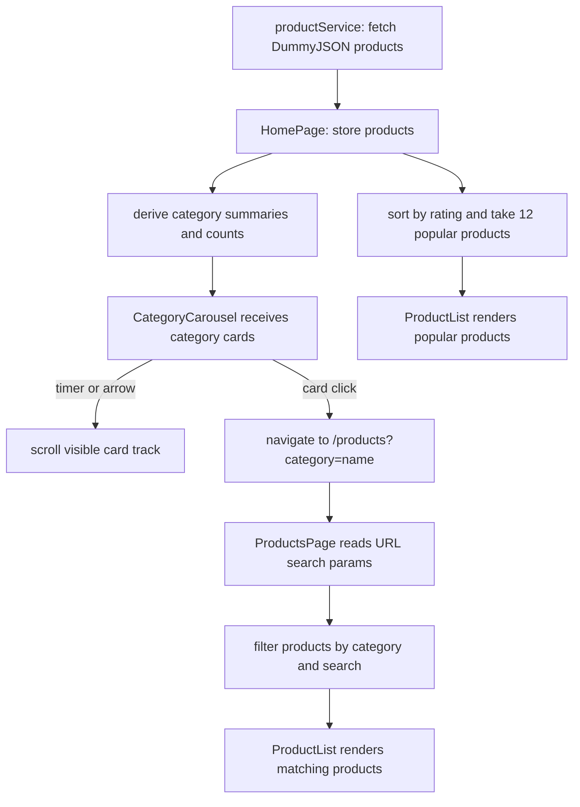

# Building the Category Carousel and HomePage from First Principles

This is the current guide for understanding and rebuilding the HomePage and category carousel. The implementation is frontend-only: product data comes from DummyJSON, while React derives the homepage content and the browser URL carries the selected catalog category.

## 1. Start with the behavior, not the component

Write down what the user should be able to do before deciding which React hooks to use:

1. Open `/` and see category cards and a short list of popular products.
2. Scroll the category cards with arrows, touch, or a trackpad.
3. Let the cards advance automatically; pause the movement while the user is interacting with the carousel.
4. Choose a category and arrive at `/products?category=category-name`.
5. On the products page, see products from that category and be able to change the category or search.
6. Choose “All products” to remove the category restriction.

This list becomes both the design target and the manual test plan. It also reveals that there are two different actions: automatic scrolling changes which cards are visible, while choosing a card changes the selected category and route. Autoplay must not silently change the user's filter.

## 2. Give each file one responsibility

| File | Responsibility |
| --- | --- |
| `src/services/productService.js` | Fetch product data from DummyJSON and return the product array. |
| `src/pages/HomePage.jsx` | Own loading/error/product state; derive category summaries and popular products; assemble the homepage. |
| `src/components/CategoryCarousel.jsx` | Render category cards and arrows, auto-scroll the track, and navigate when a card is selected. |
| `src/pages/ProductsPage.jsx` | Read `search` and `category` from the URL, filter products, and render results. |
| `src/components/ProductFilters.jsx` | Render the catalog's category dropdown. |
| `src/components/ProductList.jsx` and `ProductCard.jsx` | Render the product collection and each product. |
| `src/App.jsx` | Map `/` to `HomePage` and `/products` to `ProductsPage`. |
| `src/styles/ProductsCatalog.css` | Control card dimensions, horizontal overflow, responsive behavior, and visual states. |

When a behavior is wrong, start at the file that owns that behavior. For example, wrong category counts belong to the summary derivation in `HomePage`; wrong filtering belongs to `ProductsPage`; wrong spacing belongs to CSS.

## 3. Understand the data before rendering it

`getProducts()` requests all products with `?limit=0`. Each product includes fields such as `id`, `title`, `category`, `thumbnail`, `price`, and `rating`.

The homepage needs category cards, not just category strings. A useful summary shape is:

```js
{
  name: "beauty",
  label: "beauty",
  count: 8,
  image: "https://example.test/representative-product.jpg"
}
```

The first product encountered in a category can supply its representative image. Each later product in that category increments the count. A `Map` is useful because its keys make category names unique:

```text
for each product:
  look up product.category in categoriesByName
  if found:
    increment its count
  otherwise:
    create a summary using the product title/category/thumbnail
sort the summaries by name for a predictable order
```

The “All products” card is a special option. It uses the total number of loaded products, and selecting it means there is no category restriction. Do not mix it into the product data itself; it is a navigation choice, not a real product category.

Popular products are also derived from the same fetched array:

```text
copy the products array
sort the copy by rating, highest first
take the first 12 products
```

Copy before sorting. `sort()` changes the array it is called on, and React state should not be mutated. The current implementation does this with `[...products].sort(...).slice(0, 12)`.

## 4. Trace the data and interaction flow



The carousel does not filter the homepage's popular products. Its job is to help a user choose a category and navigate to the full catalog. `ProductsPage` owns catalog filtering. The category dropdown and carousel both lead to the same URL state, so the URL remains the single source of truth for the catalog selection.

## 5. Pseudocode: build it in a useful order

### Step A: Load the source data in the page

```text
products = []
loading = true
error = empty

when HomePage mounts:
  request products from productService
  on success: store the returned products
  on failure: store an error message
  in either case: set loading to false

while loading: render a status message
if error: render an alert
otherwise: render the page
```

Keep the network request in the service/page boundary. The carousel should not fetch products itself because the parent already has the data needed to build its cards.

### Step B: Derive category summaries and popular products

```text
categories = group products by category
for each group:
  create { name, label, count, image }
sort categories by name

popularProducts = a copied products array sorted by rating descending
popularProducts = first 12 entries
```

These are derived values. They depend on `products`, so they do not need independent state or setters. `useMemo` can avoid repeating the calculations on unrelated renders; it is an optimization, not a requirement for correctness.

### Step C: Pass data down to the carousel

```text
HomePage passes:
  categories
  total product count
  image for the All products card

CategoryCarousel:
  creates the All products option
  maps options to buttons
  displays image, label, and count
```

The child receives data through props. It should not import `HomePage` or reach into the parent's state.

### Step D: Handle selection as navigation

```text
when a category card is clicked:
  copy the current URL search parameters
  if the choice is All:
    remove the category parameter
  otherwise:
    set category to the chosen category name
  navigate to /products with those parameters
```

This is different from keeping a separate `selectedCategory` state in `HomePage`. In the current design, selection belongs to the catalog URL. `CategoryCarousel` reads that URL value to highlight the matching card when applicable, while `ProductsPage` uses it to filter products.

### Step E: Add horizontal scrolling and autoplay

```text
manual arrow:
  use a ref to find the scrolling track
  scroll by roughly one card with smooth behavior

autoplay effect:
  if there are fewer than two cards or interaction is paused:
    do not start a timer
  otherwise:
    every 4 seconds, scroll by one card
    if already at the end, scroll back to the beginning
  when the effect is cleaned up:
    clear the interval
```

The interval only moves the track. It must not select a category or navigate. Pause while the pointer is over the carousel or keyboard focus is inside it. Cleaning up the interval prevents timers from continuing after the component unmounts or its effect is restarted.

### Step F: Style the card track

```text
carousel wrapper = arrows + horizontally scrollable track
track = flex row, fixed-size non-shrinking cards, overflow-x auto
card = image, category label, optional product count
selected card = visible selected treatment
small viewport = smaller fixed card width, same horizontal scroll
```

CSS controls appearance and responsive layout; React controls data, navigation, and timer behavior. Use `scroll-snap` to make manual scrolling settle cleanly on cards. Keep the card dimensions stable so text or hover states do not resize the track.

### Step G: Verify the route and catalog behavior

1. Confirm `App.jsx` renders `HomePage` at `/` and `ProductsPage` at `/products`.
2. Click a category and inspect the address bar for `?category=...`.
3. Confirm `ProductsPage` reads that parameter and filters the product array.
4. Change the category using the dropdown and confirm the URL and results update.
5. Choose All products and confirm the category parameter is removed.

## 6. React concepts used here

### Components and composition

A component is a function that returns UI. `HomePage` composes smaller components such as `CategoryCarousel` and `ProductList`. Splitting by responsibility makes each part easier to test and change without making one component own data fetching, URL navigation, filtering, and all markup.

### Props and one-way data flow

Props are inputs from a parent to a child. `HomePage` passes category summaries to `CategoryCarousel`; the carousel renders those values. Data flows downward. A child can request an action by calling a callback or, in this implementation, use React Router navigation for the category selection.

### State with `useState`

State is data that changes over time and should cause a render. `HomePage` uses state for fetched products, loading, and errors. The carousel uses state to pause autoplay during interaction. Do not store values that can be calculated from existing state, such as category counts or the top-rated list.

### Effects with `useEffect`

An effect synchronizes a component with something outside normal rendering, such as a network request, browser timer, or event listener. Fetching products and managing `setInterval` belong in effects. Effects return cleanup functions to cancel timers or remove listeners. Effects should not be used just to calculate data that can be derived during render.

### Refs with `useRef`

A ref retains a value without triggering a render. Here it points to the DOM element that scrolls. Calling `scrollBy` or `scrollTo` changes the browser's scroll position; it does not change React data. Avoid using refs as a second place to store category selection.

### Derived data and `useMemo`

Derived data is a calculation from existing inputs. Categories and popular products are derived from `products`. `useMemo` caches a calculation between renders when its dependencies have not changed. It does not make an incorrect calculation correct, and it is not required for small, cheap computations.

### Events and event handlers

`onClick`, `onMouseEnter`, `onMouseLeave`, `onFocusCapture`, and `onBlurCapture` connect user/browser events to functions. Keep handlers focused: a category click navigates; an arrow scrolls; hover/focus pauses autoplay.

### Effects, dependencies, and Strict Mode

Every reactive value used by an effect should be represented in its dependency list. The carousel interval depends on whether autoplay is paused and how many cards exist. React Strict Mode may run effect setup/cleanup an extra time during development to reveal missing cleanup; a correctly cleared interval remains safe.

### URL state with React Router

`useSearchParams` reads and updates query-string values such as `category` and `search`. URL state is useful for filters because it survives refreshes, can be bookmarked, and can be shared. `useNavigate` changes routes from an event handler. Use local component state for temporary UI state; use the URL for navigable/filter state.

### Lists, keys, and semantic buttons

`map()` turns each category object into a card. Give each card a stable `key`, here the unique category name, so React can track list items between renders. Use a `<button>` for an action rather than a clickable `<div>`; buttons support keyboard activation and expose their role to assistive technology. `aria-pressed` communicates the selected state.

## 7. Other concepts used

- **Async/await and promises:** the HTTP request completes later; loading and error states represent those outcomes in the UI.
- **HTTP and JSON:** `fetch` makes a request, `response.json()` parses the response body, and the service returns the product array.
- **`Map` grouping:** a key-value collection makes it straightforward to aggregate count/image data once per category.
- **Immutable array operations:** copy arrays before sorting; derive new data instead of mutating React state.
- **Browser timers:** `setInterval` schedules repeated work; `clearInterval` stops it. Timers must be cleaned up.
- **DOM measurements:** `clientWidth`, `scrollWidth`, and `scrollLeft` describe the visible and total scroll area; they help detect when to wrap to the start.
- **Responsive CSS:** fixed card basis, `min-width: 0`, and horizontal overflow keep the carousel usable on narrow screens without widening the whole page.
- **Accessibility:** visible focus, meaningful button labels, pressed state, and decorative `alt=""` images make interaction understandable without relying on sight or a pointer.

## 8. Debug by following the value

If the category cards are missing:

1. Check whether `getProducts()` resolves and whether `HomePage` leaves its loading state.
2. Inspect the product objects for `category` and `thumbnail` fields.
3. Inspect the derived `categories` array before it is passed to the carousel.
4. Check that the carousel receives the expected prop shape.

If the card renders but clicking does not filter:

1. Confirm the button passes `category.name` to the click handler.
2. Confirm navigation creates `/products?category=<name>`.
3. Confirm `ProductsPage` reads the `category` search parameter.
4. Confirm its category comparison uses the same exact category value.
5. Confirm `ProductList` receives `filteredProducts`.

If autoplay does not move:

1. Confirm at least two cards exist and the track has horizontal overflow.
2. Check whether the mouse is over the carousel or keyboard focus is inside it; autoplay is intentionally paused then.
3. Check that the interval effect is active and that its cleanup only runs when the component unmounts or dependencies change.
4. Confirm the first card width plus the CSS gap produces a positive scroll amount.

If arrows or autoplay move the track but a different category becomes selected, selection and scrolling have accidentally been coupled. Scrolling should only change `scrollLeft`; only a card click should update the URL.

## 9. Manual test checklist

- Home loads with category image cards and up to 12 products sorted by rating.
- Category summaries have the expected labels, counts, and representative images.
- The carousel advances after four seconds and returns to the start at the end.
- Hovering or focusing within the carousel pauses autoplay; leaving or blurring resumes it.
- Arrows and touch/trackpad scrolling work without page-wide horizontal overflow.
- Clicking a category navigates to the matching catalog filter.
- All products removes the category restriction.
- The catalog's category dropdown and search continue to work together.
- Keyboard focus is visible and each category button exposes its pressed state.
- At mobile width, card text stays within fixed card dimensions.

## Current implementation facts

- `getProducts()` currently requests all DummyJSON products with `?limit=0`.
- `HomePage` derives category card data and the 12 highest-rated products.
- `CategoryCarousel` builds an All products card, reads selection from the URL, auto-scrolls every four seconds, pauses during hover/focus, and navigates to `/products` when a card is clicked.
- `ProductsPage` owns the actual category/search filtering. Its category dropdown remains available there.
- The carousel autoplay moves the visible track only; it does not change the selected category.

---

## Product card reference

The following is the existing reusable product-card example, kept here as a reference.

```jsx
/**
 * Reusable e-commerce product card.
 * Accepts a product object or individual product props.
 */
export default function ProductCard({
	product = {},
	name,
	image,
	price,
	originalPrice,
	rating,
	badge,
	onAddToCart,
	className = '',
}) {
	const item = {
		...product,
		name: name ?? product.name ?? 'Product',
		image: image ?? product.image,
		price: price ?? product.price,
		originalPrice: originalPrice ?? product.originalPrice,
		rating: rating ?? product.rating,
		badge: badge ?? product.badge,
	};

	const formatPrice = (value) => {
		if (typeof value !== 'number') return value;
		return new Intl.NumberFormat(undefined, {
			style: 'currency',
			currency: product.currency ?? 'USD',
		}).format(value);
	};

	return (
		<article className={`product-card ${className}`.trim()}>
			<div className="product-card__media">
				{item.image ? (
					
				) : (
					<div className="product-card__placeholder" aria-hidden="true">
						No image
					</div>
				)}
				{item.badge && <span className="product-card__badge">{item.badge}</span>}
			</div>

			<div className="product-card__content">
				<h2 className="product-card__name">{item.name}</h2>
				{item.rating != null && (
					<p className="product-card__rating" aria-label={`Rated ${item.rating} out of 5`}>
						<span aria-hidden="true">★</span> {item.rating} / 5
					</p>
				)}
				<div className="product-card__prices">
					{item.price != null && (
						<span className="product-card__price">{formatPrice(item.price)}</span>
					)}
					{item.originalPrice != null && (
						<span className="product-card__original-price">
							{formatPrice(item.originalPrice)}
						</span>
					)}
				</div>
				<button
					className="product-card__button"
					type="button"
					onClick={() => onAddToCart?.(product)}
					aria-label={`Add ${item.name} to cart`}
				>
					Add to cart
				</button>
			</div>
		</article>
	);
}
```

---

## Archived: earlier category carousel learning guide

This section is retained as a historical draft. It describes a parent-owned `selectedCategory` callback and homepage filtering, which do not match the current URL-driven implementation. Use the first-principles guide at the top of this file for current behavior.

### Goal and current starting point

The home page currently:

- Loads products in `src/pages/HomePage.jsx`.
- Derives a list of distinct category names from those products.
- Keeps the selected category in `selectedCategory`.
- Passes categories and a change handler to `src/components/ProductFilters.jsx`, which renders a `<select>`.
- Filters products in `HomePage` and passes the result to `ProductList`.

The carousel is a new way to choose a category. It should **replace the category dropdown UI**, not replace the filtering logic. Keep one source of truth: `HomePage` owns the selected category, and the product list continues to be filtered there.

### The component/data flow

Read the feature in this order:

1. **`HomePage.jsx` owns the data and selection.** It fetches products, derives category summaries, stores the active category, and filters products.
2. **`CategoryCarousel.jsx` displays choices.** It receives category data and the active choice through props. When a user picks a card, it calls a callback prop.
3. **The callback updates HomePage state.** React renders again with the new `selectedCategory`.
4. **The existing filter expression selects products.** `ProductList` receives the new filtered array and renders those product cards.
5. **`ProductsCatalog.css` controls appearance and horizontal scrolling.** CSS handles the visual carousel; React only needs to control selection and the arrow buttons.

The data flow can be pictured as:

```text
API products
    ↓
HomePage derives category cards and stores selectedCategory
    ↓ props                       ↑ onSelectCategory(categoryName)
CategoryCarousel ─────────────────┘
    ↓ click changes selectedCategory
HomePage filters products
    ↓
ProductList displays matching products
```

This is a one-way data flow. The carousel does not need its own copy of `selectedCategory`; duplicating that state can make the card highlight disagree with the displayed products.

### Step 1: Decide what a category card needs

A category name alone is enough for a dropdown, but a visual card usually needs a label, product count, and image. Derive these from the products already loaded; do not make a separate request for every category.

For example, transform products like these:

```js
[
  { category: "beauty", title: "Lipstick", thumbnail: "lipstick.jpg" },
  { category: "beauty", title: "Mascara", thumbnail: "mascara.jpg" },
  { category: "furniture", title: "Chair", thumbnail: "chair.jpg" },
]
```

into summaries like:

```js
[
  { name: "beauty", count: 2, image: "lipstick.jpg" },
  { name: "furniture", count: 1, image: "chair.jpg" },
]
```

One simple grouping pattern is a `Map`:

```js
const categoriesByName = new Map();

for (const product of products) {
  const existing = categoriesByName.get(product.category);

  if (existing) {
    existing.count += 1;
  } else {
    categoriesByName.set(product.category, {
      name: product.category,
      count: 1,
      image: product.thumbnail,
    });
  }
}

const categoryCards = [...categoriesByName.values()].sort((a, b) =>
  a.name.localeCompare(b.name),
);
```

How to read it:

- `Map` uses the category name as a unique key.
- The first product in a category creates its summary and supplies a representative image.
- Each later product in that category increments the count.
- `values()` returns the summaries; sorting gives a stable display order.

In React, derive this list from `products` with `useMemo`. That keeps the code declarative and recalculates summaries when the product list changes. `useMemo` is an optimization, not a requirement for correctness.

**Important for this project:** `getProducts()` currently asks DummyJSON for only 12 products. The carousel will therefore show categories and counts found in those 12, not necessarily every category in the API. That is consistent with the current catalog data; changing the fetch limit is a separate decision.

### Step 2: Keep selection state in the parent

The home page already has:

```jsx
const [selectedCategory, setSelectedCategory] = useState("all");
```

Keep it there. The special value `"all"` means no category restriction. Each category card passes its category name to the parent when clicked.

The existing filtering rule already expresses the intended behavior:

```js
const matchesCategory =
  selectedCategory === "all" ||
  product.category === selectedCategory;
```

Read the `||` as: “include this product if All is selected, or if its category matches the selected one.” Search and category are combined with `&&`, so a product must pass both active filters.

### Step 3: Make the carousel presentational

Give the component only what it needs, for example:

```jsx
<CategoryCarousel
  categories={categoryCards}
  selectedCategory={selectedCategory}
  onSelectCategory={setSelectedCategory}
  totalCount={products.length}
/>
```

Those props have distinct jobs:

- `categories`: the cards to display.
- `selectedCategory`: which card should appear selected.
- `onSelectCategory`: how the child tells the parent that the user chose a category.
- `totalCount`: the count to show on the “All products” card.

The component calls a callback; it does not reach into `HomePage` or import its state. This makes it reusable and easier to understand in isolation.

An individual card should be a real `<button>`, not a clickable `<div>`. A button works with keyboard input and has built-in interaction behavior. Set `aria-pressed` from whether the card matches `selectedCategory`; that exposes selection state to assistive technology as well as visually.

### Step 4: Use CSS for the horizontal track

The simplest carousel for this project is a horizontally scrollable list:

```css
.category-carousel-track {
  display: flex;
  gap: 0.75rem;
  overflow-x: auto;
  scroll-snap-type: x mandatory;
}

.category-carousel-item {
  flex: 0 0 180px;
  scroll-snap-align: start;
}
```

How it works:

- `display: flex` puts cards in one row.
- `flex: 0 0 180px` keeps each card a predictable width instead of shrinking them to fit.
- `overflow-x: auto` lets the row scroll when it is wider than the viewport.
- `scroll-snap-type` helps touch/trackpad scrolling settle on a card.

This gives users horizontal touch scrolling even before arrow buttons are added. Left/right arrow buttons are an enhancement: they use a `ref` to access the track and call `scrollBy({ left, behavior: "smooth" })`. The DOM reference is only for scrolling; React state still owns selected category.

### Step 5: Put visual states and responsive details in CSS

Plan a few states rather than styling only the default:

- **Default:** image/background, readable category label, product count.
- **Selected:** border or ring; do not rely on color alone if possible.
- **Hover/focus:** visible feedback, with `:focus-visible` for keyboard users.
- **Narrow viewport:** smaller card width, horizontal scroll, no page-wide horizontal overflow.
- **No image:** use a deliberate background or placeholder rather than a broken image.

Treat the image as decorative if the button text already names the category (`alt=""`). The button’s accessible name then comes from its text, without reading redundant image text.

### Step 6: Replace the dropdown without deleting filtering

In `HomePage.jsx`, replace the category dropdown render with `CategoryCarousel`. Continue rendering `ProductFilters` only for search if that component still owns the search input. Remove category-specific props from `ProductFilters` once it no longer renders categories.

Do not filter the product array inside `CategoryCarousel`. Its job is choosing a category; keeping filtering in `HomePage` makes the relationship between search, selected category, and product list easy to follow.

### How to read/debug the completed implementation

When a card click does not filter products, trace the value through these points:

1. Is the card’s `onClick` calling `onSelectCategory(category.name)`?
2. Does `HomePage` pass `setSelectedCategory` as `onSelectCategory`?
3. Does `selectedCategory` change in the parent?
4. Does the filter compare the product’s category with that exact selected value?
5. Does `ProductList` receive `filteredProducts`, rather than the original `products`?

When the right products show but the selected-card highlight is wrong, check that the carousel receives the current `selectedCategory` and uses it to set `aria-pressed`/selected styling.

When cards do not scroll, inspect the track’s `display`, `overflow-x`, and the card’s non-shrinking `flex-basis`. If only some categories show, inspect the loaded `products` first; with the current fetch limit, the carousel cannot show categories that were never fetched.

### Manual test checklist

- “All products” is selected on initial load and shows every currently loaded product.
- Selecting a category highlights that card and shows only matching products.
- Selecting another category updates the highlight and product list.
- Selecting “All products” clears the category restriction.
- Search still combines with category selection; clearing search does not unexpectedly reset the category.
- Counts match the loaded products.
- Track can be scrolled with touch/trackpad and, if included, arrow buttons.
- Keyboard users can focus and activate every category card; focus is visible.
- At mobile width, cards remain usable and the page itself does not overflow horizontally.
- Empty search/category results still show the existing empty state and clear-filters action.

Build the feature in this order: derive category summaries, render simple selectable cards, verify filtering, add horizontal scrolling, then add arrow controls and polish. This sequence isolates the data/state behavior from the visual carousel behavior, making bugs easier to locate and the implementation easier to learn.

---

## Archived: earlier category carousel implementation notes

This section describes an earlier iteration and may not match the current component details. Use the first-principles guide at the top of this file as the source of truth.

The category carousel is now implemented in `src/components/CategoryCarousel.jsx`. The category dropdown component was removed because the carousel replaces its only use.

### Files and responsibilities

- **`src/pages/HomePage.jsx`** owns the product list and selected category. It derives one summary per category, renders the carousel, and filters the products.
- **`src/components/CategoryCarousel.jsx`** renders the “All products” card, category cards, and horizontal scroll arrows. It reports a selection to the parent through `onSelectCategory`.
- **`src/styles/ProductsCatalog.css`** styles the cards, selected/focus states, horizontal overflow, scroll snapping, and mobile card dimensions.
- **`src/components/ProductList.jsx`** is unchanged. It still receives only the filtered product array.

### How the category summaries are derived

`HomePage` now uses a `Map` keyed by category name:

```js
const categoriesByName = new Map();

for (const product of products) {
  const existingCategory = categoriesByName.get(product.category);

  if (existingCategory) {
    existingCategory.count += 1;
  } else {
    categoriesByName.set(product.category, {
      name: product.category,
      count: 1,
      image: product.thumbnail,
    });
  }
}
```

The first product encountered for a category creates its card data, and later products increment that category’s count. That first product’s thumbnail serves as the category image. `useMemo` recalculates these summaries when the fetched product list changes. The summaries are sorted alphabetically so the carousel order is stable.

The “All products” card is constructed by the carousel itself. It uses the total loaded product count and a placeholder background rather than an image. Selecting it passes `"all"` back to the parent.

### How selecting a card filters the catalog

`HomePage` passes the current selection and its state setter:

```jsx
<CategoryCarousel
  categories={categories}
  selectedCategory={selectedCategory}
  onSelectCategory={setSelectedCategory}
  totalCount={products.length}
/>
```

The carousel calls `onSelectCategory(category.name)` when a card is clicked. Because that callback is `setSelectedCategory`, React updates the parent state and rerenders. The existing filter expression then includes a product only when it matches the search **and** either “all” is selected or its category matches:

```js
const matchesCategory =
  selectedCategory === "all" || product.category === selectedCategory;
```

This division is intentional: the carousel chooses a category; it does not own or duplicate the filtered product data. `ProductList` continues to display `filteredProducts`.

### How the arrows and scrolling work

`trackRef` points to the horizontal `<ul>`. The arrow handler uses the track’s visible width to scroll most of one viewport:

```js
track.scrollBy({
  left: direction * track.clientWidth * 0.8,
  behavior: "smooth",
});
```

The component keeps two small UI state values: `canScrollLeft` and `canScrollRight`. A scroll or window resize recalculates them from `scrollLeft`, `clientWidth`, and `scrollWidth`. This disables the left arrow at the start and the right arrow at the end. The effect removes its event listeners when the component unmounts or its category list changes.

The carousel also works without arrows: horizontal touchpad, touch, and scrollbar scrolling come from CSS `overflow-x: auto`. `scroll-snap-type` helps cards settle at consistent positions. Fixed card flex-basis prevents flexbox from squeezing every card into one row.

### Accessibility and responsive styling

- Each category is a real button, so it can be focused and activated with the keyboard.
- `aria-pressed` exposes which category is selected; CSS uses that same state to draw its active border.
- Arrow buttons have explicit accessible labels; their decorative glyphs are hidden from screen readers.
- Category images use `alt=""` because the visible category name already labels the button.
- `:focus-visible` provides a keyboard focus outline.
- At narrow widths the cards become smaller and the row remains horizontally scrollable instead of forcing the page to widen.

### One data limitation to keep in mind

The product service currently fetches 12 products. Category cards and counts are therefore based on those fetched products, not necessarily every category available from DummyJSON. To expose all API categories, change the product-fetching scope separately; the carousel itself does not fetch category data.

### How to verify and trace the feature

1. Load the home page and confirm “All products” is selected.
2. Click a category and check that its card gets the selected outline and the product grid contains only that category.
3. Click another category, then “All products,” and confirm both the selection and product list update.
4. Search from the Navbar while a category is selected; both constraints should apply together.
5. Use arrows, touch, or a trackpad to scroll; arrows should disable at the corresponding ends.
6. Resize to mobile width and confirm the carousel scrolls horizontally without making the entire page overflow.
7. If selection highlighting works but products do not change, trace the `onSelectCategory` prop into `selectedCategory`, then inspect `matchesCategory` and confirm `ProductList` receives `filteredProducts`.

---

## Cart data flow and React Context guide

This guide describes the cart implementation currently in `src/store/CartContext.jsx`, how it is connected to the app, what React concepts it uses, and what should be improved next. The goal is to be able to read the existing code, explain the data flow, and make a similar small shared-state feature yourself.

### What “global state” means here

The cart is shared state: several components need to read or modify the same cart while the user navigates:

- `ProductDetailsPage` adds a product and reads its current quantity.
- `CartPage` displays items and changes/removes quantities.
- `Navbar` displays the total item count.

React Context lets a parent make a value available to components below it without passing that value through every intermediate component as props. In this app, the cart is not globally available to every React tree or every browser tab. It is available only to descendants of `CartProvider`, for the lifetime of that mounted provider.

Think of “global” here as **shared across this app subtree**, not a server database or universal storage.

### Provider placement: how the cart becomes shared

`App.jsx` wraps the routes in `CartProvider`:

```jsx
<CartProvider>
  <BrowserRouter>
    <Routes>
      {/* pages and layout */}
    </Routes>
  </BrowserRouter>
</CartProvider>
```

`CartProvider` renders a `CartContext.Provider` around its `children`. Because `Navbar`, `CartPage`, and `ProductDetailsPage` render under that provider, each can call `useCart()` and access the same context value.

If a component is rendered outside this provider and calls `useCart()`, the custom hook throws an error. This is intentional: it identifies a wiring mistake instead of silently returning missing cart data.

### The current data flow

```text
App.jsx
└── CartProvider
    ├── stores cart state with useState
    └── provides { cart, actions } through CartContext
        ├── Navbar reads cart → calculates and displays item count
        ├── ProductDetailsPage calls addToCart → cart state changes
        └── CartPage reads cart → renders items
            ├── calls increaseQuantity / decreaseQuantity
            └── calls removeFromCart
```

State changes flow back down from the provider:

1. A component calls an action from `useCart()`.
2. The action calls `setCart(...)`.
3. React stores the new cart array and renders context consumers again.
4. Those components read the updated context value.

The consumer does not own a second cart copy. The provider is the single source of truth for the in-memory cart.

### Reading `CartContext.jsx` from top to bottom

#### 1. Create a context

```jsx
const CartContext = createContext(null);
```

`createContext` makes a channel for sharing a value through the component tree. `null` is the default when there is no matching provider. Using `null` lets `useCart` detect that missing provider.

#### 2. Create the provider and state

```jsx
export function CartProvider({ children }) {
  const [cart, setCart] = useState([]);
  // ...
}
```

`children` is the content wrapped by `<CartProvider>`. `useState([])` initializes an empty cart. The cart is an array; each element is a product snapshot plus a `quantity`.

The intended item shape is approximately:

```js
{
  id: 1,
  title: "Product name",
  price: 12.5,
  thumbnail: "https://...",
  stock: 4,
  quantity: 1
}
```

The exact product object comes from DummyJSON, so its fields should be checked against the API response and used consistently by the UI.

#### 3. Implement actions as state transitions

The provider exposes functions that describe allowed changes to the cart.

`addToCart(product)` searches for an item with the same product id:

- If it exists, `map` creates a new array and copies the matching item with quantity incremented.
- If it does not exist, the function returns a new array with a copied product and `quantity: 1`.

`removeFromCart(productId)` uses `filter` to return every item except the selected product.

`increaseQuantity(productId)` uses `map` to copy the selected item with an incremented quantity, while leaving other items unchanged. The current code compares quantity to `item.stock` before increasing.

`decreaseQuantity(productId)` uses `flatMap`:

- Other products are returned as one-element arrays, so they remain in the result.
- The selected item is returned as an empty array when quantity is 1, removing it.
- Otherwise it is returned as a one-element array containing a copied item with quantity minus one.

This means the minus button removes an item when it reaches quantity 1. The page also has a separate Remove button. A different valid design is to keep quantity at 1 and require the Remove button for removal; pick one interaction rule and make the labels/disabled states consistent with it.

#### 4. Why the functional updater form matters

The actions use the functional form:

```jsx
setCart((currentCart) => {
  // calculate and return the next cart
});
```

React may batch updates. Taking `currentCart` from the setter callback ensures an action uses the latest state rather than a possibly stale `cart` value captured by a render.

#### 5. Why updates copy arrays and objects

Methods like `map` and `filter`, plus object spread (`{ ...item }`), create new arrays/objects. React uses identity comparisons to detect state changes. Mutating an existing cart array or item in place can cause missed renders and makes state transitions harder to reason about.

The rule is: **do not mutate state; return the next state.**

#### 6. Provide the value

```jsx
<CartContext.Provider
  value={{
    cart,
    addToCart,
    removeFromCart,
    increaseQuantity,
    decreaseQuantity,
  }}
>
  {children}
</CartContext.Provider>
```

The provider value is the public API for cart consumers: current data (`cart`) plus commands (the action functions). A component should request only what it needs by destructuring from `useCart`.

#### 7. Read context through a custom hook

```jsx
export function useCart() {
  const context = useContext(CartContext);

  if (context === null) {
    throw new Error("useCart must be used within a CartProvider");
  }

  return context;
}
```

`useContext` reads the nearest provider’s current value. The custom hook avoids repeating context and provider checks in every consumer and gives the application one consistent way to use cart state.

### How consumers use it

In `ProductDetailsPage`, the component gets `addToCart` and `cart`:

```jsx
const { addToCart, cart } = useCart();
```

When the button is clicked, it calls `addToCart(product)`. It finds the corresponding cart entry by id to display “View cart (quantity).”

In `CartPage`, the component gets the cart and actions:

```jsx
const {
  cart,
  removeFromCart,
  decreaseQuantity,
  increaseQuantity,
} = useCart();
```

It maps over `cart` to render one UI row per item. Button handlers call the actions with the relevant item id. The page requests changes; it does not directly edit the provider’s state.

In `Navbar`, the component reads `cart` and derives the count:

```jsx
const cartCount = cart.reduce(
  (total, item) => total + item.quantity,
  0,
);
```

`reduce` combines all item quantities into one number. This is derived data: it can be calculated from the cart and does not need to be stored as separate state. Keeping it derived avoids a second value that might get out of sync.

### Why use Context for this project

Context is suitable here because several distant UI components share the same small piece of client-side state, and the project does not currently use a state-management library. Without Context, `App` or another common ancestor would have to pass cart data and actions through components that do not use them (“prop drilling”).

Context is not automatically the best answer for every value. A value used by one page should usually remain local state. For server-owned data such as product search results, a data-fetching/cache tool may be more appropriate as the application grows. Context also does not persist data by itself.

### Current flaws and behavior gaps to address

These are findings from the current files, not changes made by this guide:

1. **Cart resets on refresh.** `useState([])` initializes empty on every page load. Context stores data in memory only. To persist the cart, initialize from `localStorage` with a lazy initializer and save changes in an effect; validate parsed data and handle storage/JSON errors.
2. **`addToCart` does not enforce stock.** Existing items are incremented without checking `stock`; a new item is added even if stock is zero. Product details disables the button for exactly zero stock, but the shared action itself should enforce the rule because every caller should be safe.
3. **Stock may be missing or invalid.** `increaseQuantity` checks `item.quantity >= item.stock`. If stock is undefined, that comparison is false, so increases are not capped. Decide a consistent policy for unknown stock and handle it in the context action.
4. **The item image field is inconsistent.** `CartPage` renders `item.img`, but product details adds the DummyJSON object, whose image field is `thumbnail`. The cart image may therefore be broken. Use the actual `thumbnail` property consistently or normalize products to a deliberate cart-item shape.
5. **The decrease behavior removes at one.** This is implemented with `flatMap`; confirm that this matches the intended UX. If the minus control should stop at one, return the item unchanged at one and leave deletion to Remove.
6. **No totals are exposed or displayed.** The cart page displays unit price but not each item subtotal or the grand total. These should be derived from `cart`, not manually synchronized state.
7. **Every context consumer can re-render on cart changes.** The provider creates a new `value` object every render. This is usually acceptable for a small app. If profiling shows unnecessary rerenders, stabilize actions with `useCallback` and the value with `useMemo`, or split contexts. Do not add memoization preemptively without a reason.
8. **No automated cart tests are present in the current setup.** Action rules (deduplication, stock caps, removal, and totals) are good candidates for tests once a test framework is introduced. Until then, verify each behavior manually.

### Concepts used

- **React Context:** delivers a value to descendants without threading props through every level.
- **Provider component:** owns shared state and supplies it to the tree beneath it.
- **Custom hook:** packages context reading and provider validation (`useCart`).
- **Single source of truth:** cart state lives in one place (`CartProvider`).
- **State updater callback:** computes the next state from the latest state.
- **Immutable update:** creates replacement arrays/objects rather than mutating state.
- **Derived data:** count and totals are computed from cart items instead of duplicated as independent state.
- **Props/callbacks:** components receive actions and invoke them in response to user events.
- **Stable identifiers:** product `id` lets actions find the same product across pages.
- **Persistence vs. state:** Context shares state during a running app; localStorage (or a backend) is needed to survive reloads.
- **Render subscriptions:** components using the context update when its provider value changes.

### How to implement a similar shared feature yourself

Use this sequence for a wishlist, comparison list, or another small client-side shared feature:

1. **Find the consumers.** List which components need to read the value and which need to change it. If only one component uses it, start with local state.
2. **Define the data shape.** Decide what one entry contains and what uniquely identifies it. For the cart, the key is product id and the entry adds quantity.
3. **Choose the owner.** Put the state in the nearest common ancestor that contains all consumers. If that ancestor becomes awkward to thread through, use a provider.
4. **Create a context with an intentional default.** `null` is useful when the value must always come from a provider.
5. **Write actions before UI details.** Define add, update, remove, and any boundary rules as pure state transitions using setter callbacks.
6. **Return new state.** Use `map`, `filter`, and object spread; do not mutate the existing value.
7. **Expose a small API.** Provide only the state and operations consumers actually need.
8. **Create a custom hook.** Call `useContext`, validate the provider exists, and return the context value.
9. **Wrap the right subtree.** Put the provider above all consumers, but no higher than needed.
10. **Connect consumers.** Components call actions from event handlers and render from context data; they do not make their own shadow copy.
11. **Derive values where possible.** Counts and totals should normally be calculations from the source state.
12. **Add persistence only when required.** Context does not save data. For localStorage, load once at initialization, validate what was stored, and write when state changes. For cross-device or account data, persistence belongs on a server.
13. **Test rules independently.** Cover empty state, normal add, duplicate add, missing id, quantity boundaries, remove, persistence, and derived totals.

### A useful mental model

Treat the provider as a small in-memory store with a clear API:

```text
Components do not own or mutate the shared cart.
They request an action → Provider calculates the next cart
→ Context broadcasts the new value → Consumers render from it.
```

When debugging, follow one action end to end:

```text
button onClick
→ action obtained from useCart
→ setCart updater in CartProvider
→ new cart array/object
→ Provider value changes
→ Navbar / CartPage / ProductDetailsPage read the new cart
```

If one part does not update, inspect each link in that chain: correct provider placement, correct hook call, correct product id, correct returned state, and correct fields in the rendering component.

### Cart reliability updates

The cart provider now applies stock limits to both `addToCart` and `increaseQuantity`. `getStockLimit` treats a finite stock value as authoritative, flooring fractional values and clamping negative stock to zero. If stock is absent or not numeric, the client uses a fallback limit of 99. This is a frontend behavior for this demo, not an inventory guarantee; a real store must validate stock on its backend at checkout.

When adding a product already in the cart, the action synchronizes its stock snapshot and increments quantity without going above the limit. It also caps a stale quantity to the product’s current limit before calculating the next quantity. A product with stock zero cannot be added. The cart page image now reads `thumbnail`, matching the DummyJSON product object stored by `addToCart`; previously it read `img`, a field those products do not provide.

The minus button retains the existing interaction rule: decreasing quantity 1 removes that item. Persistence has not been added yet, so a refresh still starts with an empty cart.

### Cart quantity control UI

The cart page groups the minus button, displayed quantity, and plus button into a labeled quantity control. Each button has a product-specific accessible name; the displayed quantity uses `<output aria-live="polite">` so assistive technology can announce updates. At the stock limit, the plus button is disabled and visually muted. The cart context still enforces the limit as the source of truth; disabling the button is user feedback, not a substitute for state validation.

Buttons have large touch targets, hover/active/focus/disabled states, and reduced-motion handling. On narrow screens, each cart item rearranges into a compact two-column layout. The separate Remove button has a distinct danger style. The minus button still removes an item when its quantity is one, and its accessible label states that behavior.
