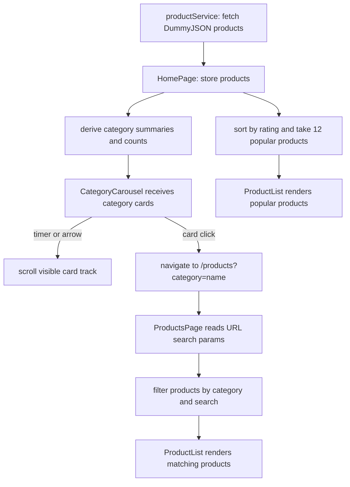

# Building the Category Carousel and HomePage from First Principles

This is the current guide for understanding and rebuilding the HomePage and category carousel. The implementation is frontend-only: product data comes from DummyJSON, while React derives the homepage content and the browser URL carries the selected catalog category.

## 1. Start with the behavior, not the component

Write down what the user should be able to do before deciding which React hooks to use:

1. Open `/` and see category cards and a short list of popular products.
2. Scroll the category cards with arrows, touch, or a trackpad.
3. Let the cards advance automatically; pause the movement while the user is interacting with the carousel.
4. Choose a category and arrive at `/products?category=category-name`.
5. On the products page, see products from that category and be able to change the category or search.
6. Choose “All products” to remove the category restriction.

This list becomes both the design target and the manual test plan. It also reveals that there are two different actions: automatic scrolling changes which cards are visible, while choosing a card changes the selected category and route. Autoplay must not silently change the user's filter.

## 2. Give each file one responsibility

| File | Responsibility |
| --- | --- |
| `src/services/productService.js` | Fetch product data from DummyJSON and return the product array. |
| `src/pages/HomePage.jsx` | Own loading/error/product state; derive category summaries and popular products; assemble the homepage. |
| `src/components/CategoryCarousel.jsx` | Render category cards and arrows, auto-scroll the track, and navigate when a card is selected. |
| `src/pages/ProductsPage.jsx` | Read `search` and `category` from the URL, filter products, and render results. |
| `src/components/ProductFilters.jsx` | Render the catalog's category dropdown. |
| `src/components/ProductList.jsx` and `ProductCard.jsx` | Render the product collection and each product. |
| `src/App.jsx` | Map `/` to `HomePage` and `/products` to `ProductsPage`. |
| `src/styles/ProductsCatalog.css` | Control card dimensions, horizontal overflow, responsive behavior, and visual states. |

When a behavior is wrong, start at the file that owns that behavior. For example, wrong category counts belong to the summary derivation in `HomePage`; wrong filtering belongs to `ProductsPage`; wrong spacing belongs to CSS.

## 3. Understand the data before rendering it

`getProducts()` requests all products with `?limit=0`. Each product includes fields such as `id`, `title`, `category`, `thumbnail`, `price`, and `rating`.

The homepage needs category cards, not just category strings. A useful summary shape is:

```js
{
  name: "beauty",
  label: "beauty",
  count: 8,
  image: "https://example.test/representative-product.jpg"
}
```

The first product encountered in a category can supply its representative image. Each later product in that category increments the count. A `Map` is useful because its keys make category names unique:

```text
for each product:
  look up product.category in categoriesByName
  if found:
    increment its count
  otherwise:
    create a summary using the product title/category/thumbnail
sort the summaries by name for a predictable order
```

The “All products” card is a special option. It uses the total number of loaded products, and selecting it means there is no category restriction. Do not mix it into the product data itself; it is a navigation choice, not a real product category.

Popular products are also derived from the same fetched array:

```text
copy the products array
sort the copy by rating, highest first
take the first 12 products
```

Copy before sorting. `sort()` changes the array it is called on, and React state should not be mutated. The current implementation does this with `[...products].sort(...).slice(0, 12)`.

## 4. Trace the data and interaction flow



The carousel does not filter the homepage's popular products. Its job is to help a user choose a category and navigate to the full catalog. `ProductsPage` owns catalog filtering. The category dropdown and carousel both lead to the same URL state, so the URL remains the single source of truth for the catalog selection.

## 5. Pseudocode: build it in a useful order

### Step A: Load the source data in the page

```text
products = []
loading = true
error = empty

when HomePage mounts:
  request products from productService
  on success: store the returned products
  on failure: store an error message
  in either case: set loading to false

while loading: render a status message
if error: render an alert
otherwise: render the page
```

Keep the network request in the service/page boundary. The carousel should not fetch products itself because the parent already has the data needed to build its cards.

### Step B: Derive category summaries and popular products

```text
categories = group products by category
for each group:
  create { name, label, count, image }
sort categories by name

popularProducts = a copied products array sorted by rating descending
popularProducts = first 12 entries
```

These are derived values. They depend on `products`, so they do not need independent state or setters. `useMemo` can avoid repeating the calculations on unrelated renders; it is an optimization, not a requirement for correctness.

### Step C: Pass data down to the carousel

```text
HomePage passes:
  categories
  total product count
  image for the All products card

CategoryCarousel:
  creates the All products option
  maps options to buttons
  displays image, label, and count
```

The child receives data through props. It should not import `HomePage` or reach into the parent's state.

### Step D: Handle selection as navigation

```text
when a category card is clicked:
  copy the current URL search parameters
  if the choice is All:
    remove the category parameter
  otherwise:
    set category to the chosen category name
  navigate to /products with those parameters
```

This is different from keeping a separate `selectedCategory` state in `HomePage`. In the current design, selection belongs to the catalog URL. `CategoryCarousel` reads that URL value to highlight the matching card when applicable, while `ProductsPage` uses it to filter products.

### Step E: Add horizontal scrolling and autoplay

```text
manual arrow:
  use a ref to find the scrolling track
  scroll by roughly one card with smooth behavior

autoplay effect:
  if there are fewer than two cards or interaction is paused:
    do not start a timer
  otherwise:
    every 4 seconds, scroll by one card
    if already at the end, scroll back to the beginning
  when the effect is cleaned up:
    clear the interval
```

The interval only moves the track. It must not select a category or navigate. Pause while the pointer is over the carousel or keyboard focus is inside it. Cleaning up the interval prevents timers from continuing after the component unmounts or its effect is restarted.

### Step F: Style the card track

```text
carousel wrapper = arrows + horizontally scrollable track
track = flex row, fixed-size non-shrinking cards, overflow-x auto
card = image, category label, optional product count
selected card = visible selected treatment
small viewport = smaller fixed card width, same horizontal scroll
```

CSS controls appearance and responsive layout; React controls data, navigation, and timer behavior. Use `scroll-snap` to make manual scrolling settle cleanly on cards. Keep the card dimensions stable so text or hover states do not resize the track.

### Step G: Verify the route and catalog behavior

1. Confirm `App.jsx` renders `HomePage` at `/` and `ProductsPage` at `/products`.
2. Click a category and inspect the address bar for `?category=...`.
3. Confirm `ProductsPage` reads that parameter and filters the product array.
4. Change the category using the dropdown and confirm the URL and results update.
5. Choose All products and confirm the category parameter is removed.

## 6. React concepts used here

### Components and composition

A component is a function that returns UI. `HomePage` composes smaller components such as `CategoryCarousel` and `ProductList`. Splitting by responsibility makes each part easier to test and change without making one component own data fetching, URL navigation, filtering, and all markup.

### Props and one-way data flow

Props are inputs from a parent to a child. `HomePage` passes category summaries to `CategoryCarousel`; the carousel renders those values. Data flows downward. A child can request an action by calling a callback or, in this implementation, use React Router navigation for the category selection.

### State with `useState`

State is data that changes over time and should cause a render. `HomePage` uses state for fetched products, loading, and errors. The carousel uses state to pause autoplay during interaction. Do not store values that can be calculated from existing state, such as category counts or the top-rated list.

### Effects with `useEffect`

An effect synchronizes a component with something outside normal rendering, such as a network request, browser timer, or event listener. Fetching products and managing `setInterval` belong in effects. Effects return cleanup functions to cancel timers or remove listeners. Effects should not be used just to calculate data that can be derived during render.

### Refs with `useRef`

A ref retains a value without triggering a render. Here it points to the DOM element that scrolls. Calling `scrollBy` or `scrollTo` changes the browser's scroll position; it does not change React data. Avoid using refs as a second place to store category selection.

### Derived data and `useMemo`

Derived data is a calculation from existing inputs. Categories and popular products are derived from `products`. `useMemo` caches a calculation between renders when its dependencies have not changed. It does not make an incorrect calculation correct, and it is not required for small, cheap computations.

### Events and event handlers

`onClick`, `onMouseEnter`, `onMouseLeave`, `onFocusCapture`, and `onBlurCapture` connect user/browser events to functions. Keep handlers focused: a category click navigates; an arrow scrolls; hover/focus pauses autoplay.

### Effects, dependencies, and Strict Mode

Every reactive value used by an effect should be represented in its dependency list. The carousel interval depends on whether autoplay is paused and how many cards exist. React Strict Mode may run effect setup/cleanup an extra time during development to reveal missing cleanup; a correctly cleared interval remains safe.

### URL state with React Router

`useSearchParams` reads and updates query-string values such as `category` and `search`. URL state is useful for filters because it survives refreshes, can be bookmarked, and can be shared. `useNavigate` changes routes from an event handler. Use local component state for temporary UI state; use the URL for navigable/filter state.

### Lists, keys, and semantic buttons

`map()` turns each category object into a card. Give each card a stable `key`, here the unique category name, so React can track list items between renders. Use a `<button>` for an action rather than a clickable `<div>`; buttons support keyboard activation and expose their role to assistive technology. `aria-pressed` communicates the selected state.

## 7. Other concepts used

- **Async/await and promises:** the HTTP request completes later; loading and error states represent those outcomes in the UI.
- **HTTP and JSON:** `fetch` makes a request, `response.json()` parses the response body, and the service returns the product array.
- **`Map` grouping:** a key-value collection makes it straightforward to aggregate count/image data once per category.
- **Immutable array operations:** copy arrays before sorting; derive new data instead of mutating React state.
- **Browser timers:** `setInterval` schedules repeated work; `clearInterval` stops it. Timers must be cleaned up.
- **DOM measurements:** `clientWidth`, `scrollWidth`, and `scrollLeft` describe the visible and total scroll area; they help detect when to wrap to the start.
- **Responsive CSS:** fixed card basis, `min-width: 0`, and horizontal overflow keep the carousel usable on narrow screens without widening the whole page.
- **Accessibility:** visible focus, meaningful button labels, pressed state, and decorative `alt=""` images make interaction understandable without relying on sight or a pointer.

## 8. Debug by following the value

If the category cards are missing:

1. Check whether `getProducts()` resolves and whether `HomePage` leaves its loading state.
2. Inspect the product objects for `category` and `thumbnail` fields.
3. Inspect the derived `categories` array before it is passed to the carousel.
4. Check that the carousel receives the expected prop shape.

If the card renders but clicking does not filter:

1. Confirm the button passes `category.name` to the click handler.
2. Confirm navigation creates `/products?category=<name>`.
3. Confirm `ProductsPage` reads the `category` search parameter.
4. Confirm its category comparison uses the same exact category value.
5. Confirm `ProductList` receives `filteredProducts`.

If autoplay does not move:

1. Confirm at least two cards exist and the track has horizontal overflow.
2. Check whether the mouse is over the carousel or keyboard focus is inside it; autoplay is intentionally paused then.
3. Check that the interval effect is active and that its cleanup only runs when the component unmounts or dependencies change.
4. Confirm the first card width plus the CSS gap produces a positive scroll amount.

If arrows or autoplay move the track but a different category becomes selected, selection and scrolling have accidentally been coupled. Scrolling should only change `scrollLeft`; only a card click should update the URL.

## 9. Manual test checklist

- Home loads with category image cards and up to 12 products sorted by rating.
- Category summaries have the expected labels, counts, and representative images.
- The carousel advances after four seconds and returns to the start at the end.
- Hovering or focusing within the carousel pauses autoplay; leaving or blurring resumes it.
- Arrows and touch/trackpad scrolling work without page-wide horizontal overflow.
- Clicking a category navigates to the matching catalog filter.
- All products removes the category restriction.
- The catalog's category dropdown and search continue to work together.
- Keyboard focus is visible and each category button exposes its pressed state.
- At mobile width, card text stays within fixed card dimensions.

## Current implementation facts

- `getProducts()` currently requests all DummyJSON products with `?limit=0`.
- `HomePage` derives category card data and the 12 highest-rated products.
- `CategoryCarousel` builds an All products card, reads selection from the URL, auto-scrolls every four seconds, pauses during hover/focus, and navigates to `/products` when a card is clicked.
- `ProductsPage` owns the actual category/search filtering. Its category dropdown remains available there.
- The carousel autoplay moves the visible track only; it does not change the selected category.

---

## Product card reference

The following is the existing reusable product-card example, kept here as a reference.

```jsx
/**
 * Reusable e-commerce product card.
 * Accepts a product object or individual product props.
 */
export default function ProductCard({
	product = {},
	name,
	image,
	price,
	originalPrice,
	rating,
	badge,
	onAddToCart,
	className = '',
}) {
	const item = {
		...product,
		name: name ?? product.name ?? 'Product',
		image: image ?? product.image,
		price: price ?? product.price,
		originalPrice: originalPrice ?? product.originalPrice,
		rating: rating ?? product.rating,
		badge: badge ?? product.badge,
	};

	const formatPrice = (value) => {
		if (typeof value !== 'number') return value;
		return new Intl.NumberFormat(undefined, {
			style: 'currency',
			currency: product.currency ?? 'USD',
		}).format(value);
	};

	return (
		<article className={`product-card ${className}`.trim()}>
			<div className="product-card__media">
				{item.image ? (
					
				) : (
					<div className="product-card__placeholder" aria-hidden="true">
						No image
					</div>
				)}
				{item.badge && <span className="product-card__badge">{item.badge}</span>}
			</div>

			<div className="product-card__content">
				<h2 className="product-card__name">{item.name}</h2>
				{item.rating != null && (
					<p className="product-card__rating" aria-label={`Rated ${item.rating} out of 5`}>
						<span aria-hidden="true">★</span> {item.rating} / 5
					</p>
				)}
				<div className="product-card__prices">
					{item.price != null && (
						<span className="product-card__price">{formatPrice(item.price)}</span>
					)}
					{item.originalPrice != null && (
						<span className="product-card__original-price">
							{formatPrice(item.originalPrice)}
						</span>
					)}
				</div>
				<button
					className="product-card__button"
					type="button"
					onClick={() => onAddToCart?.(product)}
					aria-label={`Add ${item.name} to cart`}
				>
					Add to cart
				</button>
			</div>
		</article>
	);
}
```

---

## Archived: earlier category carousel learning guide

This section is retained as a historical draft. It describes a parent-owned `selectedCategory` callback and homepage filtering, which do not match the current URL-driven implementation. Use the first-principles guide at the top of this file for current behavior.

### Goal and current starting point

The home page currently:

- Loads products in `src/pages/HomePage.jsx`.
- Derives a list of distinct category names from those products.
- Keeps the selected category in `selectedCategory`.
- Passes categories and a change handler to `src/components/ProductFilters.jsx`, which renders a `<select>`.
- Filters products in `HomePage` and passes the result to `ProductList`.

The carousel is a new way to choose a category. It should **replace the category dropdown UI**, not replace the filtering logic. Keep one source of truth: `HomePage` owns the selected category, and the product list continues to be filtered there.

### The component/data flow

Read the feature in this order:

1. **`HomePage.jsx` owns the data and selection.** It fetches products, derives category summaries, stores the active category, and filters products.
2. **`CategoryCarousel.jsx` displays choices.** It receives category data and the active choice through props. When a user picks a card, it calls a callback prop.
3. **The callback updates HomePage state.** React renders again with the new `selectedCategory`.
4. **The existing filter expression selects products.** `ProductList` receives the new filtered array and renders those product cards.
5. **`ProductsCatalog.css` controls appearance and horizontal scrolling.** CSS handles the visual carousel; React only needs to control selection and the arrow buttons.

The data flow can be pictured as:

```text
API products
    ↓
HomePage derives category cards and stores selectedCategory
    ↓ props                       ↑ onSelectCategory(categoryName)
CategoryCarousel ─────────────────┘
    ↓ click changes selectedCategory
HomePage filters products
    ↓
ProductList displays matching products
```

This is a one-way data flow. The carousel does not need its own copy of `selectedCategory`; duplicating that state can make the card highlight disagree with the displayed products.

### Step 1: Decide what a category card needs

A category name alone is enough for a dropdown, but a visual card usually needs a label, product count, and image. Derive these from the products already loaded; do not make a separate request for every category.

For example, transform products like these:

```js
[
  { category: "beauty", title: "Lipstick", thumbnail: "lipstick.jpg" },
  { category: "beauty", title: "Mascara", thumbnail: "mascara.jpg" },
  { category: "furniture", title: "Chair", thumbnail: "chair.jpg" },
]
```

into summaries like:

```js
[
  { name: "beauty", count: 2, image: "lipstick.jpg" },
  { name: "furniture", count: 1, image: "chair.jpg" },
]
```

One simple grouping pattern is a `Map`:

```js
const categoriesByName = new Map();

for (const product of products) {
  const existing = categoriesByName.get(product.category);

  if (existing) {
    existing.count += 1;
  } else {
    categoriesByName.set(product.category, {
      name: product.category,
      count: 1,
      image: product.thumbnail,
    });
  }
}

const categoryCards = [...categoriesByName.values()].sort((a, b) =>
  a.name.localeCompare(b.name),
);
```

How to read it:

- `Map` uses the category name as a unique key.
- The first product in a category creates its summary and supplies a representative image.
- Each later product in that category increments the count.
- `values()` returns the summaries; sorting gives a stable display order.

In React, derive this list from `products` with `useMemo`. That keeps the code declarative and recalculates summaries when the product list changes. `useMemo` is an optimization, not a requirement for correctness.

**Important for this project:** `getProducts()` currently asks DummyJSON for only 12 products. The carousel will therefore show categories and counts found in those 12, not necessarily every category in the API. That is consistent with the current catalog data; changing the fetch limit is a separate decision.

### Step 2: Keep selection state in the parent

The home page already has:

```jsx
const [selectedCategory, setSelectedCategory] = useState("all");
```

Keep it there. The special value `"all"` means no category restriction. Each category card passes its category name to the parent when clicked.

The existing filtering rule already expresses the intended behavior:

```js
const matchesCategory =
  selectedCategory === "all" ||
  product.category === selectedCategory;
```

Read the `||` as: “include this product if All is selected, or if its category matches the selected one.” Search and category are combined with `&&`, so a product must pass both active filters.

### Step 3: Make the carousel presentational

Give the component only what it needs, for example:

```jsx
<CategoryCarousel
  categories={categoryCards}
  selectedCategory={selectedCategory}
  onSelectCategory={setSelectedCategory}
  totalCount={products.length}
/>
```

Those props have distinct jobs:

- `categories`: the cards to display.
- `selectedCategory`: which card should appear selected.
- `onSelectCategory`: how the child tells the parent that the user chose a category.
- `totalCount`: the count to show on the “All products” card.

The component calls a callback; it does not reach into `HomePage` or import its state. This makes it reusable and easier to understand in isolation.

An individual card should be a real `<button>`, not a clickable `<div>`. A button works with keyboard input and has built-in interaction behavior. Set `aria-pressed` from whether the card matches `selectedCategory`; that exposes selection state to assistive technology as well as visually.

### Step 4: Use CSS for the horizontal track

The simplest carousel for this project is a horizontally scrollable list:

```css
.category-carousel-track {
  display: flex;
  gap: 0.75rem;
  overflow-x: auto;
  scroll-snap-type: x mandatory;
}

.category-carousel-item {
  flex: 0 0 180px;
  scroll-snap-align: start;
}
```

How it works:

- `display: flex` puts cards in one row.
- `flex: 0 0 180px` keeps each card a predictable width instead of shrinking them to fit.
- `overflow-x: auto` lets the row scroll when it is wider than the viewport.
- `scroll-snap-type` helps touch/trackpad scrolling settle on a card.

This gives users horizontal touch scrolling even before arrow buttons are added. Left/right arrow buttons are an enhancement: they use a `ref` to access the track and call `scrollBy({ left, behavior: "smooth" })`. The DOM reference is only for scrolling; React state still owns selected category.

### Step 5: Put visual states and responsive details in CSS

Plan a few states rather than styling only the default:

- **Default:** image/background, readable category label, product count.
- **Selected:** border or ring; do not rely on color alone if possible.
- **Hover/focus:** visible feedback, with `:focus-visible` for keyboard users.
- **Narrow viewport:** smaller card width, horizontal scroll, no page-wide horizontal overflow.
- **No image:** use a deliberate background or placeholder rather than a broken image.

Treat the image as decorative if the button text already names the category (`alt=""`). The button’s accessible name then comes from its text, without reading redundant image text.

### Step 6: Replace the dropdown without deleting filtering

In `HomePage.jsx`, replace the category dropdown render with `CategoryCarousel`. Continue rendering `ProductFilters` only for search if that component still owns the search input. Remove category-specific props from `ProductFilters` once it no longer renders categories.

Do not filter the product array inside `CategoryCarousel`. Its job is choosing a category; keeping filtering in `HomePage` makes the relationship between search, selected category, and product list easy to follow.

### How to read/debug the completed implementation

When a card click does not filter products, trace the value through these points:

1. Is the card’s `onClick` calling `onSelectCategory(category.name)`?
2. Does `HomePage` pass `setSelectedCategory` as `onSelectCategory`?
3. Does `selectedCategory` change in the parent?
4. Does the filter compare the product’s category with that exact selected value?
5. Does `ProductList` receive `filteredProducts`, rather than the original `products`?

When the right products show but the selected-card highlight is wrong, check that the carousel receives the current `selectedCategory` and uses it to set `aria-pressed`/selected styling.

When cards do not scroll, inspect the track’s `display`, `overflow-x`, and the card’s non-shrinking `flex-basis`. If only some categories show, inspect the loaded `products` first; with the current fetch limit, the carousel cannot show categories that were never fetched.

### Manual test checklist

- “All products” is selected on initial load and shows every currently loaded product.
- Selecting a category highlights that card and shows only matching products.
- Selecting another category updates the highlight and product list.
- Selecting “All products” clears the category restriction.
- Search still combines with category selection; clearing search does not unexpectedly reset the category.
- Counts match the loaded products.
- Track can be scrolled with touch/trackpad and, if included, arrow buttons.
- Keyboard users can focus and activate every category card; focus is visible.
- At mobile width, cards remain usable and the page itself does not overflow horizontally.
- Empty search/category results still show the existing empty state and clear-filters action.

Build the feature in this order: derive category summaries, render simple selectable cards, verify filtering, add horizontal scrolling, then add arrow controls and polish. This sequence isolates the data/state behavior from the visual carousel behavior, making bugs easier to locate and the implementation easier to learn.

---

## Archived: earlier category carousel implementation notes

This section describes an earlier iteration and may not match the current component details. Use the first-principles guide at the top of this file as the source of truth.

The category carousel is now implemented in `src/components/CategoryCarousel.jsx`. The category dropdown component was removed because the carousel replaces its only use.

### Files and responsibilities

- **`src/pages/HomePage.jsx`** owns the product list and selected category. It derives one summary per category, renders the carousel, and filters the products.
- **`src/components/CategoryCarousel.jsx`** renders the “All products” card, category cards, and horizontal scroll arrows. It reports a selection to the parent through `onSelectCategory`.
- **`src/styles/ProductsCatalog.css`** styles the cards, selected/focus states, horizontal overflow, scroll snapping, and mobile card dimensions.
- **`src/components/ProductList.jsx`** is unchanged. It still receives only the filtered product array.

### How the category summaries are derived

`HomePage` now uses a `Map` keyed by category name:

```js
const categoriesByName = new Map();

for (const product of products) {
  const existingCategory = categoriesByName.get(product.category);

  if (existingCategory) {
    existingCategory.count += 1;
  } else {
    categoriesByName.set(product.category, {
      name: product.category,
      count: 1,
      image: product.thumbnail,
    });
  }
}
```

The first product encountered for a category creates its card data, and later products increment that category’s count. That first product’s thumbnail serves as the category image. `useMemo` recalculates these summaries when the fetched product list changes. The summaries are sorted alphabetically so the carousel order is stable.

The “All products” card is constructed by the carousel itself. It uses the total loaded product count and a placeholder background rather than an image. Selecting it passes `"all"` back to the parent.

### How selecting a card filters the catalog

`HomePage` passes the current selection and its state setter:

```jsx
<CategoryCarousel
  categories={categories}
  selectedCategory={selectedCategory}
  onSelectCategory={setSelectedCategory}
  totalCount={products.length}
/>
```

The carousel calls `onSelectCategory(category.name)` when a card is clicked. Because that callback is `setSelectedCategory`, React updates the parent state and rerenders. The existing filter expression then includes a product only when it matches the search **and** either “all” is selected or its category matches:

```js
const matchesCategory =
  selectedCategory === "all" || product.category === selectedCategory;
```

This division is intentional: the carousel chooses a category; it does not own or duplicate the filtered product data. `ProductList` continues to display `filteredProducts`.

### How the arrows and scrolling work

`trackRef` points to the horizontal `<ul>`. The arrow handler uses the track’s visible width to scroll most of one viewport:

```js
track.scrollBy({
  left: direction * track.clientWidth * 0.8,
  behavior: "smooth",
});
```

The component keeps two small UI state values: `canScrollLeft` and `canScrollRight`. A scroll or window resize recalculates them from `scrollLeft`, `clientWidth`, and `scrollWidth`. This disables the left arrow at the start and the right arrow at the end. The effect removes its event listeners when the component unmounts or its category list changes.

The carousel also works without arrows: horizontal touchpad, touch, and scrollbar scrolling come from CSS `overflow-x: auto`. `scroll-snap-type` helps cards settle at consistent positions. Fixed card flex-basis prevents flexbox from squeezing every card into one row.

### Accessibility and responsive styling

- Each category is a real button, so it can be focused and activated with the keyboard.
- `aria-pressed` exposes which category is selected; CSS uses that same state to draw its active border.
- Arrow buttons have explicit accessible labels; their decorative glyphs are hidden from screen readers.
- Category images use `alt=""` because the visible category name already labels the button.
- `:focus-visible` provides a keyboard focus outline.
- At narrow widths the cards become smaller and the row remains horizontally scrollable instead of forcing the page to widen.

### One data limitation to keep in mind

The product service currently fetches 12 products. Category cards and counts are therefore based on those fetched products, not necessarily every category available from DummyJSON. To expose all API categories, change the product-fetching scope separately; the carousel itself does not fetch category data.

### How to verify and trace the feature

1. Load the home page and confirm “All products” is selected.
2. Click a category and check that its card gets the selected outline and the product grid contains only that category.
3. Click another category, then “All products,” and confirm both the selection and product list update.
4. Search from the Navbar while a category is selected; both constraints should apply together.
5. Use arrows, touch, or a trackpad to scroll; arrows should disable at the corresponding ends.
6. Resize to mobile width and confirm the carousel scrolls horizontally without making the entire page overflow.
7. If selection highlighting works but products do not change, trace the `onSelectCategory` prop into `selectedCategory`, then inspect `matchesCategory` and confirm `ProductList` receives `filteredProducts`.

---

## Cart data flow and React Context guide

This guide describes the cart implementation currently in `src/store/CartContext.jsx`, how it is connected to the app, what React concepts it uses, and what should be improved next. The goal is to be able to read the existing code, explain the data flow, and make a similar small shared-state feature yourself.

### What “global state” means here

The cart is shared state: several components need to read or modify the same cart while the user navigates:

- `ProductDetailsPage` adds a product and reads its current quantity.
- `CartPage` displays items and changes/removes quantities.
- `Navbar` displays the total item count.

React Context lets a parent make a value available to components below it without passing that value through every intermediate component as props. In this app, the cart is not globally available to every React tree or every browser tab. It is available only to descendants of `CartProvider`, for the lifetime of that mounted provider.

Think of “global” here as **shared across this app subtree**, not a server database or universal storage.

### Provider placement: how the cart becomes shared

`App.jsx` wraps the routes in `CartProvider`:

```jsx
<CartProvider>
  <BrowserRouter>
    <Routes>
      {/* pages and layout */}
    </Routes>
  </BrowserRouter>
</CartProvider>
```

`CartProvider` renders a `CartContext.Provider` around its `children`. Because `Navbar`, `CartPage`, and `ProductDetailsPage` render under that provider, each can call `useCart()` and access the same context value.

If a component is rendered outside this provider and calls `useCart()`, the custom hook throws an error. This is intentional: it identifies a wiring mistake instead of silently returning missing cart data.

### The current data flow

```text
App.jsx
└── CartProvider
    ├── stores cart state with useState
    └── provides { cart, actions } through CartContext
        ├── Navbar reads cart → calculates and displays item count
        ├── ProductDetailsPage calls addToCart → cart state changes
        └── CartPage reads cart → renders items
            ├── calls increaseQuantity / decreaseQuantity
            └── calls removeFromCart
```

State changes flow back down from the provider:

1. A component calls an action from `useCart()`.
2. The action calls `setCart(...)`.
3. React stores the new cart array and renders context consumers again.
4. Those components read the updated context value.

The consumer does not own a second cart copy. The provider is the single source of truth for the in-memory cart.

### Reading `CartContext.jsx` from top to bottom

#### 1. Create a context

```jsx
const CartContext = createContext(null);
```

`createContext` makes a channel for sharing a value through the component tree. `null` is the default when there is no matching provider. Using `null` lets `useCart` detect that missing provider.

#### 2. Create the provider and state

```jsx
export function CartProvider({ children }) {
  const [cart, setCart] = useState([]);
  // ...
}
```

`children` is the content wrapped by `<CartProvider>`. `useState([])` initializes an empty cart. The cart is an array; each element is a product snapshot plus a `quantity`.

The intended item shape is approximately:

```js
{
  id: 1,
  title: "Product name",
  price: 12.5,
  thumbnail: "https://...",
  stock: 4,
  quantity: 1
}
```

The exact product object comes from DummyJSON, so its fields should be checked against the API response and used consistently by the UI.

#### 3. Implement actions as state transitions

The provider exposes functions that describe allowed changes to the cart.

`addToCart(product)` searches for an item with the same product id:

- If it exists, `map` creates a new array and copies the matching item with quantity incremented.
- If it does not exist, the function returns a new array with a copied product and `quantity: 1`.

`removeFromCart(productId)` uses `filter` to return every item except the selected product.

`increaseQuantity(productId)` uses `map` to copy the selected item with an incremented quantity, while leaving other items unchanged. The current code compares quantity to `item.stock` before increasing.

`decreaseQuantity(productId)` uses `flatMap`:

- Other products are returned as one-element arrays, so they remain in the result.
- The selected item is returned as an empty array when quantity is 1, removing it.
- Otherwise it is returned as a one-element array containing a copied item with quantity minus one.

This means the minus button removes an item when it reaches quantity 1. The page also has a separate Remove button. A different valid design is to keep quantity at 1 and require the Remove button for removal; pick one interaction rule and make the labels/disabled states consistent with it.

#### 4. Why the functional updater form matters

The actions use the functional form:

```jsx
setCart((currentCart) => {
  // calculate and return the next cart
});
```

React may batch updates. Taking `currentCart` from the setter callback ensures an action uses the latest state rather than a possibly stale `cart` value captured by a render.

#### 5. Why updates copy arrays and objects

Methods like `map` and `filter`, plus object spread (`{ ...item }`), create new arrays/objects. React uses identity comparisons to detect state changes. Mutating an existing cart array or item in place can cause missed renders and makes state transitions harder to reason about.

The rule is: **do not mutate state; return the next state.**

#### 6. Provide the value

```jsx
<CartContext.Provider
  value={{
    cart,
    addToCart,
    removeFromCart,
    increaseQuantity,
    decreaseQuantity,
  }}
>
  {children}
</CartContext.Provider>
```

The provider value is the public API for cart consumers: current data (`cart`) plus commands (the action functions). A component should request only what it needs by destructuring from `useCart`.

#### 7. Read context through a custom hook

```jsx
export function useCart() {
  const context = useContext(CartContext);

  if (context === null) {
    throw new Error("useCart must be used within a CartProvider");
  }

  return context;
}
```

`useContext` reads the nearest provider’s current value. The custom hook avoids repeating context and provider checks in every consumer and gives the application one consistent way to use cart state.

### How consumers use it

In `ProductDetailsPage`, the component gets `addToCart` and `cart`:

```jsx
const { addToCart, cart } = useCart();
```

When the button is clicked, it calls `addToCart(product)`. It finds the corresponding cart entry by id to display “View cart (quantity).”

In `CartPage`, the component gets the cart and actions:

```jsx
const {
  cart,
  removeFromCart,
  decreaseQuantity,
  increaseQuantity,
} = useCart();
```

It maps over `cart` to render one UI row per item. Button handlers call the actions with the relevant item id. The page requests changes; it does not directly edit the provider’s state.

In `Navbar`, the component reads `cart` and derives the count:

```jsx
const cartCount = cart.reduce(
  (total, item) => total + item.quantity,
  0,
);
```

`reduce` combines all item quantities into one number. This is derived data: it can be calculated from the cart and does not need to be stored as separate state. Keeping it derived avoids a second value that might get out of sync.

### Why use Context for this project

Context is suitable here because several distant UI components share the same small piece of client-side state, and the project does not currently use a state-management library. Without Context, `App` or another common ancestor would have to pass cart data and actions through components that do not use them (“prop drilling”).

Context is not automatically the best answer for every value. A value used by one page should usually remain local state. For server-owned data such as product search results, a data-fetching/cache tool may be more appropriate as the application grows. Context also does not persist data by itself.

### Current flaws and behavior gaps to address

These are findings from the current files, not changes made by this guide:

1. **Cart resets on refresh.** `useState([])` initializes empty on every page load. Context stores data in memory only. To persist the cart, initialize from `localStorage` with a lazy initializer and save changes in an effect; validate parsed data and handle storage/JSON errors.
2. **`addToCart` does not enforce stock.** Existing items are incremented without checking `stock`; a new item is added even if stock is zero. Product details disables the button for exactly zero stock, but the shared action itself should enforce the rule because every caller should be safe.
3. **Stock may be missing or invalid.** `increaseQuantity` checks `item.quantity >= item.stock`. If stock is undefined, that comparison is false, so increases are not capped. Decide a consistent policy for unknown stock and handle it in the context action.
4. **The item image field is inconsistent.** `CartPage` renders `item.img`, but product details adds the DummyJSON object, whose image field is `thumbnail`. The cart image may therefore be broken. Use the actual `thumbnail` property consistently or normalize products to a deliberate cart-item shape.
5. **The decrease behavior removes at one.** This is implemented with `flatMap`; confirm that this matches the intended UX. If the minus control should stop at one, return the item unchanged at one and leave deletion to Remove.
6. **No totals are exposed or displayed.** The cart page displays unit price but not each item subtotal or the grand total. These should be derived from `cart`, not manually synchronized state.
7. **Every context consumer can re-render on cart changes.** The provider creates a new `value` object every render. This is usually acceptable for a small app. If profiling shows unnecessary rerenders, stabilize actions with `useCallback` and the value with `useMemo`, or split contexts. Do not add memoization preemptively without a reason.
8. **No automated cart tests are present in the current setup.** Action rules (deduplication, stock caps, removal, and totals) are good candidates for tests once a test framework is introduced. Until then, verify each behavior manually.

### Concepts used

- **React Context:** delivers a value to descendants without threading props through every level.
- **Provider component:** owns shared state and supplies it to the tree beneath it.
- **Custom hook:** packages context reading and provider validation (`useCart`).
- **Single source of truth:** cart state lives in one place (`CartProvider`).
- **State updater callback:** computes the next state from the latest state.
- **Immutable update:** creates replacement arrays/objects rather than mutating state.
- **Derived data:** count and totals are computed from cart items instead of duplicated as independent state.
- **Props/callbacks:** components receive actions and invoke them in response to user events.
- **Stable identifiers:** product `id` lets actions find the same product across pages.
- **Persistence vs. state:** Context shares state during a running app; localStorage (or a backend) is needed to survive reloads.
- **Render subscriptions:** components using the context update when its provider value changes.

### How to implement a similar shared feature yourself

Use this sequence for a wishlist, comparison list, or another small client-side shared feature:

1. **Find the consumers.** List which components need to read the value and which need to change it. If only one component uses it, start with local state.
2. **Define the data shape.** Decide what one entry contains and what uniquely identifies it. For the cart, the key is product id and the entry adds quantity.
3. **Choose the owner.** Put the state in the nearest common ancestor that contains all consumers. If that ancestor becomes awkward to thread through, use a provider.
4. **Create a context with an intentional default.** `null` is useful when the value must always come from a provider.
5. **Write actions before UI details.** Define add, update, remove, and any boundary rules as pure state transitions using setter callbacks.
6. **Return new state.** Use `map`, `filter`, and object spread; do not mutate the existing value.
7. **Expose a small API.** Provide only the state and operations consumers actually need.
8. **Create a custom hook.** Call `useContext`, validate the provider exists, and return the context value.
9. **Wrap the right subtree.** Put the provider above all consumers, but no higher than needed.
10. **Connect consumers.** Components call actions from event handlers and render from context data; they do not make their own shadow copy.
11. **Derive values where possible.** Counts and totals should normally be calculations from the source state.
12. **Add persistence only when required.** Context does not save data. For localStorage, load once at initialization, validate what was stored, and write when state changes. For cross-device or account data, persistence belongs on a server.
13. **Test rules independently.** Cover empty state, normal add, duplicate add, missing id, quantity boundaries, remove, persistence, and derived totals.

### A useful mental model

Treat the provider as a small in-memory store with a clear API:

```text
Components do not own or mutate the shared cart.
They request an action → Provider calculates the next cart
→ Context broadcasts the new value → Consumers render from it.
```

When debugging, follow one action end to end:

```text
button onClick
→ action obtained from useCart
→ setCart updater in CartProvider
→ new cart array/object
→ Provider value changes
→ Navbar / CartPage / ProductDetailsPage read the new cart
```

If one part does not update, inspect each link in that chain: correct provider placement, correct hook call, correct product id, correct returned state, and correct fields in the rendering component.

### Cart reliability updates

The cart provider now applies stock limits to both `addToCart` and `increaseQuantity`. `getStockLimit` treats a finite stock value as authoritative, flooring fractional values and clamping negative stock to zero. If stock is absent or not numeric, the client uses a fallback limit of 99. This is a frontend behavior for this demo, not an inventory guarantee; a real store must validate stock on its backend at checkout.

When adding a product already in the cart, the action synchronizes its stock snapshot and increments quantity without going above the limit. It also caps a stale quantity to the product’s current limit before calculating the next quantity. A product with stock zero cannot be added. The cart page image now reads `thumbnail`, matching the DummyJSON product object stored by `addToCart`; previously it read `img`, a field those products do not provide.

The minus button retains the existing interaction rule: decreasing quantity 1 removes that item. Persistence has not been added yet, so a refresh still starts with an empty cart.

### Cart quantity control UI

The cart page groups the minus button, displayed quantity, and plus button into a labeled quantity control. Each button has a product-specific accessible name; the displayed quantity uses `<output aria-live="polite">` so assistive technology can announce updates. At the stock limit, the plus button is disabled and visually muted. The cart context still enforces the limit as the source of truth; disabling the button is user feedback, not a substitute for state validation.

Buttons have large touch targets, hover/active/focus/disabled states, and reduced-motion handling. On narrow screens, each cart item rearranges into a compact two-column layout. The separate Remove button has a distinct danger style. The minus button still removes an item when its quantity is one, and its accessible label states that behavior.


User: can you take a look at github repos ?

Copilot: Fetch Documentation
Completed with input: {}

Yes. I can inspect GitHub repositories—read files, search code, and review issues, pull requests, and commits. Share the repository (for example, `owner/repo`) and what you’d like me to look at. Private-repo access depends on the permissions available to this session.

User: This is the github repo https://github.com/deburgerbug/Ecf2, of course , its mine. You have access to it. this repo is the 90% completion of the current folder/project which open on VS code now. Files that exist here and ones that are in repo are almost same. So your job is to guide Step by step on how can i make this current project (opened in VS code) look like a project in repo. Code is already there, i just want you to guide me , if we wanted to make this project, how we would approach things like , not perfect code but trials and error and finally getting that simple component and later we make it appropriate for our Ui and later restructure it according to other components. Good starting can be Navbar. Rember we are not connecting everything from start. we will build it, look and later restructure the components. We would make better code compared to Repo. but you got my intentions, right. As i am learning Frontend , I want to experiment and experience process that copying it from start.

Copilot: I understand—you want to recreate the project by learning through the build, not have me copy the finished repo into your workspace. I’ll compare the repo’s Navbar with what’s currently in this folder, then guide you through building it in small, understandable steps and leave the implementation to you.

Search for `Navbar|Header|Navigation`
Tool execution failed: Search paths do not exist: src

Find files matching `src/**/*`

Ran terminal command: git status --short; git branch --show-current; Get-ChildItem -Force | Select-Object -First 35 Name,Mode

Find files matching `@latest/src/**/*`

Ran terminal command: git remote -v; Get-ChildItem -Force .\@latest; Get-ChildItem -Force .\@latest\src

Read 
Completed with input: {
  "path": "C:\\Users\\harik.shah\\reactProject\\@latest\\src\\main.jsx"
}

Read 
Completed with input: {
  "path": "C:\\Users\\harik.shah\\reactProject\\@latest\\src\\components\\Navbar.jsx"
}

Read 
Completed with input: {
  "path": "C:\\Users\\harik.shah\\reactProject\\@latest\\src\\App.jsx"
}

Read 
Completed with input: {
  "path": "C:\\Users\\harik.shah\\reactProject\\@latest\\src\\App.css"
}

Read 
Completed with input: {
  "path": "C:\\Users\\harik.shah\\reactProject\\@latest\\src\\index.css"
}

Fetched [https://api.github.com/repos/deburgerbug/Ecf2/git/trees/HEAD?recursive=1](https://api.github.com/repos/deburgerbug/Ecf2/git/trees/HEAD?recursive=1)
Completed with input: {
  "url": "https://api.github.com/repos/deburgerbug/Ecf2/git/trees/HEAD?recursive=1",
  "max_length": 15000
}

Read 
Completed with input: {
  "path": "C:\\Users\\harik.shah\\reactProject\\@latest\\src\\styles"
}

Fetched [https://raw.githubusercontent.com/deburgerbug/Ecf2/HEAD/src/App.jsx](https://raw.githubusercontent.com/deburgerbug/Ecf2/HEAD/src/App.jsx)
Completed with input: {
  "url": "https://raw.githubusercontent.com/deburgerbug/Ecf2/HEAD/src/App.jsx",
  "max_length": 8000
}

Fetched [https://raw.githubusercontent.com/deburgerbug/Ecf2/HEAD/src/components/Navbar...](https://raw.githubusercontent.com/deburgerbug/Ecf2/HEAD/src/components/Navbar.jsx)
Completed with input: {
  "url": "https://raw.githubusercontent.com/deburgerbug/Ecf2/HEAD/src/components/Navbar.jsx",
  "max_length": 10000
}

Fetched [https://raw.githubusercontent.com/deburgerbug/Ecf2/HEAD/src/App.css](https://raw.githubusercontent.com/deburgerbug/Ecf2/HEAD/src/App.css)
Completed with input: {
  "url": "https://raw.githubusercontent.com/deburgerbug/Ecf2/HEAD/src/App.css",
  "max_length": 12000
}

Yes—I understand now. We’ll use **Ecf2 as a reference, not a template**: build a small version, run it, see what doesn’t look right, and improve it in stages. I checked both projects. Your local `Navbar.jsx` is empty, while `App.jsx` currently contains a simple header inline. The repo’s finished Navbar also has cart and wishlist counts, but your current app doesn’t have those features yet—so we’ll leave them for later.

**First pass: extract the header without changing how it looks.** In `@latest/src/components/Navbar.jsx`, build this small component:

```jsx
import { Link } from "react-router-dom";

function Navbar() {
  return (
    <header className="site-header">
      <Link className="site-brand" to="/">Shop</Link>
      <nav aria-label="Main navigation">
        <Link to="/">Home</Link>
        <Link to="/orders">Orders</Link>
      </nav>
    </header>
  );
}

export default Navbar;
```

Then in `App.jsx`, import `Navbar` and replace the existing `<header>…</header>` inside `AppLayout` with `<Navbar />`. Since `Link` will now be used in `Navbar.jsx`, remove it from the imports in `App.jsx` if nothing else there uses it. Keep the existing class names so the current CSS continues to style the header.

For this pass, focus on understanding the component boundary—not perfecting the design. Run the app and check that **Shop** goes home and **Orders** opens the orders page. Your workspace already has uncommitted changes, including in `Navbar.jsx` and `App.jsx`; I haven’t edited them. After you try this step, share what you see or any error, and we’ll work through the next iteration together.

User: And moving forward can we not everything in App.css and i made an dedicated folder named styles for it. and simplify the classNames moving forward.

Copilot: Absolutely. Going forward, we’ll keep `App.css` from becoming a dumping ground and put component-specific styles in your `src/styles` folder—for example, `src/styles/Navbar.css`. We can move the navbar rules there as part of this first iteration, then add styles for other components as we build them.

We’ll also use shorter, clearer class names like `.navbar`, `.navbar-brand`, and `.navbar-links`, and update the matching CSS selectors. I’ll keep the changes small and explain the reasoning as we go; I won’t edit the project for you unless you ask me to.

User: what are the updated names for Navbar component

Copilot: The component can still be named **`Navbar`** in `Navbar.jsx`. The simpler class names we’ll use inside it are:

- `site-header` → `navbar`
- `site-brand` → `navbar-brand`
- `<nav>` gets `navbar-links`

The matching styles will go in `src/styles/Navbar.css`, which `Navbar.jsx` can import.

User: What is the next iteration

Copilot: I’ll check the current Navbar and styles first so the next step builds on what you’ve actually tried, rather than repeating the previous iteration.

Read 
Completed with input: {
  "path": "C:\\Users\\harik.shah\\reactProject\\@latest\\src\\components\\Navbar.jsx"
}

Read 
Completed with input: {
  "path": "C:\\Users\\harik.shah\\reactProject\\@latest\\src\\App.jsx"
}

Find files matching `@latest/src/styles/**/*`

Read 
Completed with input: {
  "path": "C:\\Users\\harik.shah\\reactProject\\@latest\\src\\styles\\Navbar.css"
}

**Next iteration: fix the Navbar’s HTML structure before styling it.** In your current version, the brand `<Link>` is missing its destination and text, and the `<nav>` is nested inside that link. A link shouldn’t wrap the navigation links; make the brand and navigation siblings.

Try this in `Navbar.jsx`:

```jsx
import { Link } from "react-router-dom";

function Navbar() {
  return (
    <header className="navbar">
      <Link className="navbar-brand" to="/">
        Shop
      </Link>

      <nav className="navbar-links" aria-label="Main navigation">
        <Link to="/">Home</Link>
        <Link to="/orders">Orders</Link>
      </nav>
    </header>
  );
}

export default Navbar;
```

The `to` prop tells each `Link` where to navigate, and `navbar-links` is a CSS class for styling—not an accessibility label, so it belongs in `className`. Keep this iteration focused on getting the structure and navigation right. Once you’ve tried it, check that the brand, Home, and Orders links work; then we can add the styles in `src/styles/Navbar.css`.

User: I am unable to see shop link

Copilot: Read 
Completed with input: {
  "path": "C:\\Users\\harik.shah\\reactProject\\@latest\\src\\components\\Navbar.jsx"
}

Read 
Completed with input: {
  "path": "C:\\Users\\harik.shah\\reactProject\\@latest\\src\\styles\\Navbar.css"
}

Read 
Completed with input: {
  "path": "C:\\Users\\harik.shah\\reactProject\\@latest\\src\\App.css"
}

The `Shop` link is there, but it’s empty right now—your `<Link>` only contains a space:

```jsx
<Link className="navbar-brand" to="/"> </Link>
```

Add the visible text between the tags:

```jsx
<Link className="navbar-brand" to="/">
  Shop
</Link>
```

Save and check again. The navbar CSS hasn’t been added yet, but the word **Shop** should still appear.

User: Done with it, next

Copilot: **Next iteration: give the navbar its first styling.** Your existing header styles still target `.site-header`, but your component now uses `.navbar`, so those rules won’t apply to it.

In `Navbar.jsx`, import the dedicated stylesheet:

```jsx
import "../styles/Navbar.css";
```

Then add these basic rules to `src/styles/Navbar.css`:

```css
.navbar {
  align-items: center;
  border-bottom: 1px solid #e5e7eb;
  display: flex;
  justify-content: space-between;
  padding: 1rem 2rem;
}

.navbar-brand,
.navbar-links a {
  color: inherit;
  text-decoration: none;
}

.navbar-brand {
  font-weight: 700;
}

.navbar-links {
  display: flex;
  gap: 1rem;
}

.navbar-links a:hover {
  text-decoration: underline;
}
```

This gives you the basic layout and keeps the styles scoped to the Navbar. Save and check that **Shop** stays on the left, the links sit on the right, and a divider appears underneath. We can adjust spacing or mobile behavior after you’ve seen it in the browser.

User: Net iteration

Copilot: I’ll take “Net” to mean “Next” and check your current Navbar files so the next step matches your progress.

Read 
Completed with input: {
  "path": "C:\\Users\\harik.shah\\reactProject\\@latest\\src\\components\\Navbar.jsx"
}

Read 
Completed with input: {
  "path": "C:\\Users\\harik.shah\\reactProject\\@latest\\src\\styles\\Navbar.css"
}

**Next iteration: show which page is active.** Your basic layout and styling are in place, so let’s make the navigation give feedback about the current route.

In `Navbar.jsx`, import `NavLink` alongside `Link`, then use it for the Home and Orders links:

```jsx
import { Link, NavLink } from "react-router-dom";
```

```jsx
<nav className="navbar-links" aria-label="Main navigation">
  <NavLink to="/" end>Home</NavLink>
  <NavLink to="/orders">Orders</NavLink>
</nav>
```

Keep `Link` for the Shop brand. `NavLink` automatically adds the `active` class to the link matching the current page. The `end` on Home makes it match only `/`, not other routes that begin with `/`.

In `Navbar.css`, add:

```css
.navbar-links a.active {
  font-weight: 700;
  text-decoration: underline;
}
```

Try clicking between Home and Orders and notice when the styling changes. This is a small step toward matching the repo’s Navbar behavior without adding its cart or wishlist features yet.

User: WOrking , whats next

Copilot: I’ll check the current Navbar once more, then suggest one focused next improvement without pulling in cart or wishlist state.

Read 
Completed with input: {
  "path": "C:\\Users\\harik.shah\\reactProject\\@latest\\src\\components\\Navbar.jsx"
}

Read 
Completed with input: {
  "path": "C:\\Users\\harik.shah\\reactProject\\@latest\\src\\styles\\Navbar.css"
}

**Next, make the Home active state match only the Home page.** In your current code, the Home `NavLink` is missing the `end` prop. Without it, `/` can match other routes too, so Home may look active while you’re on Orders.

Update just that link:

```jsx
<NavLink to="/" end>
  Home
</NavLink>
```

Then check `/` and `/orders`: Home should be active only on `/`, and Orders only on `/orders`. After that, the next useful improvement is making the navbar spacing work on a narrow screen.

User: NExt

Copilot: **Next iteration: make the navbar fit on a narrow screen.** You can do this in CSS without changing the component.

Add this to the end of `src/styles/Navbar.css`:

```css
@media (max-width: 480px) {
  .navbar {
    padding: 1rem;
  }

  .navbar-links {
    gap: 0.75rem;
  }
}
```

Resize the browser to a phone-sized width and see how the navbar looks. This reduces the space around the edges and between the links on small screens. If it still feels cramped, we can decide together what should change next.

User: It is wirking and looks proper on phone-sixed width

Copilot: Nice—your Navbar now adapts to phone-sized screens. **Next iteration: keep it visible while scrolling**, like the reference repo.

Add these properties to the existing `.navbar` rule in `src/styles/Navbar.css`:

```css
background: white;
position: sticky;
top: 0;
z-index: 20;
```

The background keeps page content from showing through it; `top` pins it to the top edge, and `z-index` keeps it above the content. Scroll down a page to see the effect.

User: We will now make changes in App.css , meaning , we will clean this file and use our styles folder

Copilot: That’s a good next learning phase. I’ll map the current `App.css` rules to the components that use them so we can move styles in small, verifiable batches rather than relocating the whole file blindly.

Read 
Completed with input: {
  "path": "C:\\Users\\harik.shah\\reactProject\\@latest\\src\\App.css"
}

Read 
Completed with input: {
  "path": "C:\\Users\\harik.shah\\reactProject\\@latest\\src\\components\\ProductList.jsx"
}

Read 
Completed with input: {
  "path": "C:\\Users\\harik.shah\\reactProject\\@latest\\src\\pages\\HomePage.jsx"
}

Read 
Completed with input: {
  "path": "C:\\Users\\harik.shah\\reactProject\\@latest\\src\\components\\ProductCard.jsx"
}

Read 
Completed with input: {
  "path": "C:\\Users\\harik.shah\\reactProject\\@latest\\src\\main.jsx"
}

Great. We’ll clean `App.css` **in small, testable moves**—not replace it all at once. First, let’s move the product card’s styles to a file alongside the component.

1. Create `src/styles/ProductCard.css`.
2. Move the `.product-card`, its hover/focus styles, image and content styles, `.product-category`, and `.product-price` rules from `App.css` into it.
3. Import the stylesheet at the top of `ProductCard.jsx`:

   ```jsx
   import "../styles/ProductCard.css";
   ```

4. Remove those moved rules from `App.css`, save, and check that the product cards still look the same.

Leave `.product-grid` in `App.css` for now: it controls the layout of the collection, not an individual card. Also, the `.site-header` rules in `App.css` are now obsolete because the Navbar has its own styles; you can remove that old block during this cleanup.

User: can you break the content and tell , what goes inside it

Copilot: Yes. `ProductCard.css` will hold the styles for **one product card**—its container, image, text, price, and hover effect. Put this in `src/styles/ProductCard.css`:

```css
.product-card {
  background: white;
  border: 1px solid #e2e8f0;
  border-radius: 0.75rem;
  color: inherit;
  display: flex;
  flex-direction: column;
  overflow: hidden;
  text-decoration: none;
  transition: box-shadow 150ms ease, transform 150ms ease;
}

.product-card:hover,
.product-card:focus-visible {
  box-shadow: 0 8px 24px rgb(15 23 42 / 10%);
  transform: translateY(-2px);
}

.product-card img {
  aspect-ratio: 4 / 3;
  background: #f8fafc;
  object-fit: contain;
  padding: 1rem;
  width: 100%;
}

.product-card-content {
  display: grid;
  gap: 0.5rem;
  padding: 1rem;
}

.product-category {
  color: #64748b;
  font-size: 0.8rem;
  text-transform: capitalize;
}

.product-card h2 {
  font-size: 1rem;
  margin: 0;
}

.product-price {
  font-size: 1.05rem;
  font-weight: 700;
}
```

Here’s how the selectors correspond to your `ProductCard.jsx`:

| Selector | Styles this part |
|---|---|
| `.product-card` | The outer `<Link>` that wraps the whole card |
| `.product-card:hover` / `:focus-visible` | The card when hovered with a mouse or focused by keyboard |
| `.product-card img` | The product image |
| `.product-card-content` | The `<div>` holding category, title, and price |
| `.product-category` | The category text |
| `.product-card h2` | The product title |
| `.product-price` | The price |

Then add this import at the top of `ProductCard.jsx`:

```jsx
import "../styles/ProductCard.css";
```

Keep `.product-grid` in `App.css`: it styles the **group of cards**—their columns and spacing—not an individual card. After moving the rules, remove their old copies from `App.css` so each style has one home.

User: and what goes inside App.css and also simplify the name

Copilot: Read []()
Completed with input: {
  "path": "C:\\Users\\harik.shah\\reactProject\\@latest\\src\\App.css"
}

Read []()
Completed with input: {
  "path": "C:\\Users\\harik.shah\\reactProject\\@latest\\src\\styles\\Navbar.css"
}

Read []()
Completed with input: {
  "path": "C:\\Users\\harik.shah\\reactProject\\@latest\\src\\styles\\ProductCard.css"
}

Read []()
Completed with input: {
  "path": "C:\\Users\\harik.shah\\reactProject\\@latest\\src\\main.jsx"
}

You don’t need to keep an `App.css`. Since you want styles in `src/styles`, give the remaining **app-level layout styles** a clearer home: `src/styles/Layout.css`. Keep `index.css` for truly global rules, such as `html`, `body`, and `#root`.

For the first small move, style the page’s `<main>` container:

1. In `App.jsx`, give `<main>` a simple class: `className="page"`.
2. Create `src/styles/Layout.css` with:

   ```css
   .page {
     margin: 0 auto;
     max-width: 1200px;
     padding: 2rem;
   }

   @media (max-width: 560px) {
     .page {
       padding: 1.25rem;
     }
   }
   ```

3. In `main.jsx`, replace the `App.css` import with `./styles/Layout.css`.
4. Remove the old commented-out contents of `App.css`; once nothing imports it, you can delete it.

That leaves `Layout.css` for the outer page layout, while styles for the catalog and product cards can move into their own files later. We can simplify the catalog class names in a separate step, updating the JSX and CSS together so nothing gets out of sync.

User: What's next

Copilot: I’ll check what you’ve changed since the last step, then pick the next small CSS move based on the current files.

Read []()
Completed with input: {
  "path": "C:\\Users\\harik.shah\\reactProject\\@latest\\src\\main.jsx"
}

Read []()
Completed with input: {
  "path": "C:\\Users\\harik.shah\\reactProject\\@latest\\src\\App.jsx"
}

Read []()
Completed with input: {
  "path": "C:\\Users\\harik.shah\\reactProject\\@latest\\src\\App.css"
}

Read []()
Completed with input: {
  "path": "C:\\Users\\harik.shah\\reactProject\\@latest\\src\\styles\\Layout.css"
}

Read []()
Completed with input: {
  "path": "C:\\Users\\harik.shah\\reactProject\\@latest\\src\\pages\\HomePage.jsx"
}

Your `Layout.css` is now imported from `main.jsx`, and `App.css` isn’t imported anymore. There’s just one active style left in `App.css`: `.product-grid`. **Next, move that into a catalog stylesheet**, since it styles the group of products on the Home page.

1. Create `src/styles/Catalog.css` and put this in it:

   ```css
   .products-grid {
     display: grid;
     gap: 1.25rem;
     grid-template-columns: repeat(auto-fill, minmax(210px, 1fr));
   }
   ```

2. In `HomePage.jsx`, import the stylesheet:

   ```jsx
   import "../styles/Catalog.css";
   ```

3. Change the grid’s class from `product-grid` to `products-grid`:

   ```jsx
   <div className="products-grid">
   ```

4. Once you’ve checked that the product layout still looks right, delete `App.css`. It’s no longer imported, and its remaining contents are either old commented-out styles or the grid rule you’ve moved.

This is a good pattern to keep using: **page-level styles go in a page stylesheet; individual component styles stay with their component.**

User: All products heading , 12 products and search bar and filter are not looking we need to move the m

Copilot: Yes—the **Home page’s catalog styles** belong in `Catalog.css`: the “All products” heading and count, the search and category controls, and the product grid. Keep the global page layout in `Layout.css` and each card’s styles in `ProductCard.css`.

Create or update `src/styles/Catalog.css` with these rules:

```css
.catalog-heading {
  align-items: end;
  display: flex;
  justify-content: space-between;
  margin-bottom: 1.5rem;
}

.catalog-heading h1 {
  margin: 0;
}

.product-count {
  color: #64748b;
  margin: 0 0 0.25rem;
}

.catalog-filters {
  display: flex;
  gap: 1rem;
  margin-bottom: 1.5rem;
}

.catalog-filters input,
.catalog-filters select {
  background: white;
  border: 1px solid #cbd5e1;
  border-radius: 0.5rem;
  font: inherit;
  min-height: 2.75rem;
  padding: 0.5rem 0.75rem;
}

.catalog-filters input {
  min-width: min(20rem, 70vw);
}

.visually-hidden {
  clip: rect(0, 0, 0, 0);
  clip-path: inset(50%);
  height: 1px;
  overflow: hidden;
  position: absolute;
  white-space: nowrap;
  width: 1px;
}

@media (max-width: 560px) {
  .catalog-heading {
    align-items: start;
    gap: 0.5rem;
  }

  .catalog-filters {
    flex-direction: column;
  }

  .catalog-filters input,
  .catalog-filters select {
    width: 100%;
  }
}
```

Import it near the top of `HomePage.jsx`:

```jsx
import "../styles/Catalog.css";
```

These selectors match the class names already in your JSX. The heading and count share a flex row; the controls get their own spacing and form styles; on narrow screens, the controls stack vertically. Once you’ve checked the result, remove those same rules from `App.css` so there’s only one copy.

User: Why we used name catalog ?

Copilot: We used **`catalog`** because this section represents the product catalog: the heading and count, search and category filters, and the grid of products. The name describes the page feature, rather than tying the styles to a particular implementation.

If **`catalog`** doesn’t feel clear, `products` is also a good name. The important thing is to use it consistently—for example, `.products-heading`, `.products-filters`, and `.products-grid`—and update the matching class names in `HomePage.jsx` too.

User: I changed it to products and one problem , it has unecessary space.

Copilot: I’ll check the current product class names and CSS to pinpoint where that extra space is coming from.

Read []()
Completed with input: {
  "path": "C:\\Users\\harik.shah\\reactProject\\@latest\\src\\styles\\Catalog.css"
}
Tool execution failed: Path does not exist

Read []()
Completed with input: {
  "path": "C:\\Users\\harik.shah\\reactProject\\@latest\\src\\pages\\HomePage.jsx"
}

Read []()
Completed with input: {
  "path": "C:\\Users\\harik.shah\\reactProject\\@latest\\src\\styles\\Layout.css"
}

Read []()
Completed with input: {
  "path": "C:\\Users\\harik.shah\\reactProject\\@latest\\src\\index.css"
}

Find files matching `@latest/src/styles/*`

Read []()
Completed with input: {
  "path": "C:\\Users\\harik.shah\\reactProject\\@latest\\src\\styles\\ProductsCatalog.css"
}

I see an explicit `padding: 10px` on `.products-grid` in `ProductsCatalog.css`. That adds space **around the grid’s contents**, so try removing that line:

```css
.products-grid {
  display: grid;
  gap: 1.25rem;
  grid-template-columns: repeat(auto-fill, minmax(210px, 1fr));
}
```

Keep `gap`: it controls the spacing **between product cards**. If you meant a different gap—like between the heading and filters—tell me where you see it and we can trace that separately.

User: I mean in navbar and products- filters, heading,search

Copilot: Got it—you mean the space around the navbar and the product heading/filter/search area, not between the product cards. I’ll check the current layout and Navbar padding, since both can contribute to that whitespace.

Read []()
Completed with input: {
  "path": "C:\\Users\\harik.shah\\reactProject\\@latest\\src\\styles\\Layout.css"
}

Read []()
Completed with input: {
  "path": "C:\\Users\\harik.shah\\reactProject\\@latest\\src\\styles\\Navbar.css"
}

Read []()
Completed with input: {
  "path": "C:\\Users\\harik.shah\\reactProject\\@latest\\src\\styles\\ProductsCatalog.css"
}

Read []()
Completed with input: {
  "path": "C:\\Users\\harik.shah\\reactProject\\@latest\\src\\components\\Navbar.jsx"
}

Read []()
Completed with input: {
  "path": "C:\\Users\\harik.shah\\reactProject\\@latest\\src\\App.jsx"
}

You’re right—I misunderstood. There are a few different spaces involved:

- **Inside the navbar:** `padding: 1rem 2rem` gives the content space from the navbar’s edges.
- **Around the page content:** `.page` has `padding: 2rem`, which adds space around the heading, filters, and products.
- **Between the heading and filters:** `.products-heading` has `margin-bottom: 1.5rem`.
- **Below the filters:** `.products-filters` has `margin-bottom: 1.5rem`.

Try reducing those values in small steps. For example, first change `.page` padding to `1rem` and navbar padding to `0.75rem 1rem`. If the heading and filters still feel too far apart, reduce their `margin-bottom` values from `1.5rem` to `0.75rem`.

`padding` controls space **inside** an element; `margin-bottom` controls space **between** elements. Change one or two values, refresh, and see which change addresses the whitespace you mean.

User: What is next

Copilot: Read []()
Completed with input: {
  "path": "C:\\Users\\harik.shah\\reactProject\\@latest\\src\\App.css"
}

Read []()
Completed with input: {
  "path": "C:\\Users\\harik.shah\\reactProject\\@latest\\src\\main.jsx"
}

Read []()
Completed with input: {
  "path": "C:\\Users\\harik.shah\\reactProject\\@latest\\src\\styles\\ProductsCatalog.css"
}

**Next, finish removing `App.css`.** `main.jsx` already imports `Layout.css` instead, so the old commented-out styles aren’t active. But `App.css` still has a live `.product-grid` rule—and your page now uses `.products-grid`, styled in `ProductsCatalog.css`.

Remove the leftover `.product-grid` rule and the old commented block from `App.css`. Then check that `App.css` isn’t imported anywhere; if it isn’t, delete the file. That leaves each active style in its dedicated stylesheet.

User: Done, what is next

Copilot: I’ll check the current styles and imports to choose a next step that builds on the cleanup you just finished.

Read []()
Completed with input: {
  "path": "C:\\Users\\harik.shah\\reactProject\\@latest\\src\\pages\\HomePage.jsx"
}

Read []()
Completed with input: {
  "path": "C:\\Users\\harik.shah\\reactProject\\@latest\\src\\styles\\ProductsCatalog.css"
}

Read []()
Completed with input: {
  "path": "C:\\Users\\harik.shah\\reactProject\\@latest\\src\\styles\\Layout.css"
}

Read []()
Completed with input: {
  "path": "C:\\Users\\harik.shah\\reactProject\\@latest\\src\\main.jsx"
}

Find files matching `@latest/src/styles/*`

**Next iteration: polish the catalog heading and form controls.** The file split is done; now we can improve the pieces that still use mostly browser-default spacing.

In `ProductsCatalog.css`, add a style for the product count:

```css
.product-count {
  color: #64748b;
  margin: 0 0 0.25rem;
}
```

Then add padding to the existing shared input/select rule:

```css
.products-filters input,
.products-filters select {
  /* keep the existing declarations */
  padding: 0.5rem 0.75rem;
}
```

The count’s default paragraph margin can make its alignment feel off next to the heading; the padding makes the search and filter controls easier to use. Save and compare the page before and after. Also, your `HomePage.jsx` still has a commented-out “Find” paragraph—you can remove it as a small cleanup.

User: Done, what's next

Copilot: I’ll check the catalog styles and markup as they stand, then suggest one focused next iteration.

Read []()
Completed with input: {
  "path": "C:\\Users\\harik.shah\\reactProject\\@latest\\src\\styles\\ProductsCatalog.css"
}

Read []()
Completed with input: {
  "path": "C:\\Users\\harik.shah\\reactProject\\@latest\\src\\pages\\HomePage.jsx"
}

Read []()
Completed with input: {
  "path": "C:\\Users\\harik.shah\\reactProject\\@latest\\src\\styles\\ProductCard.css"
}

Read []()
Completed with input: {
  "path": "C:\\Users\\harik.shah\\reactProject\\@latest\\src\\components\\ProductCard.jsx"
}

I spotted a small CSS typo: the `padding` values are separated by a comma, which makes the browser ignore the declaration. Change it to spaces:

```css
padding: 0.5rem 0.75rem;
```

Save and check whether the search and filter controls now have the spacing you intended. **After that, the next iteration can style the “No products match your search” message** so the empty state feels intentional too.

User: Done

Copilot: **Next iteration: style the empty state.** Your Home page already shows “No products match your search” when nothing matches, but it needs a little styling. Add this to `src/styles/ProductsCatalog.css`:

```css
.empty-results {
  color: #64748b;
  padding: 2rem 0;
  text-align: center;
}
```

Then search for a product name that won’t match anything. You should see the message centered with some breathing room instead of stuck against the edge.

User: Next

Copilot: I’ll check the catalog files to see whether the empty-state style is in place, then choose the next small improvement.

Read []()
Completed with input: {
  "path": "C:\\Users\\harik.shah\\reactProject\\@latest\\src\\styles\\ProductsCatalog.css"
}

Read []()
Completed with input: {
  "path": "C:\\Users\\harik.shah\\reactProject\\@latest\\src\\pages\\HomePage.jsx"
}

Read []()
Completed with input: {
  "path": "C:\\Users\\harik.shah\\reactProject\\@latest\\src\\components\\ProductCard.jsx"
}

The empty-state style is in place. **Next, make the search and category controls show a clear focus state**—useful when navigating with a keyboard.

Add this to `ProductsCatalog.css`:

```css
.products-filters input:focus-visible,
.products-filters select:focus-visible {
  border-color: #2563eb;
  outline: 2px solid #2563eb;
  outline-offset: 2px;
}
```

Click into the search box or category filter, then try reaching them with `Tab` to see the focus indicator. This improves keyboard usability without changing how the filters work.

User: Next

Copilot: I’ll verify the focus styling is present, then suggest the next small catalog improvement.

Read []()
Completed with input: {
  "path": "C:\\Users\\harik.shah\\reactProject\\@latest\\src\\styles\\ProductsCatalog.css"
}

Read []()
Completed with input: {
  "path": "C:\\Users\\harik.shah\\reactProject\\@latest\\src\\pages\\HomePage.jsx"
}

The focus style is in place. **Next, make the product count read naturally** for zero, one, or multiple results.

In `HomePage.jsx`, replace:

```jsx
<p className="product-count">{filteredProducts.length} products</p>
```

with:

```jsx
<p className="product-count">
  {filteredProducts.length}{" "}
  {filteredProducts.length === 1 ? "product" : "products"}
</p>
```

This is a small JSX conditional: when the filtered count is `1`, it displays “product”; otherwise it displays “products.” Try searching for a single match, no matches, and multiple matches to see each case.

User: Next iteration

Copilot: I’ll check the product count change and current card styles, then choose the next step based on what’s already done.

Read []()
Completed with input: {
  "path": "C:\\Users\\harik.shah\\reactProject\\@latest\\src\\pages\\HomePage.jsx"
}

Read []()
Completed with input: {
  "path": "C:\\Users\\harik.shah\\reactProject\\@latest\\src\\styles\\ProductsCatalog.css"
}

Read []()
Completed with input: {
  "path": "C:\\Users\\harik.shah\\reactProject\\@latest\\src\\components\\ProductCard.jsx"
}

Read []()
Completed with input: {
  "path": "C:\\Users\\harik.shah\\reactProject\\@latest\\src\\styles\\ProductCard.css"
}

**Next iteration: make the product cards’ keyboard focus easier to see.** The card is one big link, so someone tabbing through the page should be able to spot which card is focused.

In `ProductCard.css`, add an outline to the existing `:focus-visible` rule:

```css
.product-card:focus-visible {
  outline: 2px solid #2563eb;
  outline-offset: 2px;
}
```

Test it by pressing `Tab` until a product card is focused. The outline should make the focused card stand out without changing the mouse-hover effect.

User: next

Copilot: I’ll verify the card’s focus styling and current markup, then suggest the next small improvement.

Read []()
Completed with input: {
  "path": "C:\\Users\\harik.shah\\reactProject\\@latest\\src\\styles\\ProductCard.css"
}

Read []()
Completed with input: {
  "path": "C:\\Users\\harik.shah\\reactProject\\@latest\\src\\components\\ProductCard.jsx"
}

Read []()
Completed with input: {
  "path": "C:\\Users\\harik.shah\\reactProject\\@latest\\src\\pages\\HomePage.jsx"
}

I don’t see the keyboard-focus outline in `ProductCard.css` yet. The card currently gets a shadow and slight lift on focus, but adding an outline makes keyboard focus easier to spot.

Add this rule:

```css
.product-card:focus-visible {
  outline: 2px solid #2563eb;
  outline-offset: 2px;
}
```

Then press `Tab` until a product card is focused and check that the outline appears.

User: next

Copilot: I’ll check whether the focus outline is in place and use the current card as the basis for the next iteration.

Read []()
Completed with input: {
  "path": "C:\\Users\\harik.shah\\reactProject\\@latest\\src\\styles\\ProductCard.css"
}

Read []()
Completed with input: {
  "path": "C:\\Users\\harik.shah\\reactProject\\@latest\\src\\components\\ProductCard.jsx"
}

The keyboard-focus outline is in place. **Next: keep long product titles from making cards look uneven.**

Add this to `ProductCard.css`:

```css
.product-card h2 {
  display: -webkit-box;
  -webkit-box-orient: vertical;
  -webkit-line-clamp: 2;
  line-clamp: 2;
  overflow: hidden;
}
```

It limits titles to two lines and clips the rest. Keep your existing `font-size` and `margin` declarations in the same rule. Check the catalog for a long title and see whether the cards feel more consistent.

User: we  don't need to make perfect CSS now, we can make it later.

Copilot: Agreed. Let’s stop polishing CSS for now—the two-line title limit can wait. We’ll treat the current styles as “good enough” and focus next on **component structure**, without changing the look.

A useful next step is to extract the search and category controls into a `ProductFilters` component. `HomePage` will keep the filter state; the new component will receive the current values and change handlers as props. That gives us a chance to practice component boundaries and props while leaving the CSS untouched.

User: What to do

Copilot: Let’s extract the **search and category controls** into their own component without changing their behavior or styling.

1. Create `src/components/ProductFilters.jsx` and add:

   ```jsx
   function ProductFilters({
     searchTerm,
     onSearchChange,
     selectedCategory,
     onCategoryChange,
     categories,
   }) {
     return (
       <div className="products-filters">
         <label>
           <span className="visually-hidden">Search products</span>
           <input
             type="search"
             placeholder="Search products..."
             value={searchTerm}
             onChange={onSearchChange}
           />
         </label>

         <label>
           <span className="visually-hidden">Filter by category</span>
           <select
             value={selectedCategory}
             onChange={onCategoryChange}
           >
             <option value="all">All categories</option>
             {categories.map((category) => (
               <option key={category} value={category}>
                 {category.replaceAll("-", " ")}
               </option>
             ))}
           </select>
         </label>
       </div>
     );
   }

   export default ProductFilters;
   ```

2. In `HomePage.jsx`, import it:

   ```jsx
   import ProductFilters from "../components/ProductFilters";
   ```

3. Replace the existing `<div className="products-filters">…</div>` with:

   ```jsx
   <ProductFilters
     searchTerm={searchTerm}
     onSearchChange={(event) => setSearchTerm(event.target.value)}
     selectedCategory={selectedCategory}
     onCategoryChange={(event) => setSelectedCategory(event.target.value)}
     categories={categories}
   />
   ```

Keep the state in `HomePage` for now: it owns the product data and uses the filters to calculate the results. `ProductFilters` just displays the controls and reports changes through props. Don’t move the CSS yet; the existing class names should keep the appearance unchanged.

User: next

Copilot: I’ll check whether `ProductFilters` has been extracted, then suggest the next structural step without adding more CSS polish.

Read []()
Completed with input: {
  "path": "C:\\Users\\harik.shah\\reactProject\\@latest\\src\\components\\ProductFilters.jsx"
}

Read []()
Completed with input: {
  "path": "C:\\Users\\harik.shah\\reactProject\\@latest\\src\\pages\\HomePage.jsx"
}

Find files matching `@latest/src/components/*`

You’ve extracted the filters—nice. **Next, extract the product grid into the `ProductList` component** that already exists. This moves the repeated card rendering out of `HomePage` without changing its behavior or styling.

In `src/components/ProductList.jsx`, add:

```jsx
import ProductCard from "./ProductCard";

function ProductList({ products }) {
  return (
    <div className="products-grid">
      {products.map((product) => (
        <ProductCard key={product.id} product={product} />
      ))}
    </div>
  );
}

export default ProductList;
```

Then import it in `HomePage.jsx`:

```jsx
import ProductList from "../components/ProductList";
```

Replace the existing grid mapping with `<ProductList products={filteredProducts} />`, keeping the “no matches” message as the other branch of the conditional.

One small fix in `ProductFilters.jsx`: `visually-hideen` is misspelled, so change it to `visually-hidden`; that lets the existing CSS hide the label visually while keeping it available to assistive technology.

User: Next

Copilot: I’ll check whether `ProductList` is wired up and whether the filter-label typo was fixed, then pick the next structural step.

Read []()
Completed with input: {
  "path": "C:\\Users\\harik.shah\\reactProject\\@latest\\src\\components\\ProductList.jsx"
}

Read []()
Completed with input: {
  "path": "C:\\Users\\harik.shah\\reactProject\\@latest\\src\\pages\\HomePage.jsx"
}

Read []()
Completed with input: {
  "path": "C:\\Users\\harik.shah\\reactProject\\@latest\\src\\components\\ProductFilters.jsx"
}

`ProductList` is now doing the rendering, so the next step can add a small useful behavior: **let the user reset the filters when no products match**. We’ll keep this in `HomePage` because that’s where the filter state lives, and we won’t add styling yet.

In `HomePage.jsx`, replace the current empty-results message with:

```jsx
<p className="empty-results">No products match your search.</p>
<button
  type="button"
  onClick={() => {
    setSearchTerm("");
    setSelectedCategory("all");
  }}
>
  Clear filters
</button>
```

Try searching for something that won’t match, then click **Clear filters**. Once that works, remove the unused `ProductCard` import from `HomePage.jsx`—`ProductList` imports and renders it now.

User: check the error

Copilot: I’ll inspect the current `HomePage` and run the project’s build check to identify the exact error before suggesting a fix.

Read []()
Completed with input: {
  "path": "C:\\Users\\harik.shah\\reactProject\\@latest\\src\\pages\\HomePage.jsx"
}

Read []()
Completed with input: {
  "path": "C:\\Users\\harik.shah\\reactProject\\@latest\\src\\components\\ProductFilters.jsx"
}

Read []()
Completed with input: {
  "path": "C:\\Users\\harik.shah\\reactProject\\@latest\\package.json"
}

Ran terminal command: npm run build

Ran terminal command: Set-Location '.\@latest'; npm run build

The build fails in `HomePage.jsx` around line 67. There are **two issues** in the “no results” branch:

1. The `<p>` and `<button>` are adjacent JSX elements, so React needs them wrapped in one parent.
2. `onClick` needs a function. The current expression attempts to call both state setters while rendering.

Replace the `:` branch with:

```jsx
<>
  <p className="empty-results">No products match your search.</p>
  <button
    type="button"
    onClick={() => {
      setSearchTerm("");
      setSelectedCategory("all");
    }}
  >
    Clear filters
  </button>
</>
```

The fragment `<>...</>` groups both elements without adding an extra DOM element. The arrow function makes the setters run **when the button is clicked**. After updating it, run the build again from the `@latest` folder.

User: CSS for search and filter is brokn

Copilot: I’ll compare the filter component’s class names with the catalog CSS selectors and check whether that stylesheet is still imported.

Read []()
Completed with input: {
  "path": "C:\\Users\\harik.shah\\reactProject\\@latest\\src\\components\\ProductFilters.jsx"
}

Read []()
Completed with input: {
  "path": "C:\\Users\\harik.shah\\reactProject\\@latest\\src\\styles\\ProductsCatalog.css"
}

Read []()
Completed with input: {
  "path": "C:\\Users\\harik.shah\\reactProject\\@latest\\src\\pages\\HomePage.jsx"
}

Read []()
Completed with input: {
  "path": "C:\\Users\\harik.shah\\reactProject\\@latest\\src\\styles\\Layout.css"
}

I found the cause: the **Clear filters** button’s `onClick` handler is running immediately during render:

```jsx
onClick={(setSearchTerm(""), setSelectedCategory("all"))}
```

That resets your filter state every time the page renders, so the search and category filter can’t keep their values. Change it to a function that runs only when clicked:

```jsx
onClick={() => {
  setSearchTerm("");
  setSelectedCategory("all");
}}
```

The search/filter CSS selectors still match the classes in `ProductFilters.jsx`. Fix this handler first and try the controls again.

User: too big Search bar

Copilot: In `ProductsCatalog.css`, the search input has a minimum width of `20rem`, which makes it fairly wide. Reduce it to `14rem`:

```css
.products-filters input {
  min-width: min(14rem, 70vw);
}
```

The mobile rule that sets the input to `width: 100%` will still let it fill the available space on small screens.

User: Next

Copilot: I’ll check the current filter sizing and component state, then suggest the next small step without drifting back into CSS perfection.

Read []()
Completed with input: {
  "path": "C:\\Users\\harik.shah\\reactProject\\@latest\\src\\styles\\ProductsCatalog.css"
}

Read []()
Completed with input: {
  "path": "C:\\Users\\harik.shah\\reactProject\\@latest\\src\\components\\ProductFilters.jsx"
}

Read []()
Completed with input: {
  "path": "C:\\Users\\harik.shah\\reactProject\\@latest\\src\\pages\\HomePage.jsx"
}

**Next iteration: fix the focus selector.** A comma is missing between the input and select selectors in `ProductsCatalog.css`, so the focus styles won’t apply to either control as intended.

Replace this:

```css
.products-filters select:focus-visible
.products-filters input:focus-visible {
```

with:

```css
.products-filters select:focus-visible,
.products-filters input:focus-visible {
```

The comma means “apply these styles to either selector.” Then use `Tab` to focus the search box and category dropdown and check that each gets the outline.

User: I think problems is something else, check recent changs we made

Copilot: Read []()
Completed with input: {
  "path": "C:\\Users\\harik.shah\\reactProject\\@latest\\src\\styles\\ProductsCatalog.css"
}

Read []()
Completed with input: {
  "path": "C:\\Users\\harik.shah\\reactProject\\@latest\\src\\components\\ProductFilters.jsx"
}

Read []()
Completed with input: {
  "path": "C:\\Users\\harik.shah\\reactProject\\@latest\\src\\index.css"
}

Ran terminal command: git status --short -- '@latest/src'; git --no-pager diff -- '@latest/src/styles/ProductsCatalog.css' '@latest/src/components/ProductFilters.jsx' '@latest/src/pages/HomePage.jsx' '@latest/src/styles/Layout.css' '@latest/src/components/ProductList.jsx'

I found the likely cause in `ProductsCatalog.css`:

```css
min-width: min(10rem);
```

CSS’s `min()` function needs at least two values, so the browser ignores this declaration. That leaves the search input at its default width. Change it to a plain minimum width:

```css
.products-filters input {
  min-width: 10rem;
}
```

The recent move into `ProductFilters.jsx` didn’t break the styling: its `products-filters` class still matches the CSS selector. The invalid `min()` declaration is the sizing issue.

User: It still lookes bigger in width compared to filter, check thoroughly,

Copilot: Read []()
Completed with input: {
  "path": "C:\\Users\\harik.shah\\reactProject\\@latest\\src\\styles\\ProductsCatalog.css"
}

Read []()
Completed with input: {
  "path": "C:\\Users\\harik.shah\\reactProject\\@latest\\src\\components\\ProductFilters.jsx"
}

Read []()
Completed with input: {
  "path": "C:\\Users\\harik.shah\\reactProject\\@latest\\src\\index.css"
}

Read []()
Completed with input: {
  "path": "C:\\Users\\harik.shah\\reactProject\\@latest\\src\\styles\\Layout.css"
}

You’re right—the earlier fix only changed the **minimum** width. `min-width: 10rem` means “don’t get smaller than this”; it doesn’t stop the browser’s text input from being wider. The filter dropdown, meanwhile, sizes itself to its content, so they look uneven.

If you want them the same width on desktop, replace the input’s `min-width` rule with:

```css
.products-filters input,
.products-filters select {
  width: 12rem;
  box-sizing: border-box;
}
```

Remove the old `.products-filters input { min-width: 10rem; }` rule. Your mobile rule already sets both controls to `width: 100%`, so they’ll still fill the available space on phone-sized screens.

User: done next

Copilot: **Next iteration: extract the products heading into a small component.** This keeps the title and result count together, while `HomePage` remains responsible for calculating the count.

Create `src/components/ProductHeading.jsx`:

```jsx
function ProductHeading({ count }) {
  return (
    <div className="products-heading">
      <h1>All products</h1>
      <p className="product-count">
        {count} {count === 1 ? "product" : "products"}
      </p>
    </div>
  );
}

export default ProductHeading;
```

In `HomePage.jsx`, import it:

```jsx
import ProductHeading from "../components/ProductHeading";
```

Then replace the current `products-heading` block with:

```jsx
<ProductHeading count={filteredProducts.length} />
```

Keep the existing class names so the CSS stays unchanged. This is just a component-structure step; no need to polish the styles right now.

User: Products count is below heading

Copilot: I’ll check the heading component and its CSS; this sounds like the markup or a responsive rule is placing the count on a new line.

Read []()
Completed with input: {
  "path": "C:\\Users\\harik.shah\\reactProject\\@latest\\src\\components\\ProductHeading.jsx"
}

Read []()
Completed with input: {
  "path": "C:\\Users\\harik.shah\\reactProject\\@latest\\src\\styles\\ProductsCatalog.css"
}

Read []()
Completed with input: {
  "path": "C:\\Users\\harik.shah\\reactProject\\@latest\\src\\pages\\HomePage.jsx"
}

Read []()
Completed with input: {
  "path": "C:\\Users\\harik.shah\\reactProject\\@latest\\src\\styles\\Layout.css"
}

The count is below the heading because the component uses `className="product-heading"`, but the flex styles target `.products-heading`. Also, `HomePage` wraps the component in an extra heading container.

In `ProductHeading.jsx`, change the class to match the existing CSS:

```jsx
<div className="products-heading">
```

Then in `HomePage.jsx`, replace the surrounding `<div>` with the component directly:

```jsx
<ProductHeading count={filteredProducts.length} />
```

The `.products-heading` flex rule will then place the title and count side by side.

User: it is still broken

Copilot: I’ll recheck the latest JSX and CSS together; there may still be a mismatch in the heading markup or a mobile rule affecting its layout.

Read []()
Completed with input: {
  "path": "C:\\Users\\harik.shah\\reactProject\\@latest\\src\\components\\ProductHeading.jsx"
}

Read []()
Completed with input: {
  "path": "C:\\Users\\harik.shah\\reactProject\\@latest\\src\\pages\\HomePage.jsx"
}

Read []()
Completed with input: {
  "path": "C:\\Users\\harik.shah\\reactProject\\@latest\\src\\styles\\ProductsCatalog.css"
}

Read []()
Completed with input: {
  "path": "C:\\Users\\harik.shah\\reactProject\\@latest\\src\\styles\\Layout.css"
}

I found the likely cause: **`ProductHeading` is wrapped in another `.products-heading` container**. That nested flex layout can shrink the inner heading and wrap the count.

In `HomePage.jsx`, replace this:

```jsx
<div className="products-heading">
  <ProductHeading count={filteredProducts.length} />
</div>
```

with just:

```jsx
<ProductHeading count={filteredProducts.length} />
```

Your `ProductHeading` already renders the `.products-heading` container, so it should own that layout. Also, its title is an `<h2>`, while the CSS currently targets `h1`; update the selector to `.products-heading h2` if you want that rule to apply. Save and check again.

User: Fixed, next

Copilot: Read []()
Completed with input: {
  "path": "C:\\Users\\harik.shah\\reactProject\\@latest\\src\\pages\\HomePage.jsx"
}

Read []()
Completed with input: {
  "path": "C:\\Users\\harik.shah\\reactProject\\@latest\\src\\components\\ProductHeading.jsx"
}

Read []()
Completed with input: {
  "path": "C:\\Users\\harik.shah\\reactProject\\@latest\\src\\components\\ProductFilters.jsx"
}

Read []()
Completed with input: {
  "path": "C:\\Users\\harik.shah\\reactProject\\@latest\\src\\components\\ProductList.jsx"
}

The heading fix is good. **Next, make the Clear filters click handler easier to read**—no CSS changes.

In `HomePage`, add this function inside `HomePage`, before the `return`:

```jsx
function handleClearFilters() {
  setSearchTerm("");
  setSelectedCategory("all");
}
```

Then replace the button’s inline handler with:

```jsx
<button type="button" onClick={handleClearFilters}>
  Clear filters
</button>
```

This gives the reset action a name and keeps the button markup simple. Try a search with no matches, click **Clear filters**, and confirm both controls reset.

User: Done next

Copilot: Read []()
Completed with input: {
  "path": "C:\\Users\\harik.shah\\reactProject\\@latest\\src\\pages\\HomePage.jsx"
}

Read []()
Completed with input: {
  "path": "C:\\Users\\harik.shah\\reactProject\\@latest\\src\\components\\ProductFilters.jsx"
}

I checked the current `HomePage.jsx`: the **Clear filters** handler and button are commented out, so that feature isn’t active right now.

For the next step, uncomment/restore the handler and button so you can try the reset behavior:

```jsx
function handleClearFilters() {
  setSearchTerm("");
  setSelectedCategory("all");
}
```

Then, in the no-results branch:

```jsx
<>
  <p className="empty-results">No products match your search.</p>
  <button type="button" onClick={handleClearFilters}>
    Clear filters
  </button>
</>
```

Test it with a search that returns no products and a selected category. Once both controls reset on click, we can move on to the next component.

User: But we need show below no results found clear filters

Copilot: Yes—the **Clear filters** button should appear directly below the no-results message. Put the message first and the button immediately after it in the same fragment:

```jsx
<>
  <p className="empty-results">No products match your search.</p>
  <button type="button" onClick={handleClearFilters}>
    Clear filters
  </button>
</>
```

Make sure `handleClearFilters` and the button aren’t commented out. The paragraph comes first in the JSX, so the button follows it.

User: i mean in css

Copilot: Read []()
Completed with input: {
  "path": "C:\\Users\\harik.shah\\reactProject\\@latest\\src\\pages\\HomePage.jsx"
}

Read []()
Completed with input: {
  "path": "C:\\Users\\harik.shah\\reactProject\\@latest\\src\\styles\\ProductsCatalog.css"
}

Got it—you want to control the **spacing and alignment in CSS**. Add a wrapper around the message and button in `HomePage.jsx`:

```jsx
<div className="empty-state">
  <p className="empty-results">No products match your search.</p>
  <button type="button" onClick={handleClearFilters}>
    Clear filters
  </button>
</div>
```

Then add this to `ProductsCatalog.css`:

```css
.empty-state {
  display: flex;
  flex-direction: column;
  align-items: center;
  gap: 0.75rem;
}

.empty-results {
  color: #64748b;
  margin: 0;
  text-align: center;
}
```

The column layout places the button below the message, and `gap` controls the space between them.

User: Next

Copilot: I’ll check the current Home page and component setup, then suggest the next step focused on structure and behavior rather than more CSS polish.

Read []()
Completed with input: {
  "path": "C:\\Users\\harik.shah\\reactProject\\@latest\\src\\pages\\HomePage.jsx"
}

Read []()
Completed with input: {
  "path": "C:\\Users\\harik.shah\\reactProject\\@latest\\src\\components\\ProductFilters.jsx"
}

Read []()
Completed with input: {
  "path": "C:\\Users\\harik.shah\\reactProject\\@latest\\src\\components\\ProductHeading.jsx"
}

Read []()
Completed with input: {
  "path": "C:\\Users\\harik.shah\\reactProject\\@latest\\src\\components\\ProductList.jsx"
}

**Next: add sorting by price**—a small feature that practices controlled inputs and derived data, without needing more CSS.

1. In `HomePage.jsx`, add state:

   ```jsx
   const [sortOrder, setSortOrder] = useState("default");
   ```

2. After `filteredProducts` is calculated, create a sorted copy. Sorting a copy avoids mutating the filtered array:

   ```jsx
   const sortedProducts = [...filteredProducts];

   if (sortOrder === "price-low") {
     sortedProducts.sort((a, b) => a.price - b.price);
   } else if (sortOrder === "price-high") {
     sortedProducts.sort((a, b) => b.price - a.price);
   }
   ```

3. In `ProductFilters.jsx`, add a labeled `<select>` with options for **Default**, **Price: low to high**, and **Price: high to low**. Pass it `sortOrder` and `onSortChange` props, just like the existing category control.

4. In `HomePage.jsx`, pass `sortOrder` and `onSortChange={(event) => setSortOrder(event.target.value)}` to `ProductFilters`, and pass `sortedProducts` to `ProductList`.

Test both sort directions, then check that search and category filtering still work together with sorting.

User: LEt's set aside sort , move to add to cart module, and we will also not dump from now on in HomePage.jsx, only necessary

Copilot: Agreed—we’ll pause sorting and keep `HomePage` focused on the product listing. I’ll check the current product-details, app layout, and navigation structure so the cart starts as a separate module and plugs in cleanly.

Read []()
Completed with input: {
  "path": "C:\\Users\\harik.shah\\reactProject\\@latest\\src\\pages\\ProductDetailsPage.jsx"
}

Read []()
Completed with input: {
  "path": "C:\\Users\\harik.shah\\reactProject\\@latest\\src\\App.jsx"
}

Read []()
Completed with input: {
  "path": "C:\\Users\\harik.shah\\reactProject\\@latest\\src\\components\\Navbar.jsx"
}

Read []()
Completed with input: {
  "path": "C:\\Users\\harik.shah\\reactProject\\@latest\\src\\services\\productService.js"
}

Find files matching `@latest/src/store/**/*`

Agreed—**we’ll pause sorting and keep cart logic out of `HomePage`**. The Add to Cart button belongs on `ProductDetailsPage`; the shared cart state should live in a separate store module so the Navbar and a future Cart page can use it too. We’ll build it in small steps, not add the whole cart feature at once.

**First iteration: create the cart state module.** Add `src/store/CartContext.jsx`:

```jsx
import { createContext, useContext, useState } from "react";

const CartContext = createContext(null);

export function CartProvider({ children }) {
  const [cart, setCart] = useState([]);

  function addToCart(product) {
    setCart((currentCart) => {
      const existingItem = currentCart.find(
        (item) => item.id === product.id,
      );

      if (existingItem) {
        return currentCart.map((item) =>
          item.id === product.id
            ? { ...item, quantity: item.quantity + 1 }
            : item,
        );
      }

      return [...currentCart, { ...product, quantity: 1 }];
    });
  }

  return (
    <CartContext.Provider value={{ cart, addToCart }}>
      {children}
    </CartContext.Provider>
  );
}

export function useCart() {
  const context = useContext(CartContext);

  if (context === null) {
    throw new Error("useCart must be used within a CartProvider");
  }

  return context;
}
```

Then import `CartProvider` in `App.jsx` and wrap the existing `<BrowserRouter>…</BrowserRouter>` with `<CartProvider>`. This gives the app one shared cart without adding cart behavior to the product-list page.

We’ll use `ProductDetailsPage` for the first Add to Cart button. That keeps the button outside the product-card link and lets us test the shared state before building a Cart page.

User: How to wrap

Copilot: Import `CartProvider` at the top of `App.jsx`:

```jsx
import { CartProvider } from "./store/CartContext";
```

Then wrap the existing `<BrowserRouter>` with it in `App`:

```jsx
function App() {
  return (
    <CartProvider>
      <BrowserRouter>
        <Routes>
          {/* keep your existing routes here */}
        </Routes>
      </BrowserRouter>
    </CartProvider>
  );
}
```

Leave `AppLayout` and its `<Outlet />` as they are. The provider sits outside the router so the cart state is shared across the whole app.

User: Next

Copilot: I’ll check whether the cart provider is in place, then guide the next contained step: adding a button on the product detail page that uses the shared cart state.

Read []()
Completed with input: {
  "path": "C:\\Users\\harik.shah\\reactProject\\@latest\\src\\store\\CartContext.jsx"
}

Read []()
Completed with input: {
  "path": "C:\\Users\\harik.shah\\reactProject\\@latest\\src\\App.jsx"
}

Read []()
Completed with input: {
  "path": "C:\\Users\\harik.shah\\reactProject\\@latest\\src\\pages\\ProductDetailsPage.jsx"
}

The `CartProvider` is wrapping the app, so the shared cart state is available on the product page. **Next, add the first Add to Cart action**—without changing `HomePage` or building the cart page yet.

In `ProductDetailsPage.jsx`, import the hook:

```jsx
import { useCart } from "../store/CartContext";
```

Inside `ProductDetailsPage`, before the `useEffect`, get the action:

```jsx
const { addToCart } = useCart();
```

Then add a button near the product price or stock details:

```jsx
<button type="button" onClick={() => addToCart(product)}>
  Add to cart
</button>
```

Test by opening a product and clicking the button. This should add it to the shared cart state; clicking again should increase its quantity. We’ll make that state visible in the Navbar in the next step.

User: Done, what next

Copilot: I’ll check the product-page button and cart state, then guide the next small step: showing the total item quantity in the Navbar.

Read []()
Completed with input: {
  "path": "C:\\Users\\harik.shah\\reactProject\\@latest\\src\\pages\\ProductDetailsPage.jsx"
}

Read []()
Completed with input: {
  "path": "C:\\Users\\harik.shah\\reactProject\\@latest\\src\\store\\CartContext.jsx"
}

Read []()
Completed with input: {
  "path": "C:\\Users\\harik.shah\\reactProject\\@latest\\src\\components\\Navbar.jsx"
}

Read []()
Completed with input: {
  "path": "C:\\Users\\harik.shah\\reactProject\\@latest\\src\\App.jsx"
}

**Next, show the cart quantity in the Navbar.** This lets you verify that cart state is shared between `ProductDetailsPage` and `Navbar`. Count the total quantity—not just the number of different products.

In `Navbar.jsx`, import the cart hook:

```jsx
import { useCart } from "../store/CartContext";
```

Inside `Navbar`, before `return`, calculate the total:

```jsx
const { cart } = useCart();
const cartCount = cart.reduce((total, item) => total + item.quantity, 0);
```

Then add a simple cart label inside `<nav>` for now:

```jsx
<span>Cart ({cartCount})</span>
```

Add a product, then add it again: the count should go from `1` to `2`. We’ll make Cart a real page/link after we create that page, rather than linking to a route that doesn’t exist yet.

User: What's next

Copilot: I’ll check the Navbar and current routes to confirm the count works, then suggest the next step for the cart module.

Read []()
Completed with input: {
  "path": "C:\\Users\\harik.shah\\reactProject\\@latest\\src\\components\\Navbar.jsx"
}

Read []()
Completed with input: {
  "path": "C:\\Users\\harik.shah\\reactProject\\@latest\\src\\App.jsx"
}

Read []()
Completed with input: {
  "path": "C:\\Users\\harik.shah\\reactProject\\@latest\\src\\store\\CartContext.jsx"
}

Find files matching `@latest/src/pages/*`

**Next, make the Cart label a real page.** Your Navbar already calculates the total quantity, and you have a shared cart store. Create `src/pages/CartPage.jsx` to display those cart items—without adding quantity controls or styling yet.

```jsx
import { useCart } from "../store/CartContext";

function CartPage() {
  const { cart } = useCart();

  if (cart.length === 0) {
    return <p>Your cart is empty.</p>;
  }

  return (
    <section>
      <h1>Your cart</h1>

      {cart.map((item) => (
        <div key={item.id}>
          <h2>{item.title}</h2>
          <p>Quantity: {item.quantity}</p>
          <p>Price: ${item.price.toFixed(2)}</p>
        </div>
      ))}
    </section>
  );
}

export default CartPage;
```

Then add the page to `App.jsx`:

```jsx
import CartPage from "./pages/CartPage";
```

Inside the existing layout route, add:

```jsx
<Route path="cart" element={<CartPage />} />
```

Finally, in `Navbar.jsx`, import `NavLink` if needed and replace `<span>Cart ({cartCount})</span>` with:

```jsx
<NavLink to="/cart">Cart ({cartCount})</NavLink>
```

Add a product, open Cart from the Navbar, and confirm its name and quantity appear. We’ll add remove/update controls in a later iteration.

User: Next

Copilot: I’ll check the Cart page and shared state as they stand, then give you one small next cart step.

Read []()
Completed with input: {
  "path": "C:\\Users\\harik.shah\\reactProject\\@latest\\src\\pages\\CartPage.jsx"
}

Read []()
Completed with input: {
  "path": "C:\\Users\\harik.shah\\reactProject\\@latest\\src\\store\\CartContext.jsx"
}

Read []()
Completed with input: {
  "path": "C:\\Users\\harik.shah\\reactProject\\@latest\\src\\App.jsx"
}

Read []()
Completed with input: {
  "path": "C:\\Users\\harik.shah\\reactProject\\@latest\\src\\components\\Navbar.jsx"
}

There’s a route mismatch: the Navbar links to `/cart`, but `App.jsx` registers `/carts`. Change the route to singular:

```jsx
<Route path="cart" element={<CartPage />} />
```

Then click **Cart** in the Navbar. The page should open instead of hitting the fallback route. After that, add `key={item.id}` to the `<div>` inside `cart.map()` in `CartPage.jsx` to give each rendered item a stable React key.

User: Done

Copilot: I’ll check that the Cart route and list key are corrected, then choose the next cart behavior to build.

Read []()
Completed with input: {
  "path": "C:\\Users\\harik.shah\\reactProject\\@latest\\src\\App.jsx"
}

Read []()
Completed with input: {
  "path": "C:\\Users\\harik.shah\\reactProject\\@latest\\src\\pages\\CartPage.jsx"
}

Read []()
Completed with input: {
  "path": "C:\\Users\\harik.shah\\reactProject\\@latest\\src\\store\\CartContext.jsx"
}

The Cart route is fixed, but `CartPage.jsx` still needs the list key: add `key={item.id}` to the `<div>` inside `cart.map()`.

**Next cart step: let the user remove an item.** Keep that state change in the cart store, not in `CartPage`:

1. In `CartContext.jsx`, add a `removeFromCart` function that filters the item out by its ID:

   ```jsx
   function removeFromCart(productId) {
     setCart((currentCart) =>
       currentCart.filter((item) => item.id !== productId),
     );
   }
   ```

2. Include it in the provider value:

   ```jsx
   value={{ cart, addToCart, removeFromCart }}
   ```

3. In `CartPage.jsx`, get `removeFromCart` from `useCart()` and add a button for each item:

   ```jsx
   <button type="button" onClick={() => removeFromCart(item.id)}>
     Remove
   </button>
   ```

Add a product, open the Cart page, and confirm **Remove** deletes that item and the Navbar count updates.

User: next

Copilot: I’ll check whether remove-item behavior is in place, then suggest the next cart feature as a small separate change.

Read []()
Completed with input: {
  "path": "C:\\Users\\harik.shah\\reactProject\\@latest\\src\\store\\CartContext.jsx"
}

Read []()
Completed with input: {
  "path": "C:\\Users\\harik.shah\\reactProject\\@latest\\src\\pages\\CartPage.jsx"
}

Read []()
Completed with input: {
  "path": "C:\\Users\\harik.shah\\reactProject\\@latest\\src\\components\\Navbar.jsx"
}

Before adding another feature, fix a bug in **Remove**: the `setCart` updater currently doesn’t return the filtered array, so removing an item sets the cart to `undefined`.

Change `removeFromCart` in `CartContext.jsx` to:

```jsx
function removeFromCart(productId) {
  setCart((currentCart) =>
    currentCart.filter((item) => item.id !== productId),
  );
}
```

The parentheses make the arrow function return the filtered array. Then add two different products, remove one, and confirm the other remains and the Navbar count updates.

User: next

Copilot: I’ll verify the remove fix first, then suggest one contained next step for cart behavior.

Read []()
Completed with input: {
  "path": "C:\\Users\\harik.shah\\reactProject\\@latest\\src\\store\\CartContext.jsx"
}

Read []()
Completed with input: {
  "path": "C:\\Users\\harik.shah\\reactProject\\@latest\\src\\pages\\CartPage.jsx"
}

Read []()
Completed with input: {
  "path": "C:\\Users\\harik.shah\\reactProject\\@latest\\src\\components\\Navbar.jsx"
}

The remove fix is in place. **Next, let users change item quantities from the Cart page.** Keep the quantity updates in `CartContext`, so `CartPage` only calls the actions.

In `CartContext.jsx`, add these functions:

```jsx
function increaseQuantity(productId) {
  setCart((currentCart) =>
    currentCart.map((item) =>
      item.id === productId
        ? { ...item, quantity: item.quantity + 1 }
        : item,
    ),
  );
}

function decreaseQuantity(productId) {
  setCart((currentCart) =>
    currentCart.flatMap((item) => {
      if (item.id !== productId) return [item];
      if (item.quantity === 1) return [];
      return [{ ...item, quantity: item.quantity - 1 }];
    }),
  );
}
```

Add both to the provider value:

```jsx
value={{ cart, addToCart, removeFromCart, increaseQuantity, decreaseQuantity }}
```

In `CartPage.jsx`, get the two new actions from `useCart()` and place **−** and **+** buttons beside each item’s quantity. Wire them to `decreaseQuantity(item.id)` and `increaseQuantity(item.id)`. With this behavior, pressing **−** when quantity is 1 removes the item. Check that the Navbar count changes when you adjust quantities.

User: Next

Copilot: I’ll check the quantity controls and cart store first, then choose the next step based on what you’ve completed.

Read []()
Completed with input: {
  "path": "C:\\Users\\harik.shah\\reactProject\\@latest\\src\\store\\CartContext.jsx"
}

Read []()
Completed with input: {
  "path": "C:\\Users\\harik.shah\\reactProject\\@latest\\src\\pages\\CartPage.jsx"
}

Read []()
Completed with input: {
  "path": "C:\\Users\\harik.shah\\reactProject\\@latest\\src\\components\\Navbar.jsx"
}

The cart store has `increaseQuantity` and `decreaseQuantity`, but `CartPage` doesn’t use them yet. **Next, connect those actions to the page.**

In `CartPage.jsx`, get them from the hook:

```jsx
const { cart, removeFromCart, increaseQuantity, decreaseQuantity } = useCart();
```

Replace the quantity paragraph with:

```jsx
<div>
  <button
    type="button"
    onClick={() => decreaseQuantity(item.id)}
    aria-label={`Decrease quantity of ${item.title}`}
  >
    −
  </button>

  <span> {item.quantity} </span>

  <button
    type="button"
    onClick={() => increaseQuantity(item.id)}
    aria-label={`Increase quantity of ${item.title}`}
  >
    +
  </button>
</div>
```

Keep the existing **Remove** button for explicitly removing the item. Test that `+` increments the quantity, `−` decrements it, and `−` at quantity 1 removes it; the Navbar count should update too.

User: Next

Copilot: I’ll check the Cart page and store to see whether quantity controls are wired up, then suggest the next cart step.

Read []()
Completed with input: {
  "path": "C:\\Users\\harik.shah\\reactProject\\@latest\\src\\pages\\CartPage.jsx"
}

Read []()
Completed with input: {
  "path": "C:\\Users\\harik.shah\\reactProject\\@latest\\src\\store\\CartContext.jsx"
}

Read []()
Completed with input: {
  "path": "C:\\Users\\harik.shah\\reactProject\\@latest\\src\\components\\Navbar.jsx"
}

Before adding another cart feature, fix the quantity decrement logic. `decreaseQuantity` currently uses `.map()` but returns arrays (`[item]` and `[]`), so the cart becomes an array of arrays instead of cart items.

Use `.flatMap()` here; it flattens those per-item results into one cart array:

```jsx
function decreaseQuantity(productId) {
  setCart((currentCart) =>
    currentCart.flatMap((item) => {
      if (item.id !== productId) return [item];
      if (item.quantity === 1) return [];
      return [{ ...item, quantity: item.quantity - 1 }];
    }),
  );
}
```

Test decreasing one item while another remains in the cart. Once that works, the next cart step is calculating and displaying the total price.

User: I will update it myself later, i doing experiment so ignore it

Copilot: Got it. Experiment with it as-is—I won’t ask you to change that logic. I’ll treat your current code as part of the learning process and focus on the next step only when you ask.

User: src/pages/HomePage.jsx 
Add  useSearchParams  to your React Router import:

import { useSearchParams } from "react-router-dom";

Replace the local  searchTerm  state:

const [searchTerm, setSearchTerm] = useState("");

with URL-based state:

const [searchParams, setSearchParams] = useSearchParams(); const searchTerm = searchParams.get("search") ?? "";

Update  handleClearFilters :

function handleClearFilters() { setSearchParams((current) => { const next = new URLSearchParams(current); next.delete("search"); return next; }); setSelectedCategory("all"); }

In the    call, remove the  searchTerm  and  onSearchChange  props. Keep its category-related props.

 src/components/ProductFilters.jsx 
Replace the file contents with:

function ProductFilters({ categories, selectedCategory, onCategoryChange, }) { return (

Filter by category All {categories.map((category) => ( {category.replaceAll("-", " ")} ))}
); }
export default ProductFilters;

 src/components/Navbar.jsx 
Add  useNavigate  and  useSearchParams  to the React Router import. Inside  Navbar , add:

const navigate = useNavigate(); const [searchParams] = useSearchParams(); const searchTerm = searchParams.get("search") ?? "";

function handleSearchChange(event) { const value = event.target.value;

navigate( { pathname: "/", search: value ? ?search=${encodeURIComponent(value)} : "", }, { replace: true }, ); }

Add this input between the brand link and the navigation links:

Search products
In  src/styles/Navbar.css , add:

.navbar-search { flex: 1; margin: 0 2rem; max-width: 28rem; }

.navbar-search input { box-sizing: border-box; font: inherit; min-height: 2.5rem; padding: 0.5rem 0.75rem; width: 100%; }

.navbar-search input:focus-visible { outline: 2px solid #2563eb; outline-offset: 2px; }

@media (max-width: 600px) { .navbar { flex-wrap: wrap; gap: 0.75rem; }

.navbar-search { flex-basis: 100%; margin: 0; max-width: none; order: 3; } } does this changes align with our current codebase , ? it is for moving Search from Products page to NavBar.

Copilot: I’ll compare the proposed URL-based search changes with your current Home page, filters, and Navbar, then point out any edits needed before you try them.

Read []()
Completed with input: {
  "path": "C:\\Users\\harik.shah\\reactProject\\@latest\\src\\components\\ProductFilters.jsx"
}

Read []()
Completed with input: {
  "path": "C:\\Users\\harik.shah\\reactProject\\@latest\\src\\pages\\HomePage.jsx"
}

Read []()
Completed with input: {
  "path": "C:\\Users\\harik.shah\\reactProject\\@latest\\src\\components\\Navbar.jsx"
}

Read []()
Completed with input: {
  "path": "C:\\Users\\harik.shah\\reactProject\\@latest\\src\\styles\\Navbar.css"
}

Read []()
Completed with input: {
  "path": "C:\\Users\\harik.shah\\reactProject\\@latest\\src\\App.jsx"
}

Yes—the approach fits your current structure. You already have `BrowserRouter` around both `Navbar` and `HomePage`, so `useNavigate` and `useSearchParams` will work in both components. It also keeps the search term in the URL instead of duplicating it in local state.

A few adjustments before trying it:

- **The `navigate` example has a typo.** Use this in `Navbar.jsx`:

  ```jsx
  navigate(
    {
      pathname: "/",
      search: value ? `?search=${encodeURIComponent(value)}` : "",
    },
    { replace: true },
  );
  ```

  Typing into the Navbar search on another route will navigate to Home, where results are shown.

- **Keep category filtering in `ProductFilters`.** Remove its search props and search input, but retain the category label/select and `categories`, `selectedCategory`, and `onCategoryChange`. The replacement JSX in your message looks like formatting was lost, so don’t paste it literally.

- **In `HomePage`,** replace local `searchTerm` state with `useSearchParams`, derive `searchTerm` from the `"search"` query parameter, and use the updated clear handler to delete that parameter and reset the selected category. Pass only category-related props to `ProductFilters`.

One behavior to be aware of: the search term lives in the URL for the current route. Clicking a product link will usually drop the query string, so the Navbar search may appear empty on the product-details page. That’s fine for a first version; if you want the search term to persist while navigating, we can handle that as a later iteration.

User: can you give the revised code , one by one with explaination like why and how weare using it

Copilot: Yes—let’s do this **one change at a time**, preserving the current search UI while we move its state into the URL. First, update `HomePage.jsx`; we’ll move the input into the Navbar after this URL-backed search works.

**Step 1: Make `HomePage` read and update the `search` URL parameter.**

Update the React Router import:

```jsx
import { useSearchParams } from "react-router-dom";
```

Replace the local search state:

```jsx
const [searchTerm, setSearchTerm] = useState("");
```

with:

```jsx
const [searchParams, setSearchParams] = useSearchParams();
const searchTerm = searchParams.get("search") ?? "";
```

`searchTerm` is now derived from the URL—for example, `/?search=shirt`—so refreshing or sharing the page keeps the search.

Add these handlers inside `HomePage`:

```jsx
function handleSearchChange(event) {
  const value = event.target.value;

  setSearchParams((current) => {
    const next = new URLSearchParams(current);

    if (value) {
      next.set("search", value);
    } else {
      next.delete("search");
    }

    return next;
  }, { replace: true });
}

function handleClearFilters() {
  setSearchParams((current) => {
    const next = new URLSearchParams(current);
    next.delete("search");
    return next;
  });

  setSelectedCategory("all");
}
```

The first handler updates the query parameter as you type. `{ replace: true }` updates the current history entry instead of adding one per keystroke. The clear handler removes only `search` from the URL and resets the category.

Finally, keep your existing `ProductFilters` component for now, but pass it the new handler:

```jsx
<ProductFilters
  searchTerm={searchTerm}
  onSearchChange={handleSearchChange}
  selectedCategory={selectedCategory}
  onCategoryChange={(event) => setSelectedCategory(event.target.value)}
  categories={categories}
/>
```

Try searching and refreshing the page: the URL should include the search term, and the results should remain filtered after refresh. Once this works, we’ll move the input into `Navbar.jsx` and simplify `ProductFilters`.

User: Done , what next

Copilot: I’ll check that URL-backed search is working in `HomePage`, then give you the next single step: moving the search input into the Navbar and removing it from `ProductFilters`.

Read []()
Completed with input: {
  "path": "C:\\Users\\harik.shah\\reactProject\\@latest\\src\\pages\\HomePage.jsx"
}

Read []()
Completed with input: {
  "path": "C:\\Users\\harik.shah\\reactProject\\@latest\\src\\components\\Navbar.jsx"
}

Read []()
Completed with input: {
  "path": "C:\\Users\\harik.shah\\reactProject\\@latest\\src\\components\\ProductFilters.jsx"
}

Read []()
Completed with input: {
  "path": "C:\\Users\\harik.shah\\reactProject\\@latest\\src\\styles\\Navbar.css"
}

The URL-backed search is in place. **Next, move the search input into the Navbar**, while leaving category filtering in `ProductFilters`.

**1. Update `Navbar.jsx`.** Import the router hooks:

```jsx
import { Link, NavLink, useNavigate, useSearchParams } from "react-router-dom";
```

Inside `Navbar`, before `return`, add:

```jsx
const navigate = useNavigate();
const [searchParams] = useSearchParams();
const searchTerm = searchParams.get("search") ?? "";

function handleSearchChange(event) {
  const value = event.target.value;

  navigate(
    {
      pathname: "/",
      search: value ? `?search=${encodeURIComponent(value)}` : "",
    },
    { replace: true },
  );
}
```

`useSearchParams` keeps the input value in sync with the URL. `useNavigate` sends search changes to the products page; `replace: true` avoids adding a browser-history entry for every keystroke.

Add this between the brand link and `<nav>`:

```jsx
<label className="navbar-search">
  <input
    type="search"
    aria-label="Search products"
    placeholder="Search products..."
    value={searchTerm}
    onChange={handleSearchChange}
  />
</label>
```

**2. Simplify `ProductFilters.jsx`.** Remove its search props, search label, and input. Keep the category `<select>` and its `categories`, `selectedCategory`, and `onCategoryChange` props.

**3. Update `HomePage.jsx`.** Keep deriving `searchTerm` from `searchParams`, since the product filtering still uses it. Remove `handleSearchChange`, and stop passing `searchTerm` and `onSearchChange` to `ProductFilters`.

**4. Add the Navbar styles** to `Navbar.css`:

```css
.navbar-search {
  flex: 1;
  margin: 0 2rem;
  max-width: 28rem;
}

.navbar-search input {
  box-sizing: border-box;
  font: inherit;
  min-height: 2.5rem;
  padding: 0.5rem 0.75rem;
  width: 100%;
}

.navbar-search input:focus-visible {
  outline: 2px solid #2563eb;
  outline-offset: 2px;
}

@media (max-width: 600px) {
  .navbar {
    flex-wrap: wrap;
    gap: 0.75rem;
  }

  .navbar-search {
    flex-basis: 100%;
    margin: 0;
    max-width: none;
    order: 3;
  }
}
```

Test searching from Home and from another route: typing should take you to Home and filter products, and refreshing a URL like `/?search=shirt` should keep the search applied. Since the search input is no longer in the catalog, you can remove its old input-specific rules from `ProductsCatalog.css` afterward.

User: Is there another way to approach this problem, i.e. moving search to Navbar in UI ??

Copilot: Yes. A simpler alternative is a **search form in the Navbar that submits to Home**, instead of updating the URL on every keystroke.

Use React Router’s `Form`:

```jsx
import { Form } from "react-router-dom";

<Form method="get" action="/">
  <label className="navbar-search">
    <span className="visually-hidden">Search products</span>
    <input
      type="search"
      name="search"
      defaultValue={searchTerm}
      placeholder="Search products..."
    />
  </label>
</Form>
```

The `name="search"` field becomes the `?search=...` query parameter when submitted. `HomePage` can keep reading that parameter with `useSearchParams`, so refreshing and sharing the search URL still works. The user submits by pressing Enter; you don’t need `useNavigate` or a change handler in the Navbar.

This is a good learning step if you’re happy with **search-on-submit**. Your current `useNavigate` approach is better if you want **live filtering as the user types**. A context/provider is another option for shared live state, but URL syncing adds extra work and the search wouldn’t naturally be shareable unless you implement that too.

User: You didn't understood the problem , when i said  moving search to Navbar . i mean right now it is products/(older catalog) container, can we just change its current position and its new place can be in NavBar container .

Copilot: You’re right—I misunderstood. You mean **move the search box itself from the products area into the Navbar**, not change how search works. Yes: we can move its UI there and keep the URL-based search you’ve already added.

The clean structure is:

- `Navbar` renders the search input in its layout.
- `HomePage` still reads `?search=...` and filters the products.
- `ProductFilters` keeps only the category dropdown.

So the input changes **where it appears**, while the URL remains the bridge between the Navbar input and the Home page results. You don’t need to add a separate form-based search approach.

User: yes now you understand , lets implement it

Copilot: I’ll move the existing search UI into the Navbar, keep `?search=` as the shared state so Home still filters results, and leave the category dropdown on the products page.

Read []()
Completed with input: {
  "path": "C:\\Users\\harik.shah\\reactProject\\@latest\\src\\components\\Navbar.jsx"
}

Read []()
Completed with input: {
  "path": "C:\\Users\\harik.shah\\reactProject\\@latest\\src\\components\\ProductFilters.jsx"
}

Read []()
Completed with input: {
  "path": "C:\\Users\\harik.shah\\reactProject\\@latest\\src\\pages\\HomePage.jsx"
}

Read []()
Completed with input: {
  "path": "C:\\Users\\harik.shah\\reactProject\\@latest\\src\\styles\\Navbar.css"
}

Read []()
Completed with input: {
  "path": "C:\\Users\\harik.shah\\reactProject\\@latest\\src\\styles\\ProductsCatalog.css"
}

Edit [](), [](), [](), [](), []()
Completed with input: "*** Begin Patch\n*** Update File: C:\\Users\\harik.shah\\reactProject\\@latest\\src\\components\\Navbar.jsx\n@@\n-import { Link, NavLink } from \"react-router-dom\";\n-import \"../styles/Navbar.css\"\n+import { Link, NavLink, useNavigate, useSearchParams } from \"react-router-dom\";\n+import \"../styles/Navbar.css\";\n import { useCart } from \"../store/CartContext\";\n+\n function Navbar() {\n-  const {cart} = useCart()\n-  const cartCount = cart.reduce((total,item) => total + item.quantity,0)\n+  const { cart } = useCart();\n+  const cartCount = cart.reduce((total, item) => total + item.quantity, 0);\n+  const navigate = useNavigate();\n+  const [searchParams] = useSearchParams();\n+  const searchTerm = searchParams.get(\"search\") ?? \"\";\n+\n+  function handleSearchChange(event) {\n+    const value = event.target.value;\n+\n+    navigate(\n+      {\n+        pathname: \"/\",\n+        search: value ? `?search=${encodeURIComponent(value)}` : \"\",\n+      },\n+      { replace: true },\n+    );\n+  }\n \n   return (\n-    <>\n-      <header className=\"navbar\" >\n-        <Link className=\"navbar-brand\" to=\"/\" >Shop </Link>\n+    <header className=\"navbar\">\n+        <Link className=\"navbar-brand\" to=\"/\">Shop</Link>\n+        <label className=\"navbar-search\">\n+          <span className=\"visually-hidden\">Search products</span>\n+          <input\n+            type=\"search\"\n+            placeholder=\"Search products...\"\n+            value={searchTerm}\n+            onChange={handleSearchChange}\n+          />\n+        </label>\n         <nav className=\"navbar-links\" aria-label=\"Main navigation\" >\n-          <NavLink to=\"/\" end>Home</NavLink>\n-          <NavLink to=\"/orders\" >Orders</NavLink>\n-          <NavLink to=\"/cart\">Cart ({cartCount}) </NavLink>\n+          <NavLink to=\"/\" end>Home</NavLink>\n+          <NavLink to=\"/orders\">Orders</NavLink>\n+          <NavLink to=\"/cart\">Cart ({cartCount})</NavLink>\n         </nav>\n-        \n-      </header>\n-    </>\n+    </header>\n   );\n }\n*** Update File: C:\\Users\\harik.shah\\reactProject\\@latest\\src\\components\\ProductFilters.jsx\n@@\n-function ProductFilters({searchTerm, onSearchChange, categories, selectedCategory, onCategoryChange}){\n-    return (\n-        <div className=\"products-filters\">\n-            <label>\n-                <span className=\"visually-hidden\">Search Products </span>\n-                <input type=\"text\" placeholder=\"search\" value={searchTerm} onChange={onSearchChange} />\n-            </label>\n-            <label>\n-                <span className=\"visually-hidden\">Filter by category</span>\n-                <select value={selectedCategory} onChange={onCategoryChange}>\n-                    <option value=\"all\" >All</option>\n-                    {categories.map((category)=>(\n-                        <option key={category} value={category} > {category.replaceAll(\"-\", \" \")}</option>\n-                    ))}\n-                </select>\n-            </label>\n-\n-        </div>\n-    )\n+function ProductFilters({ categories, selectedCategory, onCategoryChange }) {\n+  return (\n+    <div className=\"products-filters\">\n+      <label>\n+        <span className=\"visually-hidden\">Filter by category</span>\n+        <select value={selectedCategory} onChange={onCategoryChange}>\n+          <option value=\"all\">All categories</option>\n+          {categories.map((category) => (\n+            <option key={category} value={category}>\n+              {category.replaceAll(\"-\", \" \")}\n+            </option>\n+          ))}\n+        </select>\n+      </label>\n+    </div>\n+  );\n }\n+\n export default ProductFilters;\n*** Update File: C:\\Users\\harik.shah\\reactProject\\@latest\\src\\pages\\HomePage.jsx\n@@\n-  function handleSearchChange(e){\n-    const value = e.target.value;\n-\n-    setSearchParams((current)=>{\n-      const next = new URLSearchParams(current);\n-      if(value){\n-        next.set(\"search\", value);\n-      }else{\n-        next.delete(\"search\")\n-      }\n-      return next;\n-    }, {replace:true}\n-  )\n-  }\n-\n   function handleClearFilters() {\n@@\n-      <ProductFilters searchTerm={searchTerm} onSearchChange={handleSearchChange} selectedCategory={selectedCategory}\n-        onCategoryChange={(e) => setSelectedCategory(e.target.value)} categories={categories} />\n+      <ProductFilters\n+        selectedCategory={selectedCategory}\n+        onCategoryChange={(event) => setSelectedCategory(event.target.value)}\n+        categories={categories}\n+      />\n*** Update File: C:\\Users\\harik.shah\\reactProject\\@latest\\src\\styles\\Navbar.css\n@@\n .navbar-brand{\n     font-weight: 700;   \n }\n \n+.navbar-search {\n+    flex: 1;\n+    margin: 0 2rem;\n+    max-width: 28rem;\n+}\n+\n+.navbar-search input {\n+    box-sizing: border-box;\n+    font: inherit;\n+    min-height: 2.5rem;\n+    padding: 0.5rem 0.75rem;\n+    width: 100%;\n+}\n+\n+.navbar-search input:focus-visible {\n+    outline: 2px solid #2563eb;\n+    outline-offset: 2px;\n+}\n+\n .navbar-links{\n     display: flex;\n     gap: 1rem;    \n@@\n @media (max-width: 480px){\n     .navbar{\n         padding: 1rem\n     }\n }\n \n+@media (max-width: 600px) {\n+    .navbar {\n+        flex-wrap: wrap;\n+        gap: 0.75rem;\n+    }\n+\n+    .navbar-search {\n+        flex-basis: 100%;\n+        margin: 0;\n+        max-width: none;\n+        order: 3;\n+    }\n+}\n+\n .navbar-links{\n     gap: 0.75rem;\n }\n*** Update File: C:\\Users\\harik.shah\\reactProject\\@latest\\src\\styles\\ProductsCatalog.css\n@@\n-.products-filters input,\n .products-filters select {\n@@\n-.products-filters input,\n-.products-filters select {\n+.products-filters select {\n   width: 12rem;\n   box-sizing: border-box;\n }\n-.products-filters select:focus-visible,\n-.products-filters input:focus-visible {\n+.products-filters select:focus-visible {\n@@\n-  .products-filters input,\n   .products-filters select {\n*** End Patch"
Tool execution failed: Patch partially applied before failure.

Applied successfully before the failure:
Modified 1 file(s): C:\Users\harik.shah\reactProject\@latest\src\components\Navbar.jsx

Failed while applying Update File: C:\Users\harik.shah\reactProject\@latest\src\components\ProductFilters.jsx:
Error: Patch application permission was not approved.

Remaining hunks were not attempted:
- Update File: C:\Users\harik.shah\reactProject\@latest\src\pages\HomePage.jsx
- Update File: C:\Users\harik.shah\reactProject\@latest\src\styles\Navbar.css
- Update File: C:\Users\harik.shah\reactProject\@latest\src\styles\ProductsCatalog.css

Warning: earlier hunks were applied and not rolled back. Inspect the files before retrying; retry only failed/remaining hunks or revert first.

Permission result:
The user rejected this tool call. User feedback: tell me one by one , i will do it 

Read []()
Completed with input: {
  "path": "C:\\Users\\harik.shah\\reactProject\\@latest\\src\\components\\Navbar.jsx"
}

You’re right—I jumped ahead instead of guiding you one change at a time. My attempted patch partially changed `Navbar.jsx` before it stopped; I’ll restore that file to its previous version, then we’ll make just the first edit together.

Edit []()
Completed with input: "*** Begin Patch\n*** Update File: C:\\Users\\harik.shah\\reactProject\\@latest\\src\\components\\Navbar.jsx\n@@\n-import { Link, NavLink, useNavigate, useSearchParams } from \"react-router-dom\";\n-import \"../styles/Navbar.css\";\n+import { Link, NavLink } from \"react-router-dom\";\n+import \"../styles/Navbar.css\"\n import { useCart } from \"../store/CartContext\";\n-\n function Navbar() {\n-  const { cart } = useCart();\n-  const cartCount = cart.reduce((total, item) => total + item.quantity, 0);\n-  const navigate = useNavigate();\n-  const [searchParams] = useSearchParams();\n-  const searchTerm = searchParams.get(\"search\") ?? \"\";\n-\n-  function handleSearchChange(event) {\n-    const value = event.target.value;\n-\n-    navigate(\n-      {\n-        pathname: \"/\",\n-        search: value ? `?search=${encodeURIComponent(value)}` : \"\",\n-      },\n-      { replace: true },\n-    );\n-  }\n+  const {cart} = useCart()\n+  const cartCount = cart.reduce((total,item) => total + item.quantity,0)\n \n   return (\n-    <header className=\"navbar\">\n-        <Link className=\"navbar-brand\" to=\"/\">Shop</Link>\n-        <label className=\"navbar-search\">\n-          <span className=\"visually-hidden\">Search products</span>\n-          <input\n-            type=\"search\"\n-            placeholder=\"Search products...\"\n-            value={searchTerm}\n-            onChange={handleSearchChange}\n-          />\n-        </label>\n+    <>\n+      <header className=\"navbar\" >\n+        <Link className=\"navbar-brand\" to=\"/\" >Shop </Link>\n         <nav className=\"navbar-links\" aria-label=\"Main navigation\" >\n-          <NavLink to=\"/\" end>Home</NavLink>\n-          <NavLink to=\"/orders\">Orders</NavLink>\n-          <NavLink to=\"/cart\">Cart ({cartCount})</NavLink>\n+          <NavLink to=\"/\" end>Home</NavLink>\n+          <NavLink to=\"/orders\" >Orders</NavLink>\n+          <NavLink to=\"/cart\">Cart ({cartCount}) </NavLink>\n         </nav>\n+        \n+      </header>\n+    </>\n   );\n }\n*** End Patch"
Tool execution failed: Failed to apply patch: Error: Failed to find expected lines in C:\Users\harik.shah\reactProject\@latest\src\components\Navbar.jsx:
import { Link, NavLink, useNavigate, useSearchParams } from "react-router-dom";
import "../styles/Navbar.css";
import { useCart } from "../store/CartContext";

function Navbar() {
  const { cart } = useCart();
  const cartCount = cart.reduce((total, item) => total + item.quantity, 0);
  const navigate = useNavigate();
  const [searchParams] = useSearchParams();
  const searchTerm = searchParams.get("search") ?? "";

  function handleSearchChange(event) {
    const value = event.target.value;

    navigate(
      {
        pathname: "/",
        search: value ? `?search=${encodeURIComponent(value)}` : "",
      },
      { replace: true },
    );
  }

  return (
    <header className="navbar">
        <Link className="navbar-brand" to="/">Shop</Link>
        <label className="navbar-search">
          <span className="visually-hidden">Search products</span>
          <input
            type="search"
            placeholder="Search products..."
            value={searchTerm}
            onChange={handleSearchChange}
          />
        </label>
        <nav className="navbar-links" aria-label="Main navigation" >
          <NavLink to="/" end>Home</NavLink>
          <NavLink to="/orders">Orders</NavLink>
          <NavLink to="/cart">Cart ({cartCount})</NavLink>
        </nav>
  );
}

Edit []()
Completed with input: "*** Begin Patch\n*** Update File: C:\\Users\\harik.shah\\reactProject\\@latest\\src\\components\\Navbar.jsx\n@@\n-import { Link, NavLink, useNavigate, useSearchParams } from \"react-router-dom\";\n-import \"../styles/Navbar.css\";\n+import { Link, NavLink } from \"react-router-dom\";\n+import \"../styles/Navbar.css\"\n import { useCart } from \"../store/CartContext\";\n-\n function Navbar() {\n-  const { cart } = useCart();\n-  const cartCount = cart.reduce((total, item) => total + item.quantity, 0);\n-  const navigate = useNavigate();\n-  const [searchParams] = useSearchParams();\n-  const searchTerm = searchParams.get(\"search\") ?? \"\";\n-\n-  function handleSearchChange(event) {\n-    const value = event.target.value;\n-\n-    navigate(\n-      {\n-        pathname: \"/\",\n-        search: value ? `?search=${encodeURIComponent(value)}` : \"\",\n-      },\n-      { replace: true },\n-    );\n-  }\n+  const {cart} = useCart()\n+  const cartCount = cart.reduce((total,item) => total + item.quantity,0)\n \n   return (\n-    <header className=\"navbar\">\n-        <Link className=\"navbar-brand\" to=\"/\">Shop</Link>\n-        <label className=\"navbar-search\">\n-          <span className=\"visually-hidden\">Search products</span>\n-          <input\n-            type=\"search\"\n-            placeholder=\"Search products...\"\n-            value={searchTerm}\n-            onChange={handleSearchChange}\n-          />\n-        </label>\n+    <>\n+      <header className=\"navbar\" >\n+        <Link className=\"navbar-brand\" to=\"/\" >Shop </Link>\n         <nav className=\"navbar-links\" aria-label=\"Main navigation\" >\n           <NavLink to=\"/\" end>Home</NavLink>\n-          <NavLink to=\"/orders\">Orders</NavLink>\n-          <NavLink to=\"/cart\">Cart ({cartCount})</NavLink>\n+          <NavLink to=\"/orders\" >Orders</NavLink>\n+          <NavLink to=\"/cart\">Cart ({cartCount}) </NavLink>\n         </nav>\n+        \n+      </header>\n+    </>\n   );\n }\n*** End Patch"
Tool execution failed: Failed to apply patch: Error: Failed to find expected lines in C:\Users\harik.shah\reactProject\@latest\src\components\Navbar.jsx:
import { Link, NavLink, useNavigate, useSearchParams } from "react-router-dom";
import "../styles/Navbar.css";
import { useCart } from "../store/CartContext";

function Navbar() {
  const { cart } = useCart();
  const cartCount = cart.reduce((total, item) => total + item.quantity, 0);
  const navigate = useNavigate();
  const [searchParams] = useSearchParams();
  const searchTerm = searchParams.get("search") ?? "";

  function handleSearchChange(event) {
    const value = event.target.value;

    navigate(
      {
        pathname: "/",
        search: value ? `?search=${encodeURIComponent(value)}` : "",
      },
      { replace: true },
    );
  }

  return (
    <header className="navbar">
        <Link className="navbar-brand" to="/">Shop</Link>
        <label className="navbar-search">
          <span className="visually-hidden">Search products</span>
          <input
            type="search"
            placeholder="Search products..."
            value={searchTerm}
            onChange={handleSearchChange}
          />
        </label>
        <nav className="navbar-links" aria-label="Main navigation" >
          <NavLink to="/" end>Home</NavLink>
          <NavLink to="/orders">Orders</NavLink>
          <NavLink to="/cart">Cart ({cartCount})</NavLink>
        </nav>
  );
}

Read []()
Completed with input: {
  "path": "C:\\Users\\harik.shah\\reactProject\\@latest\\src\\components\\Navbar.jsx"
}

Edit []()
Completed with input: "*** Begin Patch\n*** Update File: C:\\Users\\harik.shah\\reactProject\\@latest\\src\\components\\Navbar.jsx\n@@\n-import { Link, NavLink, useNavigate, useSearchParams } from \"react-router-dom\";\n-import \"../styles/Navbar.css\";\n+import { Link, NavLink } from \"react-router-dom\";\n+import \"../styles/Navbar.css\"\n import { useCart } from \"../store/CartContext\";\n \n function Navbar() {\n-  const { cart } = useCart();\n-  const cartCount = cart.reduce((total, item) => total + item.quantity, 0);\n-  const navigate = useNavigate();\n-  const [searchParams] = useSearchParams();\n-  const searchTerm = searchParams.get(\"search\") ?? \"\";\n-\n-  function handleSearchChange(event) {\n-    const value = event.target.value;\n-\n-    navigate(\n-      {\n-        pathname: \"/\",\n-        search: value ? `?search=${encodeURIComponent(value)}` : \"\",\n-      },\n-      { replace: true },\n-    );\n-  }\n+  const {cart} = useCart()\n+  const cartCount = cart.reduce((total,item) => total + item.quantity,0)\n \n   return (\n-    <header className=\"navbar\">\n-        <Link className=\"navbar-brand\" to=\"/\">Shop</Link>\n-        <label className=\"navbar-search\">\n-          <span className=\"visually-hidden\">Search products</span>\n-          <input\n-            type=\"search\"\n-            placeholder=\"Search products...\"\n-            value={searchTerm}\n-            onChange={handleSearchChange}\n-          />\n-        </label>\n+    <>\n+      <header className=\"navbar\" >\n+        <Link className=\"navbar-brand\" to=\"/\" >Shop </Link>\n         <nav className=\"navbar-links\" aria-label=\"Main navigation\" >\n           <NavLink to=\"/\" end>Home</NavLink>\n-          <NavLink to=\"/orders\">Orders</NavLink>\n-          <NavLink to=\"/cart\">Cart ({cartCount})</NavLink>\n+          <NavLink to=\"/orders\" >Orders</NavLink>\n+          <NavLink to=\"/cart\">Cart ({cartCount}) </NavLink>\n         </nav>\n-    </header>\n+        \n+      </header>\n+    </>\n   );\n }\n*** End Patch"
Tool execution failed: The user rejected this tool call. User feedback: Give the code in CLI, i will implement it 

You’re right—I should guide you one step at a time and leave the edits to you. I also need to flag that my earlier attempt **partially changed `Navbar.jsx`**: it now contains the search input and URL navigation logic. I couldn’t restore it after you clarified your preference, so please leave that file alone for this step.

**Next, update only `src/components/ProductFilters.jsx`** so it contains the category filter, not a second search box. Replace its contents with:

```jsx
function ProductFilters({ categories, selectedCategory, onCategoryChange }) {
  return (
    <div className="products-filters">
      <label>
        <span className="visually-hidden">Filter by category</span>
        <select value={selectedCategory} onChange={onCategoryChange}>
          <option value="all">All categories</option>
          {categories.map((category) => (
            <option key={category} value={category}>
              {category.replaceAll("-", " ")}
            </option>
          ))}
        </select>
      </label>
    </div>
  );
}

export default ProductFilters;
```

This keeps category selection on the products page while avoiding a duplicate search input. Your `HomePage.jsx` still passes the old search props; we’ll remove those in the next step, after you’ve made this change.

User: check the changes NavBar.jsx

Copilot: Read []()
Completed with input: {
  "path": "C:\\Users\\harik.shah\\reactProject\\@latest\\src\\components\\Navbar.jsx"
}

`Navbar.jsx` now has the search input and keeps it synchronized with the `search` URL parameter. The input navigates to Home as you type, and `{ replace: true }` avoids creating a browser-history entry for every character. The cart count and navigation links are still present.

One thing to expect: until you remove the search input from `ProductFilters`, you’ll see **two** search boxes. Also, the Navbar search styles still need to be added to `Navbar.css`.

User: done

Copilot: I’ll check whether the duplicate search input is gone and whether the Navbar has its search styles, then give you the next single step.

Read []()
Completed with input: {
  "path": "C:\\Users\\harik.shah\\reactProject\\@latest\\src\\components\\ProductFilters.jsx"
}

Read []()
Completed with input: {
  "path": "C:\\Users\\harik.shah\\reactProject\\@latest\\src\\pages\\HomePage.jsx"
}

Read []()
Completed with input: {
  "path": "C:\\Users\\harik.shah\\reactProject\\@latest\\src\\styles\\ProductsCatalog.css"
}

Read []()
Completed with input: {
  "path": "C:\\Users\\harik.shah\\reactProject\\@latest\\src\\styles\\Navbar.css"
}

The duplicate search input is gone from `ProductFilters`, but `HomePage.jsx` still has the old search handler and passes obsolete search props. **Next, update only `HomePage.jsx`:**

1. Remove the `handleSearchChange` function. The Navbar now updates the URL; HomePage reads `searchTerm` from it to filter products.
2. Replace the `ProductFilters` call with:

   ```jsx
   <ProductFilters
     selectedCategory={selectedCategory}
     onCategoryChange={(event) => setSelectedCategory(event.target.value)}
     categories={categories}
   />
   ```

Keep `searchParams`, `setSearchParams`, and `handleClearFilters`: HomePage still needs them to read the URL search and clear it. Afterward, search from the Navbar and confirm the product list filters; the category dropdown should still work too.

User: Done

Copilot: I’ll verify the Home page props are cleaned up, then give you the next single step: styling the search input in its new Navbar location.

Read []()
Completed with input: {
  "path": "C:\\Users\\harik.shah\\reactProject\\@latest\\src\\pages\\HomePage.jsx"
}

Read []()
Completed with input: {
  "path": "C:\\Users\\harik.shah\\reactProject\\@latest\\src\\styles\\Navbar.css"
}

Read []()
Completed with input: {
  "path": "C:\\Users\\harik.shah\\reactProject\\@latest\\src\\components\\Navbar.jsx"
}

Read []()
Completed with input: {
  "path": "C:\\Users\\harik.shah\\reactProject\\@latest\\src\\styles\\ProductsCatalog.css"
}

The Home page is now reading search from the URL, and `ProductFilters` only handles categories. **Next, style the search input in its new Navbar position.**

Add these rules to `src/styles/Navbar.css`:

```css
.navbar-search {
  flex: 1;
  margin: 0 2rem;
  max-width: 28rem;
}

.navbar-search input {
  box-sizing: border-box;
  font: inherit;
  min-height: 2.5rem;
  padding: 0.5rem 0.75rem;
  width: 100%;
}

.navbar-search input:focus-visible {
  outline: 2px solid #2563eb;
  outline-offset: 2px;
}

@media (max-width: 600px) {
  .navbar {
    flex-wrap: wrap;
    gap: 0.75rem;
  }

  .navbar-search {
    flex-basis: 100%;
    margin: 0;
    max-width: none;
    order: 3;
  }
}
```

This gives the search field flexible space between the brand and navigation links; on smaller screens, it wraps onto its own row. Check it at desktop and phone widths. After that, we can remove the now-unused input selectors from `ProductsCatalog.css`.

User: somehow we lost responsiveness of page, can you check thta

Copilot: I’ll check the current responsive rules in the Navbar, page layout, and product grid to find what changed and where the layout starts breaking.

Read []()
Completed with input: {
  "path": "C:\\Users\\harik.shah\\reactProject\\@latest\\src\\styles\\Navbar.css"
}

Read []()
Completed with input: {
  "path": "C:\\Users\\harik.shah\\reactProject\\@latest\\src\\styles\\Layout.css"
}

Read []()
Completed with input: {
  "path": "C:\\Users\\harik.shah\\reactProject\\@latest\\src\\styles\\ProductsCatalog.css"
}

Read []()
Completed with input: {
  "path": "C:\\Users\\harik.shah\\reactProject\\@latest\\src\\components\\Navbar.jsx"
}

Read []()
Completed with input: {
  "path": "C:\\Users\\harik.shah\\reactProject\\@latest\\src\\index.css"
}

I found the likely issue: the Navbar has a search field now, but its CSS is missing the **mobile wrapping rules**. The only small-screen rule currently reduces the Navbar’s padding; it doesn’t let the search move to its own row. The brand, search, and links can therefore run out of horizontal space.

Add this to the end of `Navbar.css`:

```css
@media (max-width: 600px) {
  .navbar {
    flex-wrap: wrap;
    gap: 0.75rem;
  }

  .navbar-search {
    flex-basis: 100%;
    margin: 0;
    max-width: none;
    order: 3;
  }

  .navbar-search input {
    box-sizing: border-box;
    width: 100%;
  }
}
```

That keeps the brand and links on the first row and puts the search on the next row on narrow screens. Your product grid has a separate rule forcing two columns below `425px`; if the issue you’re seeing is cramped product cards rather than the Navbar, that rule may also be contributing.

User: What is nex

Copilot: I’ll check whether the Navbar’s mobile layout change is in place, then suggest the next step.

Read []()
Completed with input: {
  "path": "C:\\Users\\harik.shah\\reactProject\\@latest\\src\\styles\\Navbar.css"
}

Read []()
Completed with input: {
  "path": "C:\\Users\\harik.shah\\reactProject\\@latest\\src\\styles\\ProductsCatalog.css"
}

Read []()
Completed with input: {
  "path": "C:\\Users\\harik.shah\\reactProject\\@latest\\src\\components\\ProductFilters.jsx"
}

Read []()
Completed with input: {
  "path": "C:\\Users\\harik.shah\\reactProject\\@latest\\src\\pages\\HomePage.jsx"
}

The responsive wrapping rule is in place. **Next, make the search input fill its Navbar container**: right now `.navbar-search` can grow, but the input has no `width: 100%` rule outside the mobile media query.

Add this base rule to `Navbar.css`:

```css
.navbar-search input {
  box-sizing: border-box;
  font: inherit;
  min-height: 2.5rem;
  padding: 0.5rem 0.75rem;
  width: 100%;
}
```

This makes the input fill the flexible space beside the brand and links, and also fill its own row on mobile. Check it at desktop and phone widths.

User: We need to complete individual product view module

Copilot: Let’s focus on the product-detail module and build it up from your current version rather than jumping to the repo’s finished implementation. I’ll inspect the page and its existing styles first, then suggest one step at a time.

Read []()
Completed with input: {
  "path": "C:\\Users\\harik.shah\\reactProject\\@latest\\src\\styles\\ProductDetails.css"
}
Tool execution failed: Path does not exist

Read []()
Completed with input: {
  "path": "C:\\Users\\harik.shah\\reactProject\\@latest\\src\\pages\\ProductDetailsPage.jsx"
}

Read []()
Completed with input: {
  "path": "C:\\Users\\harik.shah\\reactProject\\@latest\\src\\services\\productService.js"
}

Read []()
Completed with input: {
  "path": "C:\\Users\\harik.shah\\reactProject\\@latest\\src\\components\\ProductCard.jsx"
}

Fetched [https://raw.githubusercontent.com/deburgerbug/Ecf2/HEAD/src/pages/ProductDeta...](https://raw.githubusercontent.com/deburgerbug/Ecf2/HEAD/src/pages/ProductDetailsPage.jsx)
Completed with input: {
  "url": "https://raw.githubusercontent.com/deburgerbug/Ecf2/HEAD/src/pages/ProductDetailsPage.jsx",
  "max_length": 7000
}

Your current `ProductDetailsPage` already fetches a product and has a basic **Add to Cart** button. The main thing it lacks is a clear layout. Let’s start there, without adding more product features yet.

**First iteration: separate the product image from its information.**

In `ProductDetailsPage.jsx`, replace the current returned fragment with this structure:

```jsx
return (
  <section className="product-details">
    <Link to="/">Back to products</Link>

    <div className="product-details-layout">
      

      <div className="product-details-info">
        <p>{product.category}</p>
        <h1>{product.title}</h1>
        <p>{product.description}</p>
        <p>${product.price.toFixed(2)}</p>
        <p>Rating: {product.rating}</p>
        <p>In stock: {product.stock}</p>
        <button type="button" onClick={() => addToCart(product)}>
          Add to Cart
        </button>
      </div>
    </div>
  </section>
);
```

Then create `src/styles/ProductDetails.css` and add this basic layout:

```css
.product-details-layout {
  display: grid;
  gap: 2rem;
  grid-template-columns: minmax(0, 1fr) minmax(0, 1fr);
  margin-top: 1rem;
}

.product-details-image {
  max-width: 100%;
  object-fit: contain;
}

@media (max-width: 600px) {
  .product-details-layout {
    grid-template-columns: 1fr;
  }
}
```

Import it in `ProductDetailsPage.jsx`:

```jsx
import "../styles/ProductDetails.css";
```

This gives the image and information their own clear areas on desktop, then stacks them on a narrow screen. After you try it and see how it looks, we can pick the next detail to add.

User: This is too simple, we need to work on it

Copilot: Agreed—the previous version was just a layout sketch. Let’s build a proper product-detail experience in layers: **image gallery, product summary, stock-aware quantity selection, add-to-cart feedback, then reviews/specifications**. We’ll keep fetching and loading/error handling in `ProductDetailsPage`, and split the visible sections into components instead of growing one page file.

**First, build an image gallery.** DummyJSON products provide an `images` array as well as a `thumbnail`. Create `src/components/ProductGallery.jsx`:

```jsx
import { useState } from "react";

function ProductGallery({ product }) {
  const images = product.images?.length
    ? product.images
    : [product.thumbnail];

  const [selectedImage, setSelectedImage] = useState(images[0]);

  return (
    <div className="details-gallery">
      

      <div className="details-thumbnails">
        {images.map((image, index) => (
          <button
            key={image}
            type="button"
            onClick={() => setSelectedImage(image)}
            aria-label={`View product image ${index + 1}`}
            aria-pressed={selectedImage === image}
          >
            
          </button>
        ))}
      </div>
    </div>
  );
}

export default ProductGallery;
```

The component owns which image is selected; the product page only supplies the product data. Next, import it into `ProductDetailsPage.jsx` and render `<ProductGallery product={product} />` where the product image currently appears. Try a product with multiple images and click the thumbnails. We’ll shape the layout around it in the next iteration.

User: lets keep image gallery for now lets just structure the products details page, and we can get more info , what do you think ?

Copilot: Yes—let’s postpone the gallery and give the product page a **proper information hierarchy** first. Keep one product image, but organize the page into three areas: the main image and purchase details, a product-information section, and reviews if the API returns them. We can style those areas after the structure is in place.

In `ProductDetailsPage.jsx`, keep your loading, error, and not-found checks. Replace only the returned JSX with:

```jsx
return (
  <section className="details">
    <Link to="/" className="details-back">
      Back to products
    </Link>

    <div className="details-main">
      <div className="details-media">
        
      </div>

      <div className="details-summary">
        <p className="details-category">{product.category}</p>
        <h1>{product.title}</h1>

        {product.brand && (
          <p className="details-brand">by {product.brand}</p>
        )}

        <p className="details-price">${product.price.toFixed(2)}</p>
        <p>{product.description}</p>
        <p>In stock: {product.stock}</p>

        <button type="button" onClick={() => addToCart(product)}>
          Add to Cart
        </button>
      </div>
    </div>

    <section className="details-info" aria-labelledby="details-info-title">
      <h2 id="details-info-title">Product information</h2>

      <dl>
        <div>
          <dt>Rating</dt>
          <dd>{product.rating} / 5</dd>
        </div>

        {product.sku && (
          <div>
            <dt>SKU</dt>
            <dd>{product.sku}</dd>
          </div>
        )}

        {product.warrantyInformation && (
          <div>
            <dt>Warranty</dt>
            <dd>{product.warrantyInformation}</dd>
          </div>
        )}

        {product.shippingInformation && (
          <div>
            <dt>Shipping</dt>
            <dd>{product.shippingInformation}</dd>
          </div>
        )}

        {product.returnPolicy && (
          <div>
            <dt>Returns</dt>
            <dd>{product.returnPolicy}</dd>
          </div>
        )}
      </dl>
    </section>

    {product.reviews?.length > 0 && (
      <section className="details-reviews" aria-labelledby="details-reviews-title">
        <h2 id="details-reviews-title">Reviews</h2>

        {product.reviews.map((review) => (
          <article key={`${review.reviewerEmail}-${review.date}`}>
            <h3>{review.reviewerName}</h3>
            <p>{review.rating} / 5</p>
            <p>{review.comment}</p>
          </article>
        ))}
      </section>
    )}
  </section>
);
```

The `<dl>` groups product facts as label/value pairs; optional API fields are rendered only when present, and the reviews section only appears when reviews exist. This gives us a meaningful page structure before we add more behavior or fine-tune the CSS.

User: Tell me how search is working ?

Copilot: Search is **client-side filtering driven by the URL**:

1. The Navbar input reads its value from the URL’s `search` parameter. For example, `/?search=shirt` makes the box show “shirt.”
2. When you type, `Navbar` uses React Router’s `navigate()` to update the URL to `/?search=<your text>`. It uses `encodeURIComponent` so spaces and special characters are represented safely, and `{ replace: true }` avoids adding a browser-history entry for every keystroke. Typing from another route takes you back to `/`.
3. `HomePage` reads that same parameter with `useSearchParams()` and filters the products already loaded in the browser. It compares the search text against product titles, ignoring letter case.
4. Category selection is separate: it stays in local state on `HomePage`, then combines with the search filter. A product appears only if it matches both.

So the search isn’t sent to the product API on every keystroke; it filters the loaded product list. The URL makes the search shareable and keeps it after a refresh.

User: I mean the logic .

Copilot: The **URL is the source of truth** for the search text; there’s no separate `searchTerm` state.

In `Navbar`, the input gets its displayed value from the URL:

```js
const searchTerm = searchParams.get("search") ?? "";
```

When you type, `handleSearchChange` reads the input value and navigates to `/` with that value in the query string. If the input is empty, it removes the query string:

```js
search: value ? `?search=${encodeURIComponent(value)}` : ""
```

In `HomePage`, `useSearchParams()` reads the same `search` value. The page filters the loaded products by comparing each title with the search text, ignoring case and trimming extra spaces:

```js
product.title
  .toLowerCase()
  .includes(searchTerm.trim().toLowerCase())
```

It also checks the selected category. A product is shown only when **both** checks pass:

```js
return matchesSearch && matchesCategory;
```

So typing updates the URL, the URL updates the input and HomePage, and HomePage filters the products already loaded from the API.

User: ProductDetailsPage.jsx is half the way give the file again.

Copilot: Read []()
Completed with input: {
  "path": "C:\\Users\\harik.shah\\reactProject\\@latest\\src\\pages\\ProductDetailsPage.jsx"
}

Read []()
Completed with input: {
  "path": "C:\\Users\\harik.shah\\reactProject\\@latest\\src\\styles\\ProductDetails.css"
}

Read []()
Completed with input: {
  "path": "C:\\Users\\harik.shah\\reactProject\\@latest\\src\\pages\\ProductDetailsPage.jsx"
}

Here’s the **complete `ProductDetailsPage.jsx`** with your existing fetch, loading/error states, and Add to Cart action, plus the organized information and reviews sections. Replace the file contents with this:

```jsx
import { useEffect, useState } from "react";
import { Link, useParams } from "react-router-dom";
import { getProductById } from "../services/productService";
import { useCart } from "../store/CartContext";
import "../styles/ProductDetails.css";

function ProductDetailsPage() {
  const [product, setProduct] = useState(null);
  const [error, setError] = useState("");
  const [loading, setLoading] = useState(true);
  const { id } = useParams();
  const { addToCart } = useCart();

  useEffect(() => {
    async function loadProduct() {
      setLoading(true);
      setError("");

      try {
        setProduct(await getProductById(id));
      } catch (err) {
        setError(err.message || "Unable to load product.");
      } finally {
        setLoading(false);
      }
    }

    loadProduct();
  }, [id]);

  if (loading) return <p role="status">Loading product...</p>;
  if (error) return <p role="alert">Error: {error}</p>;
  if (!product) return <p>Product not found.</p>;

  return (
    <section className="details">
      <Link to="/" className="details-back">
        Back to products
      </Link>

      <div className="product-details-layout">
        <div>
          
        </div>

        <div className="details-summary">
          <p className="details-category">{product.category}</p>
          <h1>{product.title}</h1>

          {product.brand && (
            <p className="details-brand">by {product.brand}</p>
          )}

          <p className="details-price">${product.price.toFixed(2)}</p>
          <p>{product.description}</p>
          <p>In stock: {product.stock}</p>

          <button
            type="button"
            onClick={() => addToCart(product)}
            disabled={product.stock === 0}
          >
            {product.stock === 0 ? "Out of stock" : "Add to cart"}
          </button>
        </div>
      </div>

      <section className="details-info" aria-labelledby="details-info-title">
        <h2 id="details-info-title">Product information</h2>

        <dl>
          <div>
            <dt>Rating</dt>
            <dd>{product.rating} / 5</dd>
          </div>

          {product.sku && (
            <div>
              <dt>SKU</dt>
              <dd>{product.sku}</dd>
            </div>
          )}

          {product.warrantyInformation && (
            <div>
              <dt>Warranty</dt>
              <dd>{product.warrantyInformation}</dd>
            </div>
          )}

          {product.shippingInformation && (
            <div>
              <dt>Shipping</dt>
              <dd>{product.shippingInformation}</dd>
            </div>
          )}

          {product.returnPolicy && (
            <div>
              <dt>Return policy</dt>
              <dd>{product.returnPolicy}</dd>
            </div>
          )}
        </dl>
      </section>

      {product.reviews?.length > 0 && (
        <section className="details-reviews" aria-labelledby="reviews-title">
          <h2 id="reviews-title">Reviews</h2>

          {product.reviews.map((review) => (
            <article key={`${review.reviewerEmail}-${review.date}`}>
              <h3>{review.reviewerName}</h3>
              <p>{review.rating} / 5</p>
              <p>{review.comment}</p>
            </article>
          ))}
        </section>
      )}
    </section>
  );
}

export default ProductDetailsPage;
```

The page remains responsible for fetching the product and showing loading/error states. The returned markup separates the main product summary from additional product facts and optional reviews. The review section only renders when the API provides reviews; the brand and other optional fields are also guarded.

One CSS issue to fix separately: in `ProductDetails.css`, `grid-template-columns: minmax(100, 1fr)` is invalid because `minmax()` needs a valid minimum length and maximum. For two equal columns, use `grid-template-columns: minmax(0, 1fr) minmax(0, 1fr);`.

User: next

Copilot: I’ll check the product-detail page and stylesheet as they are now, then suggest one focused next step.

Read []()
Completed with input: {
  "path": "C:\\Users\\harik.shah\\reactProject\\@latest\\src\\pages\\ProductDetailsPage.jsx"
}

Read []()
Completed with input: {
  "path": "C:\\Users\\harik.shah\\reactProject\\@latest\\src\\styles\\ProductDetails.css"
}

The detail content is there, but its **JSX class names don’t match the stylesheet**, so the layout rules aren’t attaching. Let’s fix that before adding features.

In `ProductDetailsPage.jsx`, change:

```jsx
<div className="details-main">
```

to:

```jsx
<div className="product-details-layout">
```

And add the image class:

```jsx

```

Then fix the invalid grid value in `ProductDetails.css`:

```css
grid-template-columns: minmax(0, 1fr) minmax(0, 1fr);
```

The two columns put the image and summary side by side on wider screens; your existing mobile rule stacks them. Check whether that layout appears before we move to the next detail.

User: next

Copilot: I’ll check whether the detail layout classes and grid fix are in place, then give you one next step.

Read []()
Completed with input: {
  "path": "C:\\Users\\harik.shah\\reactProject\\@latest\\src\\pages\\ProductDetailsPage.jsx"
}

Read []()
Completed with input: {
  "path": "C:\\Users\\harik.shah\\reactProject\\@latest\\src\\styles\\ProductDetails.css"
}

The grid fix is in place. One typo is stopping the image style from applying: in `ProductDetailsPage.jsx`, change `classNmae` to `className`:

```jsx

```

Save and check the image layout. Then we can fix the reviews section: its condition currently checks for zero reviews, but then tries to render them.

User: next.

Copilot: I’ll check the current product details markup, especially the reviews section, before suggesting the next change.

Read []()
Completed with input: {
  "path": "C:\\Users\\harik.shah\\reactProject\\@latest\\src\\pages\\ProductDetailsPage.jsx"
}

Read []()
Completed with input: {
  "path": "C:\\Users\\harik.shah\\reactProject\\@latest\\src\\styles\\ProductDetails.css"
}

The image still has `classNmae`, so the `.product-details-image` styles aren’t applying. **Fix that first:** change it to `className` on the ``. React only recognizes `className`, and this lets the CSS target the image.

After that, the next step is correcting the reviews condition: it currently checks for zero reviews but then tries to render them.

User: done

Copilot: Read []()
Completed with input: {
  "path": "C:\\Users\\harik.shah\\reactProject\\@latest\\src\\pages\\ProductDetailsPage.jsx"
}

Read []()
Completed with input: {
  "path": "C:\\Users\\harik.shah\\reactProject\\@latest\\src\\styles\\ProductDetails.css"
}

The image class is fixed. **Next, make the Reviews section render when reviews exist.** In `ProductDetailsPage.jsx`, change:

```jsx
{product.reviews?.length === 0 && (
```

to:

```jsx
{product.reviews?.length > 0 && (
```

Then give the section heading some text:

```jsx
<h2 id="review-title">Reviews</h2>
```

Right now, the condition is backwards, so the reviews are hidden when present. I also see two stray backticks after the brand block—remove those so they don’t show up in the page.

User: dobne

Copilot: Ran terminal command: Set-Location '.\@latest'; npm run build

Read []()
Completed with input: {
  "path": "C:\\Users\\harik.shah\\reactProject\\@latest\\src\\pages\\ProductDetailsPage.jsx"
}

The reviews condition is fixed, and the project build passes. One small thing remains: `ProductDetailsPage.jsx` still has two stray backticks after the brand block (`)``). They’ll render as text on the page, so remove them before the next iteration.

User: Removed

Copilot: Read []()
Completed with input: {
  "path": "C:\\Users\\harik.shah\\reactProject\\@latest\\src\\pages\\ProductDetailsPage.jsx"
}

Confirmed—the stray backticks are gone, and the reviews section now renders when reviews exist.

**Next, make the Add to Cart button respect stock.** Change it to:

```jsx
<button
  type="button"
  onClick={() => addToCart(product)}
  disabled={product.stock === 0}
>
  {product.stock === 0 ? "Out of stock" : "Add to cart"}
</button>
```

That prevents adding an item when the API reports zero stock. After checking it, we can add feedback confirming a product was added.

User: Next

Copilot: I’ll check the product page’s current stock/button behavior and markup, then choose the next useful step without expanding the page all at once.

Read []()
Completed with input: {
  "path": "C:\\Users\\harik.shah\\reactProject\\@latest\\src\\pages\\ProductDetailsPage.jsx"
}

Read []()
Completed with input: {
  "path": "C:\\Users\\harik.shah\\reactProject\\@latest\\src\\styles\\ProductDetails.css"
}

Read []()
Completed with input: {
  "path": "C:\\Users\\harik.shah\\reactProject\\@latest\\src\\store\\CartContext.jsx"
}

The stock-aware Add to Cart button is in place. **Next, show feedback when it’s clicked.**

In `ProductDetailsPage`, add state with your other state declarations:

```jsx
const [cartMessage, setCartMessage] = useState("");
```

Add a handler inside the component:

```jsx
function handleAddToCart() {
  addToCart(product);
  setCartMessage(`${product.title} added to cart.`);
}
```

Use it on the button instead of the inline handler:

```jsx
<button
  type="button"
  onClick={handleAddToCart}
  disabled={product.stock === 0}
>
  {product.stock === 0 ? "Out of stock" : "Add to Cart"}
</button>
```

Then render the confirmation below the button:

```jsx
{cartMessage && <p role="status">{cartMessage}</p>}
```

`role="status"` makes the confirmation available to assistive technology too. Test by adding the product, then navigating to another product and adding that one.

User: Next

Copilot: I’ll check whether add-to-cart feedback is in place, then suggest the next product-detail improvement.

Read []()
Completed with input: {
  "path": "C:\\Users\\harik.shah\\reactProject\\@latest\\src\\pages\\ProductDetailsPage.jsx"
}

Read []()
Completed with input: {
  "path": "C:\\Users\\harik.shah\\reactProject\\@latest\\src\\styles\\ProductDetails.css"
}

The add-to-cart feedback is there. Before the next feature, fix one typo in the button: it checks `product.strock`, but the field is `product.stock`. As written, the button won’t disable when inventory is zero.

```jsx
disabled={product.stock === 0}
```

Once that works, a useful next step is displaying whether the product is already in the cart and linking to the Cart page.

User: Done

Copilot: I’ll verify the stock check, then move to the next product-detail behavior: show whether this product is already in the cart and offer a link to view it.

Read []()
Completed with input: {
  "path": "C:\\Users\\harik.shah\\reactProject\\@latest\\src\\pages\\ProductDetailsPage.jsx"
}

Read []()
Completed with input: {
  "path": "C:\\Users\\harik.shah\\reactProject\\@latest\\src\\store\\CartContext.jsx"
}

The stock check is fixed. **Next, show when this product is already in the cart, with a link to view it.**

In `ProductDetailsPage.jsx`, update the cart hook:

```jsx
const { cart, addToCart } = useCart();
```

After the loading, error, and not-found checks, find this product in the cart:

```jsx
const cartItem = cart.find((item) => item.id === product.id);
```

Then, below the Add to Cart button, render a link only when it’s in the cart:

```jsx
{cartItem && (
  <Link to="/cart">View cart ({cartItem.quantity})</Link>
)}
```

This reads the shared cart state and shows the current quantity for this product. Add it once and check that the link appears, its quantity updates when you add again, and it disappears if you remove the item from the cart.

User: Next

Copilot: Read []()
Completed with input: {
  "path": "C:\\Users\\harik.shah\\reactProject\\@latest\\src\\pages\\ProductDetailsPage.jsx"
}

The `cartItem` check and “View cart” link are in place. **Next, let the product page add more than one unit at a time.** We’ll do this in two small steps, starting with the cart store.

In `CartContext.jsx`, change `addToCart` to accept an optional quantity:

```jsx
function addToCart(product, quantity = 1) {
  setCart((currentCart) => {
    const existingItem = currentCart.find((item) => item.id === product.id);
    const currentQuantity = existingItem?.quantity ?? 0;
    const nextQuantity = Math.min(currentQuantity + quantity, product.stock);

    if (existingItem) {
      return currentCart.map((item) =>
        item.id === product.id
          ? { ...item, quantity: nextQuantity }
          : item,
      );
    }

    return [...currentCart, { ...product, quantity: nextQuantity }];
  });
}
```

This lets callers add a chosen quantity and caps the cart quantity at the product’s stock. For now, make only this store change and confirm the app still builds; next we’ll add a quantity input to `ProductDetailsPage` and pass its value to `addToCart`.

User: I think we should move to styling after this, to atleast visualize , before adding every functionality

Copilot: Agreed. We have enough functionality to make the product page worth visualizing; **let’s pause new features and style the structure that’s already there**. We can come back to quantity selection later.

For the first styling pass, use the classes already in `ProductDetailsPage.jsx`. In `ProductDetails.css`, add basic spacing and layout for `.details`, `.details-main` (or use your existing `.product-details-layout` class), `.product-details-image`, and `.details-summary`. Keep it rough: image beside the product info on desktop, stacked on mobile. Then check it in the browser and adjust based on what you see before styling the information and reviews sections.

User: Lets do it

Copilot: Let’s do a **first visual pass**—not final polish. Your JSX already uses `.details`, `.product-details-layout`, `.product-details-image`, `.details-summary`, `.details-info`, and `.detail-reviews`, so add styles for those in `src/styles/ProductDetails.css`.

Keep your existing layout and image rules, then add:

```css
.details {
  display: grid;
  gap: 2rem;
}

.details-back {
  color: #2563eb;
  text-decoration: none;
}

.details-back:hover {
  text-decoration: underline;
}

.product-details-image {
  background: #f8fafc;
  border-radius: 0.75rem;
  display: block;
  height: 100%;
  max-height: 28rem;
  object-fit: contain;
  width: 100%;
}

.details-summary {
  align-content: start;
  display: grid;
  gap: 0.75rem;
}

.details-summary p,
.details-summary h1 {
  margin: 0;
}

.details-category,
.details-brand {
  color: #64748b;
}

.details-price {
  font-size: 1.5rem;
  font-weight: 700;
}

.details-info,
.detail-reviews {
  border-top: 1px solid #e2e8f0;
  padding-top: 1rem;
}

.details-info dl {
  display: grid;
  gap: 0.75rem;
}

.details-info dl div {
  display: flex;
  justify-content: space-between;
  gap: 1rem;
}

.details-info dd {
  margin: 0;
  text-align: right;
}

.detail-reviews article {
  border-bottom: 1px solid #e2e8f0;
  padding: 0.75rem 0;
}

.detail-reviews article h3,
.detail-reviews article p {
  margin: 0.25rem 0;
}

@media (max-width: 600px) {
  .product-details-layout {
    grid-template-columns: 1fr;
  }
}
```

Your image and summary should sit side by side on wider screens and stack on smaller screens; the information and reviews should read as separate sections below. Save it, view a product, and tell me what looks off—we’ll adjust from what you see.

User: next

Copilot: I’ll check the product-detail styling you added and how it looks structurally, then suggest the next visual pass.

Read []()
Completed with input: {
  "path": "C:\\Users\\harik.shah\\reactProject\\@latest\\src\\styles\\ProductDetails.css"
}

Read []()
Completed with input: {
  "path": "C:\\Users\\harik.shah\\reactProject\\@latest\\src\\pages\\ProductDetailsPage.jsx"
}

The first pass is in. **Next, fix a few CSS selector typos** so the styles actually apply. In `ProductDetails.css`:

1. Add `#` before the back-link color:

   ```css
   color: #2563eb;
   ```

2. Your JSX uses `detail-reviews` (singular), but the CSS uses `details-reviews`. Make the section rule match the JSX:

   ```css
   .details-info,
   .detail-reviews {
     border-top: 1px solid #e2e8f0;
     padding-top: 1rem;
   }
   ```

3. Fix the review text selectors:

   ```css
   .detail-reviews article h3,
   .detail-reviews article p {
     margin: 0.25rem 0;
   }
   ```

These are targeted fixes, not a polish pass. Once they’re in, check the details divider and review spacing; then we can style the purchase area.

User: Next

Copilot: I’ll check the current product-detail styles and markup, then pick the next styling step based on what’s actually fixed.

Read []()
Completed with input: {
  "path": "C:\\Users\\harik.shah\\reactProject\\@latest\\src\\styles\\ProductDetails.css"
}

Read []()
Completed with input: {
  "path": "C:\\Users\\harik.shah\\reactProject\\@latest\\src\\pages\\ProductDetailsPage.jsx"
}

The back-link and reviews section styles now match their JSX. One review-text selector still has typos, so its margins won’t apply.

In `ProductDetails.css`, replace:

```css
.details-revies article h3,
.details-reviewsarticle p {
```

with:

```css
.details-reviews article h3,
.details-reviews article p {
```

That applies the spacing to review headings and paragraphs.

User: Done

Copilot: I’ll verify the review selector fix and check the current product-detail markup for the next focused styling step.

Read []()
Completed with input: {
  "path": "C:\\Users\\harik.shah\\reactProject\\@latest\\src\\styles\\ProductDetails.css"
}

Read []()
Completed with input: {
  "path": "C:\\Users\\harik.shah\\reactProject\\@latest\\src\\pages\\ProductDetailsPage.jsx"
}

I checked the file, and the selector still has both typos:

```css
.details-revies article h3,
.details-reviewsarticle p {
```

Replace it with:

```css
.details-reviews article h3,
.details-reviews article p {
```

Save and check the review spacing. I also noticed the “View cart” link currently displays empty parentheses (`View cart ()`); we can fix that next.

User: Done

Copilot: Read []()
Completed with input: {
  "path": "C:\\Users\\harik.shah\\reactProject\\@latest\\src\\styles\\ProductDetails.css"
}

Read []()
Completed with input: {
  "path": "C:\\Users\\harik.shah\\reactProject\\@latest\\src\\pages\\ProductDetailsPage.jsx"
}

I checked again—the review paragraph selector is fixed, but the heading selector still has a typo: `.details-revies` should be `.details-reviews`. Correct that, and the review heading margin will apply too. After that, we can style the product purchase area.

User: done

Copilot: Read []()
Completed with input: {
  "path": "C:\\Users\\harik.shah\\reactProject\\@latest\\src\\styles\\ProductDetails.css"
}

Read []()
Completed with input: {
  "path": "C:\\Users\\harik.shah\\reactProject\\@latest\\src\\pages\\ProductDetailsPage.jsx"
}

The review CSS selector is now correct. Before the next styling pass, there’s a visible issue in the product summary: **“View cart ()”** has empty parentheses. Replace it with:

```jsx
<Link to="/cart">View cart ({cartItem.quantity})</Link>
```

This displays the current quantity for that product. Afterward, we can style the purchase area so the price, stock status, Add to Cart button, and View cart link read as one group.

User: first image height and information container were same , but it feels diferent now

Copilot: The image likely feels shorter because `.product-details-image` has `max-height: 28rem`, while the summary’s height is determined by its content. That cap can stop the image from stretching to match the summary.

In `ProductDetails.css`, remove `max-height: 28rem` from the image rule, and add this to `.product-details-layout`:

```css
align-items: stretch;
```

The grid’s columns should then stretch to the same row height, and the image’s existing `height: 100%` can fill its column. Check it at desktop width; on mobile, the columns stack, so equal heights aren’t expected.

User: This doesn't fix the issue we have to refactor CSS rule for both now image rooks much bigger after removing max-height

Copilot: You’re right—the previous suggestion removed the image’s size constraint without giving its column a new one, so the image can expand based on its intrinsic dimensions. I’ll check the current markup and CSS so the fix coordinates the image area and summary layout together.

Read []()
Completed with input: {
  "path": "C:\\Users\\harik.shah\\reactProject\\@latest\\src\\styles\\ProductDetails.css"
}

Read []()
Completed with input: {
  "path": "C:\\Users\\harik.shah\\reactProject\\@latest\\src\\pages\\ProductDetailsPage.jsx"
}

You’re right—we need to size the **image area and summary together**, not just remove the image’s height limit. The unbounded image can determine an oversized grid row.

In `ProductDetailsPage.jsx`, give the image’s wrapper a class:

```jsx
<div className="details-media">
  
</div>
```

Then in `ProductDetails.css`, remove both existing `.product-details-image` rules and use:

```css
.details-media {
  background: #b1dfbdb0;
  border-radius: 0.75rem;
  min-height: 24rem;
  overflow: hidden;
}

.product-details-image {
  display: block;
  height: 100%;
  object-fit: contain;
  width: 100%;
}

.product-details-layout {
  align-items: stretch;
}
```

The wrapper establishes a sensible minimum image area; the grid stretches it to the summary’s height when the summary is taller. The image stays contained inside that area instead of setting an unbounded height itself. Once that looks right on desktop, we can adjust the mobile image-area height separately.

User: image is not centralized in block and info is less in height compared to image block

Copilot: I’ll check the current image-wrapper and summary rules so the adjustment makes both columns equal-height and centers the image within its block.

Read []()
Completed with input: {
  "path": "C:\\Users\\harik.shah\\reactProject\\@latest\\src\\styles\\ProductDetails.css"
}

Read []()
Completed with input: {
  "path": "C:\\Users\\harik.shah\\reactProject\\@latest\\src\\pages\\ProductDetailsPage.jsx"
}

You’re right: the image block has a background and `min-height`, but the summary has no visible container styling, so it looks shorter. Also, `height: 100%` on the image can make it fill the block instead of sitting centered at a natural size.

Replace the `.details-media` and `.product-details-image` rules with:

```css
.details-media {
  align-items: center;
  background: #b1dfbdb0;
  border-radius: 0.75rem;
  display: flex;
  justify-content: center;
  min-height: 24rem;
}

.product-details-image {
  display: block;
  max-height: 22rem;
  max-width: 100%;
  object-fit: contain;
}
```

Then make the summary’s container match the image block’s minimum height:

```css
.details-summary {
  align-content: start;
  background: #f8fafc;
  border-radius: 0.75rem;
  box-sizing: border-box;
  display: grid;
  gap: 0.75rem;
  min-height: 24rem;
  padding: 1.5rem;
}
```

The grid stretches both columns to the same row height. Flex centers the image inside its block, while `max-height` limits its size. On mobile, the columns stack, so these blocks will naturally appear one after the other.

User: What is next in line

Copilot: I’ll check the product-detail layout after the last styling changes, then suggest the next focused step in the build.

Read []()
Completed with input: {
  "path": "C:\\Users\\harik.shah\\reactProject\\@latest\\src\\pages\\ProductDetailsPage.jsx"
}

Read []()
Completed with input: {
  "path": "C:\\Users\\harik.shah\\reactProject\\@latest\\src\\styles\\ProductDetails.css"
}

The next step is to fix the image/summary alignment—the latest CSS still has the image at `height: 100%`, and the image block isn’t centering it.

In `ProductDetails.css`, replace the `.details-media` and `.product-details-image` rules with:

```css
.details-media {
  align-items: center;
  background: #b1dfbdb0;
  border-radius: 0.75rem;
  display: flex;
  justify-content: center;
  min-height: 24rem;
  overflow: hidden;
}

.product-details-image {
  display: block;
  max-height: 22rem;
  max-width: 100%;
  object-fit: contain;
}
```

Your `.details-summary` already has `min-height: 24rem`, and the grid stretches both columns, so the blocks should match height. The wrapper centers the image without forcing it to fill or enlarge. Check the desktop view first; then we can tune the mobile layout.

User: What is next in line

Copilot: I’ll check whether the image alignment change is in place, then pick the next product-detail step.

Read []()
Completed with input: {
  "path": "C:\\Users\\harik.shah\\reactProject\\@latest\\src\\styles\\ProductDetails.css"
}

Read []()
Completed with input: {
  "path": "C:\\Users\\harik.shah\\reactProject\\@latest\\src\\pages\\ProductDetailsPage.jsx"
}

The image alignment change hasn’t been applied yet: `.details-media` still lacks centering, and the image still has `height: 100%`. **That’s the next step**—replace those two CSS rules with the centered, max-height version from my previous message. Also remove the duplicate `@media (max-width: 600px)` block; one is enough. Once you’ve checked the image and summary side by side, we can continue styling the purchase area.

User: What are the changes then

Copilot: In `ProductDetails.css`, make these specific edits:

1. Replace **both existing `.product-details-image` rules** and the `.details-media` rule with:

```css
.details-media {
  align-items: center;
  background: #b1dfbdb0;
  border-radius: 0.75rem;
  display: flex;
  justify-content: center;
  min-height: 24rem;
  overflow: hidden;
}

.product-details-image {
  display: block;
  max-height: 22rem;
  max-width: 100%;
  object-fit: contain;
}
```

This centers and caps the image inside its wrapper. The wrapper and `.details-summary` both have `min-height: 24rem`, so the grid columns should align.

2. Delete either of the two identical `@media (max-width: 600px)` blocks. Keep just one.

Then check the desktop layout: the image should be centered, fit within its block, and the image and summary blocks should have matching minimum heights.

User: There are duplicate CSS in ProductDetails.css first you have remove them to apply newer effects ,

Copilot: Yes—remove the old duplicate rules first, then keep one updated version. In `ProductDetails.css`:

- Delete both existing `.product-details-image` blocks.
- Replace the existing `.details-media` block with the new centered version.
- Delete one of the duplicate `@media (max-width: 600px)` blocks.

You should end up with **one** `.details-media` rule, **one** `.product-details-image` rule, and **one** mobile media block. The single replacement pair is:

```css
.details-media {
  align-items: center;
  background: #b1dfbdb0;
  border-radius: 0.75rem;
  display: flex;
  justify-content: center;
  min-height: 24rem;
  overflow: hidden;
}

.product-details-image {
  display: block;
  max-height: 22rem;
  max-width: 100%;
  object-fit: contain;
}
```

That prevents the older `height: 100%` rule from overriding the newer image sizing.

User: next in line

Copilot: Ran terminal command: Get-Content '.\@latest\src\styles\ProductDetails.css'

The image and summary rules are now consolidated. There’s still one duplicate: `ProductDetails.css` has **two identical `@media (max-width: 600px)` blocks**. Remove either one.

Then the next visual pass is **Product information**: give each `dl` row a bottom border and vertical padding so the rating, SKU, warranty, shipping, and return details are easier to scan. Add this to the existing `.details-info dl div` rule:

```css
border-bottom: 1px solid #e2e8f0;
padding: 0.5rem 0;
```

Check the product page at desktop and mobile widths. This styles the details section without spending time on fine polish.

User: NExt

Copilot: Ran terminal command: Get-Content '.\@latest\src\styles\ProductDetails.css'

The product-information row spacing is in place. **Next, remove the duplicate mobile media query** at the bottom of `ProductDetails.css`; both blocks do the same thing, so keep just one.

After that, check the page at a narrow width. The image and summary should stack, with the product-information section below them.

User: Whats next

Copilot: Ran terminal command: Get-Content '.\@latest\src\styles\ProductDetails.css'; Get-Content '.\@latest\src\pages\ProductDetailsPage.jsx'

The page layout and product-information rows are in place. **Next, make the Add to Cart action look like the primary action** without changing its behavior. Add this to `ProductDetails.css`:

```css
.details-summary button {
  background: #2563eb;
  border: 0;
  border-radius: 0.5rem;
  color: white;
  cursor: pointer;
  font: inherit;
  font-weight: 700;
  justify-self: start;
  padding: 0.75rem 1rem;
}

.details-summary button:hover:not(:disabled) {
  background: #1d4ed8;
}

.details-summary button:disabled {
  cursor: not-allowed;
  opacity: 0.6;
}
```

This styles the existing button and keeps it from stretching across the summary panel. Check its hover and out-of-stock appearance; next we can group the button, cart link, and confirmation message together.

User: Lets move on to CartPage now

Copilot: Sure—let’s switch to the cart page and build its structure in small steps. I’ll check the current `CartPage` and cart state first so the next change fits what you already have.

Read []()
Completed with input: {
  "path": "C:\\Users\\harik.shah\\reactProject\\@latest\\src\\pages\\CartPage.jsx"
}

Read []()
Completed with input: {
  "path": "C:\\Users\\harik.shah\\reactProject\\@latest\\src\\styles\\ProductDetails.css"
}

Read []()
Completed with input: {
  "path": "C:\\Users\\harik.shah\\reactProject\\@latest\\src\\store\\CartContext.jsx"
}

Find files matching `@latest/src/styles/*Cart*`

The Cart page already has its core behavior—quantity changes and item removal. Let’s start by giving it a clear structure, without adding more functionality or styling yet.

In `CartPage.jsx`, replace the JSX after the empty-cart check with:

```jsx
return (
  <section className="cart">
    <h1>Your cart</h1>

    <div className="cart-items">
      {cart.map((item) => (
        <article className="cart-item" key={item.id}>
          

          <div className="cart-item-info">
            <h2>{item.title}</h2>
            <p>${item.price.toFixed(2)} each</p>
            <p>Quantity: {item.quantity}</p>
          </div>

          <div className="cart-item-actions">
            <button
              type="button"
              onClick={() => decreaseQuantity(item.id)}
              aria-label={`Decrease quantity of ${item.title}`}
            >
              −
            </button>
            <span>{item.quantity}</span>
            <button
              type="button"
              onClick={() => increaseQuantity(item.id)}
              aria-label={`Increase quantity of ${item.title}`}
            >
              +
            </button>
            <button
              type="button"
              onClick={() => removeFromCart(item.id)}
            >
              Remove
            </button>
          </div>
        </article>
      ))}
    </div>
  </section>
);
```

This uses an `<article>` for each cart item and separates its information from its actions. It also removes the inline image width so we can style the cart in its own stylesheet next. Try it and confirm the same controls still work.

User: I have question, when ProductDetailsPage.jsx when we click on add to cart , below we can title added to cart and view cart, but why does image also resizes ?

Copilot: The **image block** is resizing because the product details use a two-column CSS grid with `align-items: stretch`. When “Added to cart” and “View cart” appear, the summary column gets taller; Grid stretches the image column to match it.

With the CSS we last checked, the **image itself** should stay capped at `max-height: 22rem`; its surrounding block is what grows. If you want both blocks to keep their own height, change `.product-details-layout` to `align-items: start`. Then the summary can grow without stretching the image block.

User: Okay moving on CArtPage style

Copilot: I’ll check your current Cart page and styles, then we’ll add its styling in a dedicated file without changing the cart behavior.

Read []()
Completed with input: {
  "path": "C:\\Users\\harik.shah\\reactProject\\@latest\\src\\pages\\CartPage.jsx"
}

Find files matching `@latest/src/styles/*`

Let’s give the cart items a simple responsive layout first, keeping the existing behavior.

In `CartPage.jsx`, change the repeated article’s class from `cart-items` to `cart-item` (that class belongs on each item). Give the wrapping `<div>` the `cart-items` class instead. Also fix the button text from `Rmove` to `Remove`.

Create `src/styles/Cart.css`:

```css
.cart-items {
  display: grid;
  gap: 1rem;
}

.cart-item {
  align-items: center;
  border: 1px solid #e2e8f0;
  border-radius: 0.75rem;
  display: grid;
  gap: 1rem;
  grid-template-columns: 6rem minmax(0, 1fr) auto;
  padding: 1rem;
}

.cart-item img {
  aspect-ratio: 1;
  object-fit: contain;
  width: 100%;
}

.cart-item-info h2,
.cart-item-info p {
  margin: 0 0 0.5rem;
}

.cart-item-actions {
  align-items: center;
  display: flex;
  flex-wrap: wrap;
  gap: 0.5rem;
}

@media (max-width: 560px) {
  .cart-item {
    grid-template-columns: 4rem minmax(0, 1fr);
  }

  .cart-item-actions {
    grid-column: 1 / -1;
  }
}
```

Import it at the top of `CartPage.jsx`:

```jsx
import "../styles/Cart.css";
```

This puts the image, item details, and controls in columns on wider screens, then moves the controls below on small screens. Check both sizes in the browser before we add anything else.

User: Working, enxt

Copilot: I’ll check the Cart page and its stylesheet, then suggest one next step that builds on the layout you just confirmed.

Read []()
Completed with input: {
  "path": "C:\\Users\\harik.shah\\reactProject\\@latest\\src\\pages\\CartPage.jsx"
}

Read []()
Completed with input: {
  "path": "C:\\Users\\harik.shah\\reactProject\\@latest\\src\\styles\\Cart.css"
}

Read []()
Completed with input: {
  "path": "C:\\Users\\harik.shah\\reactProject\\@latest\\src\\store\\CartContext.jsx"
}

**Next, show the cart total.** Calculate it from each item’s price × quantity; keep it derived from `cart` rather than storing another state value.

In `CartPage`, add this after getting `cart` from `useCart()`:

```jsx
const cartTotal = cart.reduce(
  (total, item) => total + item.price * item.quantity,
  0,
);
```

Then, after the closing `</div>` for `.cart-items`, add:

```jsx
<p className="cart-total">
  Total: ${cartTotal.toFixed(2)}
</p>
```

Now changing a quantity or removing an item should automatically update the total. Also, I noticed the Remove button currently says `Rmove`; fix that typo while you’re there.

User: Next

Copilot: I’ll check that the total is shown and see what cart behavior is next, without adding functionality you haven’t asked for.

Read []()
Completed with input: {
  "path": "C:\\Users\\harik.shah\\reactProject\\@latest\\src\\pages\\CartPage.jsx"
}

Read []()
Completed with input: {
  "path": "C:\\Users\\harik.shah\\reactProject\\@latest\\src\\styles\\Cart.css"
}

The total calculation is in place, but the JSX class is misspelled: it says `cart-toal`. Change it to `cart-total` so it matches the class we’ll style:

```jsx
<p className="cart-total">Total: ${cartTotal.toFixed(2)}</p>
```

Then add this to `Cart.css` to separate the total from the item list:

```css
.cart-total {
  border-top: 1px solid #e2e8f0;
  font-size: 1.25rem;
  font-weight: 700;
  margin: 1rem 0 0;
  padding-top: 1rem;
  text-align: right;
}
```

The total is derived from the cart, so it recalculates automatically when quantities change or items are removed.

User: Next

Copilot: I’ll check the cart total class and current layout, then pick the next cart-page improvement.

Read []()
Completed with input: {
  "path": "C:\\Users\\harik.shah\\reactProject\\@latest\\src\\pages\\CartPage.jsx"
}

Read []()
Completed with input: {
  "path": "C:\\Users\\harik.shah\\reactProject\\@latest\\src\\styles\\Cart.css"
}

The total isn’t picking up its CSS yet: `CartPage.jsx` still uses `cart-toal`, but the stylesheet targets `.cart-total`. Also, the border declaration has a typo: `soli` should be `solid`.

Fix both:

```jsx
<p className="cart-total">Total: ${cartTotal.toFixed(2)}</p>
```

```css
border-top: 1px solid #e2e8f0;
```

Then the total will display with the intended divider and spacing. After that, we can add a **Continue shopping** link to the empty-cart state.

User: What is next

Copilot: Read []()
Completed with input: {
  "path": "C:\\Users\\harik.shah\\reactProject\\@latest\\src\\pages\\CartPage.jsx"
}

Read []()
Completed with input: {
  "path": "C:\\Users\\harik.shah\\reactProject\\@latest\\src\\styles\\Cart.css"
}

The Cart total is wired up, but its divider still won’t appear: `Cart.css` has `border-top: 1px soli`; change `soli` to `solid`.

After that, the next feature is a **Continue shopping** link in the empty-cart state, so shoppers can navigate back to the products page.

User: register is not a function, what is the problem i created route for frontend only using locastorage. can you find the problem , it comes after clicking on button

Copilot: Search for `register|localStorage|Register`

Find files matching `@latest/src/**/*`

Read []()
Completed with input: {
  "path": "C:\\Users\\harik.shah\\reactProject\\@latest\\src\\pages\\RegisterPage.jsx"
}

Read []()
Completed with input: {
  "path": "C:\\Users\\harik.shah\\reactProject\\@latest\\src\\services\\authService.js"
}

Read []()
Completed with input: {
  "path": "C:\\Users\\harik.shah\\reactProject\\@latest\\src\\store\\AuthContext.jsx"
}

Read []()
Completed with input: {
  "path": "C:\\Users\\harik.shah\\reactProject\\@latest\\src\\App.jsx"
}

The error comes from `useAuth()` in `AuthContext.jsx`: it creates a **new context** instead of reading the existing `AuthContext`. That new context has no `register` function, so clicking Register calls `undefined`.

Update the React import:

```jsx
import { createContext, useContext, useState } from "react";
```

Then change `useAuth` to:

```jsx
export function useAuth() {
  const context = useContext(AuthContext);

  if (context === null) {
    throw new Error("useAuth must be used within an AuthProvider");
  }

  return context;
}
```

Now `RegisterPage` will receive the `register` function from the provider. There are a couple of other auth issues in the service that may surface afterward, but this is the cause of **“register is not a function.”**

User: After logout i am seein Hey, getCurrentUser

Copilot: Read []()
Completed with input: {
  "path": "C:\\Users\\harik.shah\\reactProject\\@latest\\src\\components\\Navbar.jsx"
}

Read []()
Completed with input: {
  "path": "C:\\Users\\harik.shah\\reactProject\\@latest\\src\\store\\AuthContext.jsx"
}

Read []()
Completed with input: {
  "path": "C:\\Users\\harik.shah\\reactProject\\@latest\\src\\services\\authService.js"
}

The cause is in `AuthContext.jsx`:

```jsx
const [user, setUser] = useState(() => getCurrentUser)
```

That stores the **function itself** as `user`. JavaScript gives that function the name `getCurrentUser`, which explains why the Navbar displays “Hey, getCurrentUser.”

Since `getCurrentUser()` only reads `localStorage` synchronously, make it a regular function in `authService.js`:

```js
export function getCurrentUser() {
```

Then call it in the lazy initializer in `AuthContext.jsx`:

```jsx
const [user, setUser] = useState(() => getCurrentUser());
```

Now the initial user state will be the saved user object—or `null` after logout—instead of the function.

User: I pulled some changes can you take a look at changes that may are conflicting or does not go well with our current progress

Copilot: Ran terminal command: git status --short; git --no-pager log --oneline -8; git --no-pager diff --stat HEAD~1 HEAD 2>$null

Ran terminal command: git --no-pager diff HEAD~1 HEAD -- '@latest/src/pages' '@latest/src/store' '@latest/src/services'; Select-String -Path '@latest\src\**\*.jsx' -Pattern 'CartPage.css|Cart.css|CategoryCarousel'; Select-String -Path '@latest\src\styles\CartPage.css' -Pattern '^\s*\.[a-z-]+' | Select-Object -First 40 | % Line

Read tool output
Completed with input: {
  "path": "C:\\Users\\HARIK~1.SHA\\AppData\\Local\\Temp\\1793074076703-copilot-tool-output-8716-09162db9-c271-4143-8176-dfb9309abb4b.txt"
}

Read tool output
Completed with input: {
  "path": "C:\\Users\\HARIK~1.SHA\\AppData\\Local\\Temp\\1793074076703-copilot-tool-output-8716-09162db9-c271-4143-8176-dfb9309abb4b.txt",
  "view_range": [
    1,
    230
  ]
}

Ran terminal command: Set-Location '.\@latest'; Select-String -Path 'src\*\*.jsx','src\*.jsx' -Pattern 'CartPage.css|Cart.css|CategoryCarousel|cart-toal' | % { "$($_.Filename):$($_.LineNumber) $($_.Line.Trim())" }; Select-String -Path 'src\store\AuthContext.jsx' -Pattern 'getCurrentUser'|% Line; Select-String -Path src\services\authService.js -Pattern 'function getCurrentUser'|% Line; Select-String -Path src\styles\Cart.css,src\styles\CartPage.css -Pattern '^\.[a-z-]+' | % { "$($_.Filename): $($_.Line)" } | Select -First 50; npm run build 2>&1 | Select -Last 8

The build passes and the pulled changes don't break anything. Several of the files you pulled come from the repo's own version of the app, so they don't match what we've built.

**Already compatible**
- **Auth:** `registerUser` now stores `salt`. `loginUser` now calls `saveSession` and returns the user. The ID generation uses `reduce`. `AuthContext` now has `useState(() => getCurrentUser())`, so the "Hey, getCurrentUser" bug should be gone.
- **Cart and stock:**
  - `addToCart` returns true or false, and the quantity is capped at stock.
  - The product page shows "Only N in stock", and the Add to Cart button disables when the cart quantity reaches stock.
  - `increaseQuantity` is rewritten with `map`, and the "+" button disables at stock.
- **Pages and imports:** `LoginPage` uses `useNavigate` instead of `Navigate`. The `navbar.css` imports now use `Navbar.css`, which matters on case-sensitive systems.
- **Product fetch:** `productService` now fetches `?limit=0`, which returns all products instead of 12.

**Things that don't fit**
1. **`CartPage.css` is unused.** Nothing imports it. `CartPage.jsx` imports `Cart.css`. The two files also use different class names:
   - `Cart.css` has `.cart-items`, `.cart-item-info` and `.cart-total`.
   - `CartPage.css` has `.cart-page`, `.cart-list`, `.cart-item-details`, `.quantity-control`, `.cart-remove-button` and `.cart-empty`.

   Both define `.cart-item` and `.cart-item-actions`, so importing both would clash. Pick one path:
   - **Keep our `Cart.css`.** Delete `CartPage.css`, or leave it as reference.
   - **Move to the new design.** Rename the classes in `CartPage.jsx` to match `CartPage.css` (`cart-list`, `quantity-control`, `quantity-button`, `cart-remove-button`, `cart-item-subtotal`, `cart-empty`), then delete `Cart.css`. This is a good exercise, but do it as its own step.
2. **`CategoryCarousel.jsx` is unused.** It's 100 lines and nothing imports it. It takes `categories`, `selectedCategory`, `onSelectCategory` and `totalCount`, so it's a drop-in replacement for the category `<select>` in `ProductFilters`. We can wire it in later.
3. **Limit change:** with `?limit=0` the home page now loads every product (about 194). That's fine, but you may want pagination or a "show more" button later.
4. **Remaining auth issues:**
   - `getCurrentUser` is still not confirmed to be non-async.
   - `LoginPage.jsx` always redirects to `/`. Once `ProtectedRoute` is in use, it should return the user to where they came from.
   - `LoginPage.jsx` has `setLoading(false)` only in the `catch`. This is fine because it navigates away on success.

Which would you like next: the `CartPage.css` decision, or wiring up `CategoryCarousel`?

User: I want you take a loot at project and tell me on what should we work ?

Copilot: Read []()
Completed with input: {
  "path": "c:\\Users\\harik.shah\\reactProject\\@latest\\src\\store\\CartContext.jsx"
}

Ran terminal command: Set-Location 'C:\Users\harik.shah\reactProject'; git status --short; git --no-pager log --oneline -3; Get-ChildItem '@latest\src' -Recurse -File | % { $_.FullName.Replace((Get-Location).Path+'\@latest\src\','') + " " + $_.Length }; Get-Content '@latest\src\App.jsx'

The app builds and works, but it's still missing the parts that make it a store. I'd work in this order.

**Where things stand**
- **Done:** Navbar with search, catalog with category filter, product details, cart (now saved per user in localStorage, via [CartContext.jsx]()), and register/login/logout.
- **Stubs:** [WishListPage.jsx]() is empty. [CheckoutPage.jsx]() and [OrdersPage.jsx]() are tiny.
- **Unused:** [ProtectedRoute.jsx](), [CategoryCarousel.jsx]() and [CartPage.css]() aren't used. `/checkout` and `/wishlist` have no routes in [App.jsx]().

**Suggested order**
1. **Protected routes and login redirect.** Add `/checkout` and `/orders` routes wrapped in `ProtectedRoute`. After login, send the user back to where they came from. It's a small step and teaches `Outlet`, `useLocation` and redirect state.
2. **Checkout and orders.** A checkout form (name, address). Placing the order saves it to localStorage per user, clears the cart, and shows it on the Orders page. This finishes the main shopping flow.
3. **Cart cleanup.** Decide between `Cart.css` and `CartPage.css`, and fix the `cart-toal` class typo if it's still there. Add a "Continue shopping" link and a "Checkout" button.
4. **Wishlist.** A context like the cart's, a heart button on the product card and details page, and the wishlist page. It's a good repeat of the cart pattern.
5. **Polish.** Wire in `CategoryCarousel`, add loading and error states, sorting, and responsive CSS.

I'd start with step 1. Want me to walk you through it?

User: Lets work on wishlistPage

Copilot: Ran terminal command: Set-Location 'C:\Users\harik.shah\reactProject\@latest\src'; Get-Content services\cartServices.js, store\AuthContext.jsx, components\ProductCard.jsx

Wishlist follows the same pattern as the cart, so we'll build it in small steps. Start with step 1, then tell me when it's done.

**Step 1: storage service.** Create `src/services/wishlistService.js`:

```js
import { readJSON, writeJSON } from "./storage"

export function getWishlistKey(user) {
  return user === null ? "wishlist:guest" : "wishlist:" + user.id
}

export function loadWishlist(key) {
  const items = readJSON(key, [])
  return Array.isArray(items) ? items : []
}

export function saveWishlist(key, items) {
  writeJSON(key, items)
}
```

**Step 2: context.** Create `src/store/WishlistContext.jsx`:

```jsx
import { createContext, useContext, useEffect, useState } from "react"
import { useAuth } from "./AuthContext"
import { getWishlistKey, loadWishlist, saveWishlist } from "../services/wishlistService"

const WishlistContext = createContext(null)

export function WishlistProvider({ children }) {
  const { user } = useAuth()
  const key = getWishlistKey(user)
  const [wishlist, setWishlist] = useState(() => loadWishlist(key))

  useEffect(() => {
    setWishlist(loadWishlist(key))
  }, [key])

  function changeWishlist(next) {
    setWishlist(next)
    saveWishlist(key, next)
  }

  function isInWishlist(id) {
    return wishlist.some((item) => item.id === id)
  }

  function toggleWishlist(product) {
    if (isInWishlist(product.id)) {
      changeWishlist(wishlist.filter((item) => item.id !== product.id))
    } else {
      changeWishlist([
        ...wishlist,
        { id: product.id, title: product.title, price: product.price,
          thumbnail: product.thumbnail, category: product.category, stock: product.stock },
      ])
    }
  }

  return (
    <WishlistContext.Provider value={{ wishlist, isInWishlist, toggleWishlist }}>
      {children}
    </WishlistContext.Provider>
  )
}

export function useWishlist() {
  const context = useContext(WishlistContext)
  if (context === null) {
    throw new Error("useWishlist must be used within a WishlistProvider")
  }
  return context
}
```

**Step 3: wire it up in `App.jsx`.** Wrap it inside `AuthProvider`, next to `CartProvider`, and add the route:

```jsx
import WishListPage from "./pages/WishListPage";
import { WishlistProvider } from "./store/WishlistContext";
...
<AuthProvider>
  <CartProvider>
    <WishlistProvider>
      <BrowserRouter> ... </BrowserRouter>
    </WishlistProvider>
  </CartProvider>
</AuthProvider>
...
<Route path="wishlist" element={<WishListPage />} />
```

**Step 4: the page.** Fill in the empty `WishListPage.jsx`. Keep it rough at first and style it later:

```jsx
import { Link } from "react-router-dom"
import { useWishlist } from "../store/WishlistContext"
import { useCart } from "../store/CartContext"

function WishListPage() {
  const { wishlist, toggleWishlist } = useWishlist()
  const { addToCart } = useCart()

  if (wishlist.length === 0) {
    return (
      <section>
        <h1>Your wishlist is empty</h1>
        <Link to="/">Browse products</Link>
      </section>
    )
  }

  return (
    <section>
      <h1>Wishlist ({wishlist.length})</h1>
      {wishlist.map((item) => (
        <article key={item.id}>
          
          <Link to={`/products/${item.id}`}>{item.title}</Link>
          <span>${item.price.toFixed(2)}</span>
          <button type="button" onClick={() => addToCart(item)} disabled={item.stock === 0}>
            Add to cart
          </button>
          <button type="button" onClick={() => toggleWishlist(item)}>Remove</button>
        </article>
      ))}
    </section>
  )
}

export default WishListPage
```

**Step 5: heart button and navbar link** (do these after steps 1–4 work):
- In `ProductDetailsPage.jsx`, add `const { isInWishlist, toggleWishlist } = useWishlist()` and a button `<button type="button" onClick={() => toggleWishlist(product)}>{isInWishlist(product.id) ? "♥ Saved" : "♡ Save"}</button>` next to Add to Cart.
- In `Navbar.jsx`, add `<Link to="/wishlist">Wishlist ({wishlist.length})</Link>`, using `useWishlist()`.

To test, save a product, open `/wishlist`, refresh, log in and out, and check that the list stays per user. Tell me when you've done steps 1–4, or if you hit an error.

User: step 5

Copilot: Read [](), lines 1 to 75
Completed with input: {
  "path": "c:\\Users\\harik.shah\\reactProject\\@latest\\src\\pages\\ProductDetailsPage.jsx",
  "view_range": [
    1,
    75
  ]
}

Read []()
Completed with input: {
  "path": "c:\\Users\\harik.shah\\reactProject\\@latest\\src\\components\\Navbar.jsx"
}

You're partway through step 5, and the product page has three problems:
- `useWishlist` isn't imported.
- You destructured `isWishlist`, but the context exposes `isInWishlist`.
- The button itself isn't added yet.

**ProductDetailsPage.jsx**

1. Add the import:
```jsx
import { useWishlist } from "../store/WishlistContext";
```
2. Fix the destructuring line:
```jsx
const { isInWishlist, toggleWishlist } = useWishlist()
```
3. Add the button right after the Add to Cart button:
```jsx
<button type="button" onClick={() => toggleWishlist(product)}>
  {isInWishlist(product.id) ? "♥ Saved" : "♡ Save"}
</button>
```

**Navbar.jsx**

1. Add the import:
```jsx
import { useWishlist } from "../store/WishlistContext";
```
2. Inside `Navbar()`, next to `useCart()`:
```jsx
const { wishlist } = useWishlist();
```
3. Add the link after the Cart link:
```jsx
<NavLink to="/wishlist">Wishlist ({wishlist.length})</NavLink>
```

Also check that `WishlistProvider` wraps `BrowserRouter` in `App.jsx`. `Navbar` sits inside it, so it needs the provider above it.

Test it: click Save on a product and check that the navbar count goes up. Open `/wishlist`, refresh, and log in as a different user to confirm each user has a separate list.

Tell me what you see, then we can style the wishlist page.

User: Encountered two children with the same key, `eleanor.collins@x.dummyjson.com -2025-04-30T09:41:02.053Z`. Keys should be unique so that components maintain their identity across updates. Non-unique keys may cause children to be duplicated and/or omitted — the behavior is unsupported and could change in a future version. When clicked on Save to wishlist

Copilot: That key comes from the reviews list, not the wishlist. The page re-rendered when you clicked Save, which is why the warning showed up then. Let me check how the review keys are built.

Search for `key=`

The same reviewer can leave two reviews with the same date, as in the DummyJSON data for this product, so the email and date together aren't unique. Add the array index to the key.

In `ProductDetailsPage.jsx`, find the `reviews.map(...)` call and change it to take the index:

```jsx
{product.reviews.map((review, index) => (
  <article key={`${review.reviewerEmail}-${review.date}-${index}`}>
```

The review list is static, so using the index as part of the key is safe here. Keep the email and date in the key as well, so it stays tied to the review's content.

Reload the page and the warning should be gone. It isn't related to the wishlist, which works as intended.

User: Uncaught Error: useWishlist must be used within a WishlistProvider
    at useWishlist (WishlistContext.jsx:47:11)
    at WishListPage (WishListPage.jsx:6:40)
    at Object.react_stack_bottom_frame (react-dom_client.js?v=495b255b:14141:12)
    at renderWithHooks (react-dom_client.js?v=495b255b:4399:19)
    at updateFunctionComponent (react-dom_client.js?v=495b255b:5774:16)
    at beginWork (react-dom_client.js?v=495b255b:6390:20)
    at runWithFiberInDEV (react-dom_client.js?v=495b255b:943:66)
    at performUnitOfWork (react-dom_client.js?v=495b255b:9147:92)
    at workLoopSync (react-dom_client.js?v=495b255b:9043:37)
    at renderRootSync (react-dom_client.js?v=495b255b:9027:6)
react-dom_client.js?v=495b255b:5450 An error occurred in the <WishListPage> component.

Consider adding an error boundary to your tree to customize error handling behavior.
Visit https://react.dev/link/error-boundaries to learn more about error boundaries.

Copilot: Read []()
Completed with input: {
  "path": "c:\\Users\\harik.shah\\reactProject\\@latest\\src\\App.jsx"
}

Search for `createContext|WishlistContext"|WishlistContext'`

The provider's position in the tree is right. The problem is the casing in the import path.

- `App.jsx` imports from `./store/WishListContext` (capital L).
- `WishListPage.jsx` imports from `../store/WishlistContext` (lowercase l).
- The file on disk is `WishlistContext.jsx`.

Windows ignores case in file paths, but Vite treats the two spellings as two different modules. That gives you two copies of the context, and the page reads one that has no provider.

In `App.jsx`, change the import to match the filename:

```jsx
import { WishlistProvider } from "./store/WishlistContext";
```

Use that exact spelling, `WishlistContext`, in every import. Restart `npm run dev` if the error stays after you save.

User: NEXT IN LINE ?

Copilot: Next is **styling the wishlist page**. Then we go back to the earlier roadmap.

**Step A: Wishlist styling.** Create `src/styles/Wishlist.css` and import it in `WishListPage.jsx`. Give the page and its items simple class names:

```jsx
<section className="wishlist">
  <h1>Wishlist ({wishlist.length})</h1>
  <div className="wishlist-items">
    {wishlist.map((item) => (
      <article className="wishlist-item" key={item.id}>
        
        <div className="wishlist-item-info">
          <Link to={`/products/${item.id}`}>{item.title}</Link>
          <span>${item.price.toFixed(2)}</span>
        </div>
        <div className="wishlist-item-actions">
          ...your two buttons...
        </div>
      </article>
    ))}
  </div>
</section>
```

```css
.wishlist-items { display: grid; gap: 1rem; }
.wishlist-item {
  display: grid;
  grid-template-columns: 5rem 1fr auto;
  align-items: center;
  gap: 1rem;
  padding: 1rem;
  border: 1px solid #ddd;
  border-radius: 8px;
}
.wishlist-item img { width: 5rem; height: 5rem; object-fit: contain; }
.wishlist-item-info { display: grid; gap: 0.25rem; }
.wishlist-item-actions { display: flex; gap: 0.5rem; }
```

This reuses the same layout idea as the cart items. Check it on a narrow screen too.

**Step B: roadmap after that.**
1. **Protected routes and login redirect.** Wrap `/checkout`, `/orders` and `/wishlist` in `ProtectedRoute`.
2. **Checkout and orders.** A form, saved orders per user, and clearing the cart.
3. **Cart cleanup.** Pick `Cart.css` or `CartPage.css`, and add "Continue shopping" and "Checkout" buttons.
4. **Polish.** Wire in `CategoryCarousel`, add loading states, and sorting.

Do Step A, then tell me when you're ready for the protected routes.

User: Next module ?

Copilot: Ran terminal command: Set-Location 'C:\Users\harik.shah\reactProject\@latest\src'; Get-Content components\ProtectedRoute.jsx, pages\CheckoutPage.jsx, pages\OrdersPage.jsx; Select-String -Path pages\WishListPage.jsx -Pattern 'css'|% Line; Select-String -Path pages\LoginPage.jsx -Pattern 'navigate|Link'|% Line

Next module is **protected routes with a login redirect**. It's small, and checkout and orders depend on it. You've already written most of `ProtectedRoute`.

**Step 1: fix `ProtectedRoute.jsx`.** The path `"Login"` is relative, and the target should be absolute:

```jsx
return <Navigate to="/login" replace state={{ from: location }} />
```

**Step 2: use it in `App.jsx`.** Import `ProtectedRoute` and nest the private pages inside it, still within the layout route:

```jsx
import ProtectedRoute from "./components/ProtectedRoute";
...
<Route element={<ProtectedRoute />}>
  <Route path="orders" element={<OrdersPage />} />
  <Route path="wishlist" element={<WishListPage />} />
  <Route path="checkout" element={<CheckoutPage />} />
</Route>
```

Remove the old standalone `orders` and `wishlist` routes. Wishlist is only protected here if you want it to be. The context supports guests, so it's optional, but keep it protected for consistency.

**Step 3: redirect back after login.** In `LoginPage.jsx`:

```jsx
import { Link, useLocation, useNavigate } from "react-router-dom";
...
const location = useLocation()
const goBackTo = location.state?.from?.pathname || "/"
...
navigate(goBackTo, { replace: true })
```

Do the same in `RegisterPage.jsx` if you want. It's optional.

**Step 4: a typo in `CheckoutPage.jsx`.** The import `"react-rouder-dom"` should be `"react-router-dom"`. That page also has no `export default CheckoutPage` yet, so add it. Checkout is the module after this one.

**Test:**
- Logged out, open `/orders`. You should land on `/login`.
- Log in, and you should come back to `/orders`.
- Logged out, open `/` and click Wishlist. You should get the same redirect.

I also saw that your stylesheet is `wishlist.css` and the import matches it. On a case-sensitive system, keep that spelling consistent.

Tell me when it works and we'll build Checkout and Orders.

User: can you ipmlement step 3 and step 4

Copilot: Ran terminal command: Set-Location 'C:\Users\harik.shah\reactProject\@latest\src'; Get-Content pages\LoginPage.jsx -TotalCount 12; '---'; Get-Content pages\CheckoutPage.jsx

The import typo and the export in `CheckoutPage` are already fixed. I'll check the login redirect.

Search for `goBackTo|navigate\(|location`

The fallback is `""`, and `navigate` still goes to `"/"`. I'll fix both.

Edit []()

Edit []()
Completed with input: {
  "path": "c:\\Users\\harik.shah\\reactProject\\@latest\\src\\pages\\LoginPage.jsx",
  "old_str": "navigate(\"/\", {replace: true});",
  "new_str": "navigate(goBackTo, {replace: true});"
}

Ran terminal command: Set-Location 'C:\Users\harik.shah\reactProject\@latest'; npm run build 2>&1 | Select -Last 4

I applied step 3, and step 4 was already in place.

- **Step 3, [LoginPage.jsx]():** the fallback is now `"/"`, and after login it calls `navigate(goBackTo, { replace: true })`. You get sent back to the page that redirected you to login. `useLocation` and `goBackTo` were already there.
- **Step 4, [CheckoutPage.jsx]():** the `react-router-dom` import and `export default` were already fixed, so I changed nothing there.

The build passes. I didn't test the redirect in the browser. To try it, log out, open `/orders`, log in, and you should land back on `/orders`.

`CheckoutPage` still renders only a back link. Next is building it out: order summary, payment method, and place order. Want to start?

User: Next in line ?

Copilot: Next is **Checkout**. We'll build it in two rough steps, and style it later.

**Step 1: a way to reach it.** In `CartPage.jsx`, below the total, add a link:
```jsx
import { Link } from "react-router-dom";
...
<Link to="/checkout">Proceed to checkout</Link>
```
Show it only when the cart has items. Because `/checkout` is protected, a guest will be sent to login and then come back.

**Step 2: the checkout page.** Replace the `return` in `CheckoutPage.jsx` and add the cart. Keep your `PAYMENT_METHODS`, `method` and `placed` state.

```jsx
import { useState } from "react"
import { Link } from "react-router-dom"
import { useCart } from "../store/CartContext"

// inside CheckoutPage():
const { cart, clearCart } = useCart()
const total = cart.reduce((sum, item) => sum + item.price * item.quantity, 0)

function handlePlaceOrder(e) {
  e.preventDefault()
  setPlaced(true)
  clearCart()
}

if (placed) {
  return (
    <section>
      <h1>Order placed</h1>
      <p>Thank you for your purchase.</p>
      <Link to="/orders">View orders</Link>
    </section>
  )
}

if (cart.length === 0) {
  return (
    <section>
      <h1>Your cart is empty</h1>
      <Link to="/">Back to products</Link>
    </section>
  )
}

return (
  <section>
    <Link to="/">Back to products</Link>
    <h1>Checkout</h1>

    <ul>
      {cart.map((item) => (
        <li key={item.id}>
          {item.title} × {item.quantity} — ${(item.price * item.quantity).toFixed(2)}
        </li>
      ))}
    </ul>
    <p>Total: ${total.toFixed(2)}</p>

    <form onSubmit={handlePlaceOrder}>
      {PAYMENT_METHODS.map((m) => (
        <label key={m.id}>
          <input type="radio" name="payment" checked={method === m.id}
                 onChange={() => setMethod(m.id)} />
          {m.label} — {m.summary}
        </label>
      ))}
      <button type="submit">Place order</button>
    </form>
  </section>
)
```

Two notes:
- The `placed` check comes before the empty-cart check on purpose. Without that order, `clearCart()` would empty the cart and show "Your cart is empty" instead of the confirmation.
- At this point the order is not saved anywhere, so the Orders page can't show it. That's the next module.

**Test:**
- Add items and go to checkout.
- Place an order and check that the cart count in the navbar drops to 0.

When it works, we'll add an order service and context. Orders will be saved per user in localStorage, and the Orders page will list them.

User: give the complete CheckoutPage.jsx

Copilot: Here is the complete `CheckoutPage.jsx`. Replace the whole file with it:

```jsx
import { useState } from "react"
import { Link } from "react-router-dom"
import { useCart } from "../store/CartContext"

const PAYMENT_METHODS = [
  { id: 1, label: "UPI", summary: "Pay using any UPI" },
  { id: 2, label: "Card", summary: "Pay with any Card" },
  { id: 3, label: "Netbanking", summary: "Use Netbanking" },
]

function CheckoutPage() {
  const { cart, clearCart } = useCart()
  const [method, setMethod] = useState(PAYMENT_METHODS[0].id)
  const [placed, setPlaced] = useState(false)

  const total = cart.reduce((sum, item) => sum + item.price * item.quantity, 0)

  function handlePlaceOrder(e) {
    e.preventDefault()
    setPlaced(true)
    clearCart()
  }

  if (placed) {
    return (
      <section>
        <h1>Order placed</h1>
        <p>Thank you for your purchase.</p>
        <Link to="/orders">View orders</Link>
      </section>
    )
  }

  if (cart.length === 0) {
    return (
      <section>
        <h1>Your cart is empty</h1>
        <Link to="/">Back to products</Link>
      </section>
    )
  }

  return (
    <section>
      <Link to="/">Back to products</Link>
      <h1>Checkout</h1>

      <ul>
        {cart.map((item) => (
          <li key={item.id}>
            {item.title} × {item.quantity} — ${(item.price * item.quantity).toFixed(2)}
          </li>
        ))}
      </ul>
      <p>Total: ${total.toFixed(2)}</p>

      <form onSubmit={handlePlaceOrder}>
        {PAYMENT_METHODS.map((m) => (
          <label key={m.id}>
            <input
              type="radio"
              name="payment"
              checked={method === m.id}
              onChange={() => setMethod(m.id)}
            />
            {m.label} — {m.summary}
          </label>
        ))}
        <button type="submit">Place order</button>
      </form>
    </section>
  )
}

export default CheckoutPage
```

I moved `PAYMENT_METHODS` outside the component. It's a constant, so it doesn't need to be rebuilt on every render.

The order isn't saved anywhere yet, so the Orders page stays empty. When you're ready, we'll add that next.

User: Next

Copilot: Next is **saving orders and showing them on the Orders page**.

**Step 1: `src/services/orderService.js`**
```js
import { readJSON, writeJSON } from "./storage"

export function getOrdersKey(user) {
  return "orders:" + user.id
}

export function loadOrders(user) {
  const orders = readJSON(getOrdersKey(user), [])
  return Array.isArray(orders) ? orders : []
}

export function saveOrder(user, order) {
  const orders = loadOrders(user)
  writeJSON(getOrdersKey(user), [order, ...orders])
}
```
Orders are only for logged-in users, because checkout is protected. The newest order goes first.

**Step 2: save it in `CheckoutPage.jsx`**

Imports:
```jsx
import { useAuth } from "../store/AuthContext"
import { saveOrder } from "../services/orderService"
```

Inside the component, next to `useCart()`:
```jsx
const { user } = useAuth()
```

Replace `handlePlaceOrder`:
```jsx
function handlePlaceOrder(e) {
  e.preventDefault()
  const order = {
    id: Date.now(),
    date: new Date().toISOString(),
    items: cart,
    total,
    paymentMethod: PAYMENT_METHODS.find((m) => m.id === method).label,
  }
  saveOrder(user, order)
  setPlaced(true)
  clearCart()
}
```
Copying `cart` into the order is intentional. The order keeps the price and quantity from when it was placed, even if the cart changes later.

**Step 3: list orders in `OrdersPage.jsx`**
```jsx
import { Link } from "react-router-dom"
import { useAuth } from "../store/AuthContext"
import { loadOrders } from "../services/orderService"

function OrdersPage() {
  const { user } = useAuth()
  const orders = loadOrders(user)

  if (orders.length === 0) {
    return (
      <section>
        <h1>Orders</h1>
        <p>No orders yet.</p>
        <Link to="/">Start shopping</Link>
      </section>
    )
  }

  return (
    <section>
      <h1>Orders</h1>
      {orders.map((order) => (
        <article key={order.id}>
          <h2>Order #{order.id}</h2>
          <p>{new Date(order.date).toLocaleString()} · {order.paymentMethod}</p>
          <ul>
            {order.items.map((item) => (
              <li key={item.id}>
                {item.title} × {item.quantity}
              </li>
            ))}
          </ul>
          <p>Total: ${order.total.toFixed(2)}</p>
        </article>
      ))}
    </section>
  )
}

export default OrdersPage
```
This reads localStorage on each render, which is fine for now. The page is protected, so `user` is never null here.

**Test:**
- Place two orders.
- Open `/orders` and check that both appear, newest first.
- Refresh, then log in as another user and confirm each user sees only their own orders.

After this, the main shopping flow is complete. The remaining items are cleanup (cart CSS, "Continue shopping"), styling Checkout and Orders, and wiring in `CategoryCarousel`.

User: Can you explain the checkout and orders flow with logged in and without logged in

Copilot: Read []()
Completed with input: {
  "path": "c:\\Users\\harik.shah\\reactProject\\@latest\\src\\components\\ProtectedRoute.jsx"
}

Read []()
Completed with input: {
  "path": "c:\\Users\\harik.shah\\reactProject\\@latest\\src\\pages\\CheckoutPage.jsx"
}

Read []()
Completed with input: {
  "path": "c:\\Users\\harik.shah\\reactProject\\@latest\\src\\App.jsx"
}

Read []()
Completed with input: {
  "path": "c:\\Users\\harik.shah\\reactProject\\@latest\\src\\pages\\OrdersPage.jsx"
}

Here’s how the flow works **with the current code**:

### If the user is logged in
1. They add products to the cart. The cart is saved in localStorage under that user’s key, such as `cart:123`.
2. They open `/checkout`. The [ProtectedRoute.jsx]() sees they’re logged in and lets them through.
3. [CheckoutPage.jsx]() shows the cart items and total.
4. On **Place order**, it saves the order under the logged-in user’s key, then clears the cart.
5. The user can open `/orders`. [OrdersPage.jsx]() loads and displays orders saved for that user.

### If the user is not logged in
1. They can still browse products and add items to the guest cart, saved under `cart:guest`.
2. If they open `/checkout` or `/orders`, [ProtectedRoute.jsx]() redirects them to `/login`, remembering the page they tried to open.
3. After successful login, [LoginPage.jsx]() should send them back to that page.
4. They can’t place an order or see orders until they’re logged in.

**One important detail:** the current cart service keeps guest and user carts separate. When the user logs in, the app switches from `cart:guest` to their personal cart key; it does **not** merge the guest cart into the user’s cart. So if they add products as a guest and then log in to check out, those guest-cart items may not appear in checkout. We should decide whether we want to merge the guest cart into the user cart during login—that would be the next improvement to this flow.

User: if i am told to make chnages like make checkout page open for non users, what to do, don't make chnages, just exercise

Copilot: For the exercise, first decide what **“checkout open to non-users”** means:

- **Guests can view checkout, but must log in to place an order**, or
- **Guests can complete an order without an account.**

Those are different behaviors. Your current code supports neither safely as-is: `/checkout` is inside `ProtectedRoute`, and `CheckoutPage` calls `saveOrder(user, order)`, which expects a user.

### Exercise A: Let guests open checkout, but require login to order
1. In `App.jsx`, move the `/checkout` route **outside** the `<Route element={<ProtectedRoute />}>` group. Keep `/orders` protected.
2. In `CheckoutPage`, decide what a guest should see: they can view their cart and select a payment method, but the **Place order** action should send them to login instead of calling `saveOrder`.
3. After login, return them to checkout. You already have a login redirect pattern for protected routes; think about how you’d preserve the checkout destination in this case.
4. Test both cases: a guest can open `/checkout`, but cannot place an order until logged in.

### Exercise B: Let guests complete checkout
That requires more changes: support guest orders in `orderService`, decide where to store them, and decide how they’ll be retrieved later—since there’s no account to associate them with. You’d also need to consider whether guest cart items should merge into the user’s cart if they later log in.

For a first exercise, I’d choose **Exercise A**. It changes access to the page without changing who owns the order records.

User: What are we using for total value of products ?

Copilot: We calculate the total by multiplying each cart item's **price** by its **quantity**, then adding those subtotals together:

```js
const total = cart.reduce(
  (sum, item) => sum + item.price * item.quantity,
  0
)
```

For example, 2 items at `$10` and 1 item at `$5` gives `$25`.

The price comes from the product data and is copied into the cart item when it’s added. The same calculation is used in checkout and the cart page. It doesn’t currently include shipping, tax, or discounts.

User: How redirect route works , explain it and shoe line of number where it is implemented in folder .

Copilot: Ran terminal command: $files=@('C:\Users\harik.shah\reactProject\@latest\src\App.jsx','C:\Users\harik.shah\reactProject\@latest\src\components\ProtectedRoute.jsx','C:\Users\harik.shah\reactProject\@latest\src\pages\LoginPage.jsx','C:\Users\harik.shah\reactProject\@latest\src\pages\CheckoutPage.jsx'); foreach($f in $files){"--- $f"; $i=0; Get-Content $f | ForEach-Object {$i++; if(($f -like '*App.jsx' -and $i -ge 18 -and $i -le 33) -or ($f -like '*ProtectedRoute.jsx') -or ($f -like '*LoginPage.jsx' -and (($i -ge 1 -and $i -le 32))) -or ($f -like '*CheckoutPage.jsx' -and $i -le 35)){ '{0,3}: {1}' -f $i,$_}}}

A **redirect route** checks whether someone can open a page. In this app, `ProtectedRoute` lets logged-in users through, but sends logged-out visitors to the login page while remembering the page they originally requested.

### How the flow works

1. **The route is guarded.** In [App.jsx](), `/orders`, `/wishlist`, and `/checkout` are nested inside `<Route element={<ProtectedRoute />}>`. That means those pages render only if `ProtectedRoute` allows them through.

2. **The guard checks login status.** In [ProtectedRoute.jsx](), it reads `isLoggedIn` from the auth context. At line 5, `useLocation()` captures the current URL and route.

3. **A logged-out visitor is redirected.** At [ProtectedRoute.jsx line 7](), the guard checks `!isLoggedIn`. At [line 8](), `<Navigate>` redirects them to `/login` and stores their original location in `state={{ from: location }}`. `replace` means the browser history entry is replaced, rather than adding another entry.

4. **After login, the app returns to the requested page.** In [LoginPage.jsx line 14](), `goBackTo` reads the saved pathname, with `/` as a fallback. After login succeeds, [line 26]() navigates there.

5. **A logged-in visitor gets through.** In [ProtectedRoute.jsx line 10](), `<Outlet />` renders the matching protected child route, such as Checkout.

For example, if a logged-out user visits `/checkout`, the sequence is:

`/checkout` → `/login` (with `/checkout` saved in route state) → successful login → `/checkout`

[CheckoutPage.jsx]() reads the current user, but the access control happens in `ProtectedRoute`, not in the checkout page itself.

User: Based on the current project ,what type of question would you ask based on implementaion

Copilot: I’d ask questions that help you explain **why the code works**, not just repeat what it does. For example:

### Cart and state
- In [CartContext.jsx](), why is the cart state kept in a context instead of inside `CartPage`?
- What happens when `addToCart` receives a product that’s already in the cart?
- Why does `increaseQuantity` check the item’s stock?
- How does the cart total get calculated, and why is it better to derive it than store it as separate state?
- What happens to the cart when the user logs in? Does the guest cart merge with their account cart?

### Routes and authentication
- In [ProtectedRoute.jsx](), what does `<Outlet />` render?
- How does the app remember that someone tried to visit `/checkout` before logging in?
- What would you change if guests should be allowed to open checkout?
- Which routes should be public, and which should require login? Why?

### Wishlist and persistence
- How is the wishlist kept separate for different users?
- What happens to the wishlist after a page refresh?
- How does the app prevent adding the same product to the wishlist twice?
- What would you do if the localStorage data were missing or malformed?

### Checkout and orders
- What data is saved when an order is placed?
- Why should an order keep a copy of the cart items and prices?
- What happens if checkout is opened with an empty cart?
- How would you make sure an order is saved before clearing the cart?

### Components and UI
- Why is the product card a link to the details page?
- How does the search term get from the Navbar to the product listing?
- What should the UI show while products are loading or if fetching them fails?
- How would you make the wishlist and cart usable on a narrow screen?

I’d ask **one question at a time**, let you explain your reasoning, and then follow up with a small “what if?” scenario. A good first question would be: **“If a guest adds two products to the cart, then logs in and goes to checkout, which cart will they see—and why?”**

User: There is one implementaion remaining, thta is adding an address after user clicks proceed to checkout, we need to ask user for address.

Copilot: Read []()
Completed with input: {
  "path": "c:\\Users\\harik.shah\\reactProject\\@latest\\src\\pages\\CheckoutPage.jsx"
}

Yes—**shipping address is the remaining part of checkout**. The address should be collected in `CheckoutPage` before the order is placed, then saved with that order so it remains part of the order history. For now, keep it as an order detail rather than saving it to the user’s profile.

### Step 1: Add address state and fields

In [CheckoutPage.jsx](), add address state inside `CheckoutPage`:

```jsx
const [address, setAddress] = useState({
  fullName: "",
  phone: "",
  street: "",
  city: "",
  postalCode: "",
})
```

Add a change handler:

```jsx
function handleAddressChange(event) {
  const { name, value } = event.target

  setAddress((currentAddress) => ({
    ...currentAddress,
    [name]: value,
  }))
}
```

Then, **inside the existing checkout form**, before the payment methods, add labeled inputs for those five fields. Each input should have a matching `name`, use `value={address.fullName}` (or the corresponding field), and call `onChange={handleAddressChange}`. Add `required` so the browser prevents submitting an incomplete address.

Keep the address inputs and payment options in the **same form**—don’t create a nested form. Once the fields display and accept input, the next step is attaching `address` to the order in `handlePlaceOrder` and showing it in the order details.

User: I made some changes, take a look and and tell me what need to change .

Copilot: Read []()
Completed with input: {
  "path": "c:\\Users\\harik.shah\\reactProject\\@latest\\src\\pages\\CheckoutPage.jsx"
}

You have the right pieces, but the inputs wouldn't work yet. Here is what needs to change, in order of importance.

### Bugs
1. **`handleAddressChange` never updates state.** The updater has `{ ... }` braces, so it's a function body, and it returns nothing. State becomes `undefined`. Use parentheses instead:
```jsx
setAddress((current) => ({ ...current, [name]: value }))
```
2. **The `onChange` handlers don't pass the event.** `onChange={() => handleAddressChange()}` calls it without `e`, so `e.target` crashes. Write `onChange={handleAddressChange}`.
3. **The inputs have no `name` attribute.** The handler uses `e.target.name`, so each input needs `name="fullName"`, `name="phone"`, and so on, matching the state keys.
4. **Two values point at the wrong fields.** The full-name input uses `address.name`, but the key is `fullName`. The city input uses `address.value`, but the key is `city`.
5. **The inputs are outside the `<form>`.** `required` and Place order validation won't cover them. Move them inside the form, above the payment methods.
6. **The address isn't saved with the order.** Pass it to `createOrder` and store it:
```jsx
function createOrder(items, total, paymentMethod, address) {
  return { id: Date.now(), date: new Date().toISOString(), items, total, paymentMethod, address }
}
...
const order = createOrder(cart, total, PAYMENT_METHODS.find((m) => m.id === method).label, address)
```

### Improvements
- **Use `type="tel"` for phone and `type="text"` for the PIN code.** `type="number"` drops leading zeros and shows spinner arrows. Add `inputMode="numeric"` to the PIN code input.
- **Add `required` to each input.** Optionally add `pattern="[0-9]{10}"` on phone and `pattern="[0-9]{6}"` on the PIN code.
- **Add a label to each input**, not just a placeholder. Placeholders disappear as the user types, and labels help accessibility.

Here is one input as the pattern, to repeat for the others:
```jsx
<form onSubmit={handlePlaceOrder}>
  <label>
    Full name
    <input type="text" name="fullName" value={address.fullName}
           onChange={handleAddressChange} required />
  </label>
  {/* phone (type="tel"), street, city, pinCode (inputMode="numeric") the same way */}
  ...payment methods...
  <button type="submit">Place order</button>
</form>
```

### Next step
Show the address on the Orders page. After the `<p>` with the date, add:
```jsx
{order.address && (
  <p>Ship to: {order.address.fullName}, {order.address.street}, {order.address.city} - {order.address.pinCode}</p>
)}
```
The `order.address &&` check keeps older saved orders, which have no address, from crashing.

Make the fixes and tell me what you see when you place an order.

User: check again.  ncaught TypeError: Cannot read properties of undefined (reading 'target')

Copilot: Search for `handleAddressChange|name=|setAddress|address`

The handler is now correct. The error comes from lines 77–81, which have three problems.

**1. Event not passed (the cause of the crash).** `onChange={() => handleAddressChange()}` calls the handler with no event, so `e` is `undefined`. Pass the handler itself:
```jsx
onChange={handleAddressChange}
```

**2. Missing `name` attributes.** The handler reads `e.target.name`, and none of the inputs have one. Without it, `[name]` would be `undefined`.

**3. Two wrong state keys.** The name input reads `address.name`, but the key is `fullName`.

Lines 77–81 should look like this:
```jsx
<label>Name<input type="text" name="fullName" required value={address.fullName} onChange={handleAddressChange} /></label>
<label>Phone<input type="tel" name="phone" required value={address.phone} onChange={handleAddressChange} /></label>
<label>City<input type="text" name="city" required value={address.city} onChange={handleAddressChange} /></label>
<label>Street<input type="text" name="street" required value={address.street} onChange={handleAddressChange} /></label>
<label>Pin-Code<input type="text" name="pinCode" required inputMode="numeric" value={address.pinCode} onChange={handleAddressChange} /></label>
```

Also, these inputs still sit **outside** the `<form onSubmit={handlePlaceOrder}>` on line 83, so `required` has no effect on Place order. Move them inside the form, above the payment labels.

Use `required` instead of `required={true}`. They mean the same thing.

User: Done. implemented. Next ?

Copilot: Ran terminal command: Set-Location 'C:\Users\harik.shah\reactProject\@latest'; Select-String -Path src\pages\OrdersPage.jsx -Pattern 'address'|% Line; Select-String -Path src\pages\CartPage.jsx -Pattern 'checkout|Link|toal|total'|% Line; npm run build 2>&1 | Select -Last 3

The build passes and the cart has its checkout link. The Orders page doesn't show the address yet.

**Next: show the address on the Orders page.** In [OrdersPage.jsx](), add this after the date and payment `<p>`:

```jsx
{order.address && (
  <p>
    Ship to: {order.address.fullName}, {order.address.street}, {order.address.city} - {order.address.pinCode}
  </p>
)}
```

The `order.address &&` check keeps older orders, which have no address, from crashing.

**Then, in this order:**
1. **Test the full flow.** Add items, go to checkout, and place an order. Check that the address appears on the Orders page and that a refresh keeps it.
2. **Guest cart merge or a "Continue shopping" link.** Right now, items added as a guest don't appear after login. This is the biggest gap in the flow.
3. **Style Checkout and Orders.** Create `Checkout.css` and `Orders.css` using the same grid and card ideas as the cart.
4. **Cart cleanup.** Pick `Cart.css` or `CartPage.css`, and delete the one you don't use.
5. **Polish.** Wire in `CategoryCarousel`, add loading states, and add sorting.

Do the Orders address first, then test it. Which of the rest would you like to tackle next?

User: How we are able to fetch address data in OrderPage, if we are not importing CheckoutPage's states ?

Copilot: `OrdersPage` never reads `CheckoutPage`'s state. The address gets there through **localStorage**, which acts as shared storage.

### What happens

1. **Checkout collects the address.** The form keeps it in the `address` state while the user types.
2. **Placing the order copies it into the order object.** In `handlePlaceOrder`, `createOrder(..., address)` makes `{ id, date, items, total, paymentMethod, address }`.
3. **`saveOrder` writes the order to localStorage.** In [orderService.js](), `saveOrder(user, order)` puts it into `orders:<userId>`. The address is now stored as plain data inside that order.
4. **The checkout state is discarded.** Once the user leaves `CheckoutPage`, the component unmounts and its `address` state is gone.
5. **`OrdersPage` reads from storage.** `loadOrders(user)` reads `orders:<userId>`, and each `order.address` comes back with it.

```
CheckoutPage state → createOrder → saveOrder → localStorage → loadOrders → OrdersPage
```

### Why it works this way
Component state is private to the component. Two pages that don't share a parent, a context, or storage can't see each other's state. That's why the cart uses a **context**, since many components need it live. Orders use **storage**, since the data has to outlive the page.

An order should also keep its own copy of the address. If the user changes their address later, old orders still show where they were actually shipped.

That also explains why orders placed before you added the address have no `order.address`. Nothing was saved for them, so the `order.address &&` check is needed.

User: Next

Copilot: Read []()
Completed with input: {
  "path": "c:\\Users\\harik.shah\\reactProject\\@latest\\src\\components\\ProductCard.jsx"
}

Read []()
Completed with input: {
  "path": "c:\\Users\\harik.shah\\reactProject\\@latest\\src\\styles\\ProductCard.css"
}

The next module is a **wishlist heart on the product card**. You can save products straight from the catalog, with no need to open the details page first. It reuses the wishlist context you've already built.

### Why this isn't a simple button
The whole card is a `<Link>`. A `<button>` inside an `<a>` is invalid HTML, and clicking it would also navigate to the details page. So the card needs a different structure: a wrapper `<div>` holding the link and the button as siblings.

### Step 1: restructure `ProductCard.jsx`
```jsx
import { Link } from "react-router-dom";
import { useWishlist } from "../store/WishlistContext";
import "../styles/ProductCard.css"

function ProductCard({ product }) {
  const { isInWishlist, toggleWishlist } = useWishlist()
  const saved = isInWishlist(product.id)

  return (
    <article className="product-card">
      <button
        type="button"
        className="product-card-wish"
        onClick={() => toggleWishlist(product)}
        aria-label={saved ? "Remove from wishlist" : "Add to wishlist"}
        aria-pressed={saved}
      >
        {saved ? "♥" : "♡"}
      </button>
      <Link className="product-card-link" to={`/products/${product.id}`}>
        
        <div className="product-card-content">
          <span className="product-category">{product.category.replaceAll("-", " ")}</span>
          <h2>{product.title}</h2>
          <span className="product-price">${product.price.toFixed(2)}</span>
        </div>
      </Link>
    </article>
  );
}

export default ProductCard;
```

### Step 2: adjust `ProductCard.css`
The card is now the `<article>`, and the link becomes the inner layout.

```css
.product-card {
    position: relative;
    /* keep your existing background, border, radius, overflow, transition, hover */
}
.product-card-link {
    color: inherit;
    display: flex;
    flex-direction: column;
    text-decoration: none;
}
.product-card-link:focus-visible {
    outline: 2px solid #2563eb;
    outline-offset: -2px;
}
.product-card-wish {
    position: absolute;
    top: 0.5rem;
    right: 0.5rem;
    z-index: 1;
    width: 2rem;
    height: 2rem;
    border: none;
    border-radius: 50%;
    background: white;
    cursor: pointer;
    font-size: 1.1rem;
}
```
In `.product-card`, you can drop `display: flex` and `flex-direction`. The `.product-card img` rule still works, since the image is a descendant. Move the `:focus-visible` outline to `.product-card:focus-within` or the link, as shown.

### Test
- Click the heart on a card, and the page shouldn't navigate. The navbar wishlist count goes up.
- Refresh, and the heart stays filled.
- Click the card body, and it opens the details page.
- Log in as another user, and their hearts are separate.

After this, I'd do the **guest cart merge**. It's the biggest open gap in the checkout flow.

User: WishlistContext.jsx:47 Uncaught Error: useWishlist must be used within a WishlistProvider
    at useWishlist (WishlistContext.jsx:47:11)
    at ProductCard (ProductCard.jsx:6:44)

ProductList.jsx:7 An error occurred in the <ProductCard> component.

Consider adding an error boundary to your tree to customize error handling behavior.
Visit https://react.dev/link/error-boundaries to learn more about error boundaries.

Copilot: Search for `wishlistcontext`

This is the same casing problem as before. The file is `WishlistContext.jsx` with a lowercase "l". Four files import it as `WishListContext`, and only `ProductCard` uses the right spelling. Windows treats both spellings as the same file, but Vite loads them as two separate modules, so you get two contexts. The provider sits in one and `ProductCard` reads the other.

Change these four imports to `WishlistContext`:

- [App.jsx]() line 14: `from "./store/WishlistContext"`
- [Navbar.jsx]() line 5: `from "../store/WishlistContext"`
- [ProductDetailsPage.jsx]() line 5: `from "../store/WishlistContext"`
- [WishListPage.jsx]() line 2: `from "../store/WishlistContext"`

Leave `ProductCard.jsx` as it is. Then restart `npm run dev`, since Vite may still be holding the duplicate module.

Search the whole project for `WishListContext` afterwards. No results should remain. To avoid this in future, copy the import path from the exact filename, or rename the file to the spelling you prefer and update every import to match.

User: I have downloaded react-icons library , how about we use it everywhere in out project for all the navbar

Copilot: Ran terminal command: Set-Location 'C:\Users\harik.shah\reactProject\@latest'; Select-String -Path package.json -Pattern 'react-icons'|% Line; Get-Content src\components\Navbar.jsx; Get-Content src\styles\Navbar.css

Yes, `react-icons` is already in `package.json`, so it's ready to use. Icons are imported one at a time, so the bundle only includes the ones you use. Let's do the Navbar first, then spread it out.

### Step 1: imports in `Navbar.jsx`
```jsx
import {
  FiHome, FiShoppingCart, FiHeart, FiPackage,
  FiLogIn, FiUserPlus, FiLogOut, FiSearch, FiUser,
} from "react-icons/fi";
```
Feather (`Fi`) icons share one line style, so they look consistent. Don't mix icon families.

### Step 2: put each icon before its text
```jsx
<NavLink to="/" end><FiHome aria-hidden="true" /> <span>Home</span></NavLink>
<NavLink to="/orders"><FiPackage aria-hidden="true" /> <span>Orders</span></NavLink>
<NavLink to="/cart"><FiShoppingCart aria-hidden="true" /> <span>Cart ({cartCount})</span></NavLink>
<NavLink to="/wishlist"><FiHeart aria-hidden="true" /> <span>Wishlist ({wishlist.length})</span></NavLink>
```
Do the same for Login (`FiLogIn`), Register (`FiUserPlus`), the username (`FiUser`) and the Logout button (`FiLogOut`). Also change `to="login"` to `to="/login"` and `to="register"` to `to="/register"`.

`aria-hidden="true"` hides the decorative icon from screen readers, and the `<span>` text still gets read. Keep the text for now. On a narrow screen, you can hide the `<span>` with CSS, and the links become icon-only.

The search box can use an icon too:
```jsx
<label className="navbar-search">
  <FiSearch aria-hidden="true" />
  <span className="visually-hidden">Search products</span>
  <input ... />
</label>
```

### Step 3: CSS in `Navbar.css`
Align the icon and text:
```css
.navbar-links a,
.navbar-logout {
    align-items: center;
    display: inline-flex;
    gap: 0.35rem;
}
.navbar-search {
    align-items: center;
    display: flex;
    gap: 0.5rem;
}
@media (max-width: 600px) {
    .navbar-links a span { display: none; }
}
```
The `display: none` rule makes the links icon-only on phones. If you do that, add `aria-label` to the links, because a link with no visible text needs one. Add `aria-label={`Cart, ${cartCount} items`}` for the cart link.

### Where else the icons fit, one component at a time
- **ProductCard:** swap the `♥` and `♡` characters for `FaHeart` and `FaRegHeart` from `react-icons/fa`.
- **ProductDetailsPage:** the save button, plus `FiShoppingCart` on Add to Cart.
- **CartPage:** `FiPlus`, `FiMinus` and `FiTrash2` for the quantity and remove buttons. These buttons need an `aria-label`, since they'd have no text.
- **WishListPage:** `FiTrash2` for remove.

I'd do the Navbar now, check it on both desktop and mobile widths, then move to the cards. One caveat is that the name `Fi*` and the `react-icons/fi` path must match exactly. A typo gives an undefined component, and React crashes with an error like "Element type is invalid".

Tell me how the Navbar looks, and we'll continue with the card heart.

User: Imlement the changes in Navbar.jsx by yourself

Copilot: Read [](), lines 1 to 62
Completed with input: {
  "path": "c:\\Users\\harik.shah\\reactProject\\@latest\\src\\components\\Navbar.jsx",
  "view_range": [
    1,
    62
  ]
}

Your Navbar is partway there. I'll finish it and keep your choices: icon-only Home and Orders, and a count for the cart. Icon-only links need `aria-label`s, so I'll add those.

Edit []()

Edit []()

On a narrow screen the Login, Register and Logout text is hidden, so they need `aria-label`s too.

Edit []()

Edit []()
Completed with input: {
  "new_str": "            <NavLink to=\"/login\" aria-label=\"Login\"><FiLogIn aria-hidden=\"true\" /> <span>Login</span></NavLink>\n            <NavLink to=\"/register\" aria-label=\"Register\"><FiUserPlus aria-hidden=\"true\" /> <span>Register</span></NavLink>",
  "old_str": "            <NavLink to=\"/login\"><FiLogIn aria-hidden=\"true\" /> <span>Login</span></NavLink>\n            <NavLink to=\"/register\"><FiUserPlus aria-hidden=\"true\" /> <span>Register</span></NavLink>",
  "path": "c:\\Users\\harik.shah\\reactProject\\@latest\\src\\components\\Navbar.jsx"
}

Edit []()

Ran terminal command: Set-Location 'C:\Users\harik.shah\reactProject\@latest'; npm run build 2>&1 | Select -Last 4

I finished the icon changes in [Navbar.jsx]() and [Navbar.css](). The build passes, but I haven't looked at it in the browser yet.

**Navbar.jsx**
- Home and Orders are icon-only, as you had them. They now have `aria-label` and `title`, so screen readers and hover tooltips still say what they are.
- Cart and Wishlist show an icon plus a count, for example the heart with `3`. Each has an `aria-label` such as "Cart, 2 items".
- The logged-in user shows `FiUser` with their first name. Logout is a `type="button"` with `FiLogOut` and the text "Logout".
- Login and Register have `FiLogIn` and `FiUserPlus` plus their text. I changed their paths to `/login` and `/register`. The old relative `login` path could break when the Navbar is used on other routes.

**Navbar.css**
- Icons and text now line up in the links, the user label, the logout button and the search label.
- At 600px and below, the username and the Login, Register and Logout text are hidden, leaving only icons. Those controls keep their `aria-label`s.

Check it in the browser at desktop and mobile widths. The `Hey,` greeting is gone, so tell me if you'd rather keep it.

Next is the card heart, which means swapping the `♥` and `♡` characters in `ProductCard` for `FaHeart` and `FaRegHeart`. Want me to apply that one too?

User: take a loot at Navbar.css and make all the necessary changes yourself

Copilot: Read []()
Completed with input: {
  "path": "c:\\Users\\harik.shah\\reactProject\\@latest\\src\\styles\\Navbar.css"
}

The file has duplicate rules, and the later `.navbar-search` override dropped the `flex: 1` and `max-width` it needs. I'll consolidate it.

Edit []()

Edit []()
Completed with input: {
  "path": "c:\\Users\\harik.shah\\reactProject\\@latest\\src\\styles\\Navbar.css",
  "old_str": ".navbar-links a,\n.navbar-logout{\n    align-items: center;\n    display: inline-flex;\n}\n@media (max-width: 600px){\n    .navbar{",
  "new_str": "@media (max-width: 600px){\n    .navbar{"
}

Edit []()
Completed with input: {
  "path": "c:\\Users\\harik.shah\\reactProject\\@latest\\src\\styles\\Navbar.css",
  "old_str": ".navbar-links{\n    gap: 0.75rem;\n}\n\n.navbar-user{",
  "new_str": ".navbar-user{"
}

Edit []()
Completed with input: {
  "path": "c:\\Users\\harik.shah\\reactProject\\@latest\\src\\styles\\Navbar.css",
  "old_str": ".navbar-search{\n    align-items: center;\n    display: flex;\n    gap: 0.5rem;\n}\n\n@media (max-width: 600px){\n    .navbar-user,",
  "new_str": "@media (max-width: 600px){\n    .navbar-user,"
}

Edit []()
Completed with input: {
  "path": "c:\\Users\\harik.shah\\reactProject\\@latest\\src\\styles\\Navbar.css",
  "old_str": "    font: inherit;\n    padding: 0 0.25rem 0.75rem;\n}",
  "new_str": "    font: inherit;\n    padding: 0.35rem 0.6rem;\n}"
}

Edit []()
Completed with input: {
  "path": "c:\\Users\\harik.shah\\reactProject\\@latest\\src\\styles\\Navbar.css",
  "old_str": ".navbar-links{\n    display: flex;\n    gap: 1rem;    \n}",
  "new_str": ".navbar-links{\n    align-items: center;\n    display: flex;\n    gap: 0.75rem;\n}"
}

Read [](), lines 14 to 105
Completed with input: {
  "path": "c:\\Users\\harik.shah\\reactProject\\@latest\\src\\styles\\Navbar.css",
  "view_range": [
    14,
    105
  ]
}

Search for `visually-hidden\s*\{`

Edit []()

Ran terminal command: Set-Location 'C:\Users\harik.shah\reactProject\@latest'; npm run build 2>&1 | Select -Last 3

I cleaned up [Navbar.css](), and the build passes. I haven't looked at it in the browser.

- **Search box width restored.** A later `.navbar-search` rule had overridden the earlier one and dropped `flex: 1`, the margin and `max-width`, so the box would have shrunk. It's now one rule: `flex: 1`, `max-width: 20rem`, a `0 2rem` margin, and the icon alignment and gap.
- **Duplicates removed.** There were two `.navbar-links` gap rules, two inline-flex alignment blocks and two search rules. Each is now defined once.
- **Nav links aligned.** `.navbar-links` now uses `align-items: center`, with the gap set to `0.75rem` in the same rule.
- **Logout button fixed.** The padding `0 0.25rem 0.75rem` (no top padding, 0.75rem at the bottom) made the button lopsided. It's now `0.35rem 0.6rem`.
- **Icon size added.** `.navbar svg` is `1.25rem` and doesn't shrink in the flex row.
- **Mobile unchanged.** At 600px and below, the search box moves to its own row, and the username plus the Login, Register and Logout text are hidden.

Everything still works as before. Check the Navbar at desktop and phone widths and tell me if the spacing or sizes need adjusting.

User: style the icons more, search icon going outside search box. and also make style for other Icons in navbar

Copilot: Edit []()

Edit []()

Edit []()
Completed with input: {
  "new_str": ".navbar svg{\n    flex-shrink: 0;\n    font-size: 1.25rem;\n}\n\n.navbar-links a{\n    border-radius: 0.5rem;\n    color: #475569;\n    padding: 0.4rem 0.55rem;\n    transition: background 150ms ease, color 150ms ease;\n}\n\n.navbar-links a:hover{\n    background: #f1f5f9;\n    color: #0f172a;\n    text-decoration: none;\n}\n\n.navbar-links a.active{\n    background: #eff6ff;\n    color: #2563eb;\n    text-decoration: none;\n}\n\n.navbar-links a:focus-visible,\n.navbar-logout:focus-visible{\n    outline: 2px solid #2563eb;\n    outline-offset: 2px;\n}\n\n.navbar-badge{\n    background: #2563eb;\n    border-radius: 999px;\n    color: white;\n    font-size: 0.7rem;\n    font-weight: 700;\n    line-height: 1;\n    min-width: 1.15rem;\n    padding: 0.2rem 0.35rem;\n    text-align: center;\n}\n\n.navbar-user{\n    background: #f1f5f9;\n    border-radius: 999px;\n    padding: 0.3rem 0.7rem;\n}",
  "old_str": ".navbar svg{\n    flex-shrink: 0;\n    font-size: 1.25rem;\n}",
  "path": "c:\\Users\\harik.shah\\reactProject\\@latest\\src\\styles\\Navbar.css"
}

Edit []()
Completed with input: {
  "new_str": ".navbar-logout:hover{\n    background: #fef2f2;\n    border-color: #fecaca;\n    color: #b91c1c;\n}",
  "old_str": ".navbar-logout:hover{\n    background: #f8fafc;\n}",
  "path": "c:\\Users\\harik.shah\\reactProject\\@latest\\src\\styles\\Navbar.css"
}

Edit []()
Completed with input: {
  "new_str": "<span className=\"navbar-badge\">{wishlist.length}</span>",
  "old_str": "<span>{wishlist.length}</span>",
  "path": "c:\\Users\\harik.shah\\reactProject\\@latest\\src\\components\\Navbar.jsx"
}

Ran terminal command: Set-Location 'C:\Users\harik.shah\reactProject\@latest'; npm run build 2>&1 | Select -Last 3

I fixed the search icon and styled the other Navbar icons. The build passes, but I haven't looked at it in the browser.

**Search icon**
- The icon sat outside the box because the label was a flex row with the icon beside the input. The label is now `position: relative` and the icon is absolutely placed at `left: 0.75rem`, so it sits inside the box.
- The icon has `pointer-events: none` so clicks go through to the input.
- The input has `padding-left: 2.25rem` so the text starts after the icon.
- I also gave the input rounded ends, a light border, and a blue focus ring.

**Other icons and links**
- Links have a rounded hover background with a darker icon colour.
- The active page gets a light blue background with blue text, replacing the underline.
- Keyboard focus shows a blue outline.
- The cart and wishlist counts are now small blue pill badges. I added `className="navbar-badge"` to those two spans in [Navbar.jsx]().
- The username shows as a soft grey pill.
- Logout turns red on hover.

The badge colours and sizes are all in the CSS. If you want the counts to sit on the icon corner, we can try that next.

User: Next task ?

Copilot: The next task is **icons on the rest of the app**. The Navbar is done, so we reuse the same icons and approach elsewhere. Do these one at a time:

1. **ProductCard heart.** Replace the `♥` and `♡` characters with `FaHeart` and `FaRegHeart` from `react-icons/fa`, and give the button a red filled state when saved. This also finishes the card heart we built earlier.
2. **ProductDetailsPage.** Add `FiShoppingCart` on Add to Cart, and a heart icon on the save button, the same way as the card.
3. **CartPage.** Use `FiPlus`, `FiMinus` and `FiTrash2` for the quantity and remove buttons. Give each an `aria-label` such as "Increase quantity", since they'd have no visible text.
4. **WishListPage.** Use `FiTrash2` for remove, and an icon on "Add to cart".

**After the icons**, in this order:
- **Guest cart merge.** Items a guest adds are lost after login. This is the biggest open gap in the flow.
- **Style Checkout and Orders.** Create `Checkout.css` and `Orders.css` with the same grid and card ideas as the cart.
- **Cart cleanup.** Pick `Cart.css` or `CartPage.css`, and delete the one you don't use.
- **Polish.** Wire in `CategoryCarousel`, add loading states, and add sorting.

I'd start with the ProductCard heart, since it's the smallest. Should I apply it myself, or walk you through it?

User: **ProductCard heart.** Replace the `♥` and `♡` characters with `FaHeart` and `FaRegHeart` from `react-icons/fa`, and give the button a red filled state when saved. This also finishes the card heart we built earli

guide me for this

Copilot: Read []()
Completed with input: {
  "path": "c:\\Users\\harik.shah\\reactProject\\@latest\\src\\components\\ProductCard.jsx"
}

Search for `wish`

You're almost there. One bug is left in the JSX, and the CSS needs a few changes.

### Step 1: fix the JSX
Line 12 has `{saved ? FaHeart : FaRegHeart}`. That passes the component function itself, so React doesn't render an icon. Icons are components, so they need to be used as tags:

```jsx
{saved ? <FaHeart aria-hidden="true" /> : <FaRegHeart aria-hidden="true" />}
```
Add `aria-hidden` because the button's `aria-label` already tells screen readers what it does.

You can also add a class that changes with the state. That gives you a hook for the red colour:
```jsx
className={`product-card-wish ${saved ? "is-saved" : ""}`}
```

### Step 2: fix the CSS in `ProductCard.css`
Your `.product-card-wish` rule has a few problems:
- `font-size: 2.2rem` is bigger than the `2rem` button, so the icon overflows. Use about `1rem`.
- The `background: white` is gone, so the icon sits directly on the image. Put it back.
- The icon needs centering inside the button.

Replace the whole rule with:
```css
.product-card-wish{
    align-items: center;
    background: white;
    border: none;
    border-radius: 50%;
    box-shadow: 0 1px 4px rgba(0, 0, 0, 0.2);
    color: #64748b;
    cursor: pointer;
    display: flex;
    font-size: 1rem;
    height: 2rem;
    justify-content: center;
    position: absolute;
    right: 0.5rem;
    top: 0.5rem;
    transition: color 150ms ease, transform 150ms ease;
    width: 2rem;
    z-index: 1;
}

.product-card-wish:hover{
    color: #dc2626;
    transform: scale(1.1);
}

.product-card-wish.is-saved{
    color: #dc2626;
}

.product-card-wish:focus-visible{
    outline: 2px solid #2563eb;
    outline-offset: 2px;
}
```

The icon takes its colour from `color`, and `FaHeart` and `FaRegHeart` both pick it up automatically. So the outline heart is grey, and the filled heart is red once it's saved.

### Test
- Click the heart, and the card should stay on the product list. The heart should fill red and the navbar count should go up.
- Click it again to unsave.
- Tab to the heart, and a blue outline should show.
- Refresh, and the saved state should remain.

If `.product-card` has `overflow: hidden`, the shadow can get clipped at the edges. It looks fine in the corner, but tell me if you see it cut off.

Tell me how it looks, and we'll do ProductDetailsPage next.

User: make the guide for all remaining 2 to 4

Copilot: Ran terminal command: Set-Location 'C:\Users\harik.shah\reactProject\@latest\src'; Get-Content pages\CartPage.jsx; '=====WISH'; Get-Content pages\WishListPage.jsx; '=====PD'; Get-Content pages\ProductDetailsPage.jsx | Select -First 70 | Select -Skip 40; '=====CSS'; Get-Content styles\Cart.css; Get-Content styles\wishlist.css

Here are the three guides. Do them in order. Each step is rough JSX first, then a little CSS. I based them on your current files.

## Step 2: ProductDetailsPage

**Imports** (top of `ProductDetailsPage.jsx`):
```jsx
import { FiShoppingCart } from "react-icons/fi"
import { FaHeart, FaRegHeart } from "react-icons/fa"
```

**Replace the two buttons** (the Add to Cart and wishlist buttons):
```jsx
<div className="details-actions">
  <button type="button" className="btn-primary" onClick={handleAddToCart}
    disabled={product.stock === 0 || (cartItem?.quantity ?? 0) >= product.stock}>
    <FiShoppingCart aria-hidden="true" />
    {product.stock === 0 ? "Out of stock" : "Add to cart"}
  </button>
  <button type="button"
    className={`btn-wish ${isInWishlist(product.id) ? "is-saved" : ""}`}
    onClick={() => toggleWishlist(product)}
    aria-pressed={isInWishlist(product.id)}>
    {isInWishlist(product.id) ? <FaHeart aria-hidden="true" /> : <FaRegHeart aria-hidden="true" />}
    {isInWishlist(product.id) ? "Saved" : "Save"}
  </button>
</div>
```

**CSS** (add to `ProductDetails.css`):
```css
.details-actions{ display:flex; flex-wrap:wrap; gap:0.75rem; margin:1rem 0; }
.details-actions button{ align-items:center; display:inline-flex; gap:0.5rem;
  border:1px solid #e2e8f0; border-radius:0.5rem; background:white; cursor:pointer;
  font:inherit; padding:0.6rem 1rem; }
.details-actions .btn-primary{ background:#2563eb; border-color:#2563eb; color:white; }
.details-actions .btn-primary:disabled{ background:#94a3b8; border-color:#94a3b8; cursor:not-allowed; }
.details-actions .btn-wish.is-saved{ color:#dc2626; border-color:#fecaca; }
```

## Step 3: CartPage

**Imports:**
```jsx
import { FiPlus, FiMinus, FiTrash2 } from "react-icons/fi"
```

**Replace the `cart-item-actions` block:**
```jsx
<div className="cart-item-actions">
  <button type="button" className="icon-btn" aria-label={`Decrease quantity of ${item.title}`}
    onClick={() => decreaseQuantity(item.id)}>
    <FiMinus aria-hidden="true" />
  </button>
  <span className="cart-qty">{item.quantity}</span>
  <button type="button" className="icon-btn" aria-label={`Increase quantity of ${item.title}`}
    onClick={() => increaseQuantity(item.id)} disabled={item.quantity >= item.stock}>
    <FiPlus aria-hidden="true" />
  </button>
  <button type="button" className="icon-btn icon-btn-danger" aria-label={`Remove ${item.title}`}
    onClick={() => removeFromCart(item.id)}>
    <FiTrash2 aria-hidden="true" />
  </button>
</div>
```

Also delete the `<p>Quantity: ...</p>` line in the info block, because the quantity already shows next to the buttons. Format the price as `${item.price.toFixed(2)}`, since it's missing the `$`.

**CSS** (add to `Cart.css`):
```css
.icon-btn{ align-items:center; background:white; border:1px solid #e2e8f0;
  border-radius:0.5rem; cursor:pointer; display:inline-flex; height:2rem;
  justify-content:center; width:2rem; }
.icon-btn:hover:not(:disabled){ background:#f1f5f9; }
.icon-btn:disabled{ cursor:not-allowed; opacity:0.4; }
.icon-btn-danger:hover:not(:disabled){ background:#fef2f2; border-color:#fecaca; color:#b91c1c; }
.cart-qty{ min-width:1.5rem; text-align:center; font-weight:600; }
```
You'll reuse `icon-btn` on the wishlist page, so a small shared file for it is worth considering later. For now, import `Cart.css` on the wishlist page too, or copy the rules into `wishlist.css`.

## Step 4: WishListPage

**Imports:**
```jsx
import { FiShoppingCart, FiTrash2 } from "react-icons/fi"
```

**Replace the actions block:**
```jsx
<div className="wishlist-item-actions">
  <button type="button" className="wishlist-add" onClick={() => addToCart(item)}
    disabled={item.stock === 0}>
    <FiShoppingCart aria-hidden="true" />
    <span>{item.stock === 0 ? "Out of stock" : "Add to cart"}</span>
  </button>
  <button type="button" className="icon-btn icon-btn-danger"
    aria-label={`Remove ${item.title} from wishlist`}
    onClick={() => toggleWishlist(item)}>
    <FiTrash2 aria-hidden="true" />
  </button>
</div>
```

**CSS** (add to `wishlist.css`, plus the `icon-btn` rules from Step 3 if you don't share them):
```css
.wishlist-add{ align-items:center; background:#2563eb; border:none; border-radius:0.5rem;
  color:white; cursor:pointer; display:inline-flex; font:inherit; gap:0.5rem; padding:0.5rem 0.9rem; }
.wishlist-add:disabled{ background:#94a3b8; cursor:not-allowed; }
@media (max-width:560px){
  .wishlist-item{ grid-template-columns:4rem 1fr; }
  .wishlist-item-actions{ grid-column:1 / -1; }
}
```

Using `addToCart(item)` from the wishlist works as is. The wishlist item stores `stock`, so the stock cap in `addToCart` still applies. `addToCart` returns false at the cap, so you could show a message later.

### Test checklist
- **Details page:** the heart fills red when saved, and Add to cart is disabled at stock.
- **Cart:** each icon button works, the minus button at quantity 1 removes the item, and `+` disables at stock.
- **Wishlist:** Add to cart increases the navbar count, and the trash icon removes the item.
- **Keyboard:** Tab through the icon buttons and check each shows a focus outline.

Do them one page at a time. Tell me when each works, or paste any error. After that, the next big item is the guest cart merge.

User: ### Task 1.

-Category-CArousel => Category carousel module, right now it is filter that is present above the Product cards on the homePage, 
-When we click on the any categoryCarousel it will redirect us on to the /products page, where all the products are shown, but as we  have clicked on category carousel only the products related to that category will shown, later we can change the category through category dropdown with inbuild search in it.
- With ChevronRight and ChevronLeft, I have installed react-feather.

### Task 2

Right now, we are fetching all products on the HomePage. We have to do clean up on homepage.
I will create a separate products page on navbar, which will show All the products with search bar and category dropdown.

### Task 3

On homepage, after cleanup, we will show the products by rating with title(popular products title), and not all products only 10-15 products only.

These are the tasks, which should we start first, that is actually should be done first, don't give everything at one , one file at a time .

Copilot: Ran terminal command: Set-Location 'C:\Users\harik.shah\reactProject\@latest\src'; Get-Content pages\HomePage.jsx; '=====SVC'; Get-Content services\productService.js; '=====FILTERS'; Get-Content components\ProductFilters.jsx; '=====CAROUSEL'; Get-Content components\CategoryCarousel.jsx | Select -First 30

Start with **Task 2, the Products page**. The other two depend on it:

1. **Task 2: Products page.** The carousel needs somewhere to send users, and the home page can't be trimmed until its catalog logic has moved out. This is the foundation.
2. **Task 1: category carousel.** Each category links to `/products?category=<name>`, so the Products page must already read that param.
3. **Task 3: home cleanup.** Do this last. Once the catalog logic lives in `ProductsPage`, the home page becomes the carousel plus "Popular products".

We'll make the category a **URL param**, like search, instead of local state. That's what lets a carousel click arrive pre-filtered, and it keeps the filtered page shareable and refresh-safe.

## Step 1 of Task 2: create `src/pages/ProductsPage.jsx`

This is `HomePage` with the category moved into the URL. Nothing else changes yet, so `HomePage` stays as it is for now.

```jsx
import { useEffect, useMemo, useState } from "react";
import { useSearchParams } from "react-router-dom";
import { getProducts } from "../services/productService";
import ProductFilters from "../components/ProductFilters";
import ProductList from "../components/ProductList";
import ProductHeading from "../components/ProductHeading";
import "../styles/ProductsCatalog.css";

function ProductsPage() {
  const [products, setProducts] = useState([]);
  const [searchParams, setSearchParams] = useSearchParams();
  const [loading, setLoading] = useState(true);
  const [error, setError] = useState("");

  const searchTerm = searchParams.get("search") ?? "";
  const selectedCategory = searchParams.get("category") ?? "all";

  useEffect(() => {
    async function loadProducts() {
      try {
        setProducts(await getProducts());
      } catch (err) {
        setError(err.message || "Unable to load products.");
      } finally {
        setLoading(false);
      }
    }
    loadProducts();
  }, []);

  const categories = useMemo(
    () => [...new Set(products.map((product) => product.category))].sort(),
    [products],
  );

  const filteredProducts = products.filter((product) => {
    const matchesSearch = product.title
      .toLowerCase()
      .includes(searchTerm.trim().toLowerCase());
    const matchesCategory =
      selectedCategory === "all" || product.category === selectedCategory;
    return matchesSearch && matchesCategory;
  });

  function handleCategoryChange(event) {
    const value = event.target.value;
    setSearchParams((current) => {
      const next = new URLSearchParams(current);
      if (value === "all") next.delete("category");
      else next.set("category", value);
      return next;
    });
  }

  function handleClearFilters() {
    setSearchParams({});
  }

  if (loading) return <p role="status">Loading products...</p>;
  if (error) return <p role="alert">Error: {error}</p>;

  return (
    <section className="products">
      <ProductHeading count={filteredProducts.length} />
      <ProductFilters
        selectedCategory={selectedCategory}
        onCategoryChange={handleCategoryChange}
        categories={categories}
      />
      {filteredProducts.length > 0 ? (
        <ProductList products={filteredProducts} />
      ) : (
        <div className="empty-state">
          <p className="empty-results">No products match your search.</p>
          <button type="button" onClick={handleClearFilters}>Clear filters</button>
        </div>
      )}
    </section>
  );
}

export default ProductsPage;
```

What changed from `HomePage`:
- `selectedCategory` is read from `?category=`, not `useState`.
- `handleCategoryChange` writes to the URL and keeps any existing `search` param.
- The early returns for loading and error now come after the hooks. That's the correct order, because hooks must not run conditionally.

When you've created the file, tell me, and the next file is `App.jsx` (the `/products` route). After that is `Navbar.jsx`, where the search box should send users to `/products?search=...` and a "Products" link gets added.

User: Done, next file

Copilot: Next file is **`App.jsx`**. Two small changes.

**1. Import the page** with your other page imports:
```jsx
import ProductsPage from "./pages/ProductsPage";
```

**2. Add the route.** Put it next to the product details route:
```jsx
<Route path="products" element={<ProductsPage />} />
<Route path="products/:id" element={<ProductDetailsPage />} />
```

`/products` and `/products/:id` don't conflict. React Router matches the more specific path.

**Test:**
- Open `http://localhost:5173/products`, and you should see the full catalog with the category dropdown.
- Pick a category, and the URL should change to `/products?category=...`. Refresh, and the filter should stay.
- Open `/products?category=beauty` directly, and the dropdown should already show "beauty".

Search from the navbar still goes to `/`, so it won't affect this page yet. That's the next file, `Navbar.jsx`. Tell me when `/products` works.

User: What is next

Copilot: Next is **`Navbar.jsx`**. Two changes: search goes to `/products`, and there's a Products link.

**1. Send search to `/products`.** In `handleSearchChange`, change the pathname. Right now it uses `"/"`:
```jsx
navigate(
  {
    pathname: "/products",
    search: value ? `?search=${encodeURIComponent(value)}` : "",
  },
  { replace: true },
);
```

One limitation: this replaces the whole query string, so typing in the navbar clears an active `?category=`. To keep the category, build the params from the current ones:
```jsx
const params = new URLSearchParams(searchParams);
if (value) params.set("search", value);
else params.delete("search");

navigate({ pathname: "/products", search: params.toString() }, { replace: true });
```
Use this version. `searchParams` is already in scope from `useSearchParams()`. Check the search value: since the box reads `searchParams.get("search")`, it also stays filled on `/products`.

**2. Add a Products link.** Import an icon with your others, adding `FiGrid`:
```jsx
import { FiHome, FiGrid, ... } from "react-icons/fi"
```
Then add the link after Home:
```jsx
<NavLink to="/products" aria-label="Products" title="Products"><FiGrid aria-hidden="true" /></NavLink>
```
Because `NavLink` for `/products` also matches `/products/5`, the Products icon shows as active on a product details page. That's fine here, since the details page belongs to Products.

**Test:**
- Type in the navbar from any page, such as Home or Cart. You should land on `/products?search=...`.
- Choose a category, then type in the search box. Both params should stay in the URL.
- Clear the search box, and the category should stay.

After this works, Task 1 is next: the category carousel. It needs the `category` param, which the Products page now reads. Tell me when the navbar search works.

User: chnages in navbar, check

Copilot: Read []()
Completed with input: {
  "path": "c:\\Users\\harik.shah\\reactProject\\@latest\\src\\components\\Navbar.jsx"
}

You've built `params` correctly, but the `navigate` call doesn't use it. It still builds its own `search` string from `value`, so typing in the search box clears an active `?category=`. The Products link isn't added yet either.

### Fix 1: use `params` in `navigate`
Replace the `navigate(...)` call:
```jsx
navigate(
  { pathname: "/products", search: params.toString() },
  { replace: true },
);
```
You can leave out the `?`, because React Router adds it. An empty string means no query.

### Fix 2: add the Products link
Add `FiGrid` to your icon import:
```jsx
import { FiHome, FiGrid, FiShoppingCart, ... } from "react-icons/fi"
```
Add the link right after the Home link:
```jsx
<NavLink to="/products" aria-label="Products" title="Products"><FiGrid aria-hidden="true" /></NavLink>
```

### Test
- From Home or Cart, type in the search box. You should land on `/products?search=...`.
- Pick a category, then type. Both `category` and `search` should stay in the URL.
- Clear the search text, and the category should stay.

Tell me when it works, and Task 1, the category carousel, is next.

User: Mext

Copilot: Read [](), lines 1 to 47
Completed with input: {
  "path": "c:\\Users\\harik.shah\\reactProject\\@latest\\src\\components\\Navbar.jsx",
  "view_range": [
    1,
    47
  ]
}

Read []()
Completed with input: {
  "path": "c:\\Users\\harik.shah\\reactProject\\@latest\\src\\components\\CategoryCarousel.jsx"
}

Read []()
Completed with input: {
  "path": "c:\\Users\\harik.shah\\reactProject\\@latest\\src\\pages\\ProductsPage.jsx"
}
Tool execution failed: Path does not exist

Ran terminal command: Set-Location 'C:\Users\harik.shah\reactProject\@latest\src'; Get-ChildItem pages -File | Select-Object -ExpandProperty Name; Select-String -Path App.jsx -Pattern 'products|HomePage|Category' | % Line; Get-Content pages\HomePage.jsx -TotalCount 50; Set-Location ..; Select-String -Path package.json -Pattern 'react-feather' | % Line

Read [](), lines 1 to 100
Completed with input: {
  "path": "c:\\Users\\harik.shah\\reactProject\\@latest\\src\\pages\\HomePage.jsx",
  "view_range": [
    1,
    100
  ]
}

Next is the **CategoryCarousel component**. This is one file only; we’ll wire it into a page after it’s built.

One detail I noticed: [App.jsx]() currently routes `/products` to `HomePage.jsx`, whose component is named `ProductsPage`. That’s fine for this step: the carousel will navigate to `/products?category=...`, and that page already reads the `category` query parameter.

Replace the placeholder in [CategoryCarousel.jsx]() with:

```jsx
import { useRef } from "react"
import { useNavigate, useSearchParams } from "react-router-dom"
import { ChevronLeft, ChevronRight } from "react-feather"

function CategoryCarousel({ categories = [] }) {
  const carouselRef = useRef(null)
  const navigate = useNavigate()
  const [searchParams] = useSearchParams()

  function scrollCategories(direction) {
    carouselRef.current?.scrollBy({
      left: direction * 240,
      behavior: "smooth",
    })
  }

  function handleCategoryClick(category) {
    const params = new URLSearchParams(searchParams)
    params.set("category", category)

    navigate({
      pathname: "/products",
      search: params.toString(),
    })
  }

  return (
    <section className="category-carousel" aria-label="Shop by category">
      <button
        type="button"
        className="category-carousel-arrow"
        aria-label="Scroll categories left"
        onClick={() => scrollCategories(-1)}
      >
        <ChevronLeft aria-hidden="true" />
      </button>

      <div className="category-carousel-list" ref={carouselRef}>
        {categories.map((category) => (
          <button
            key={category}
            type="button"
            className="category-carousel-item"
            onClick={() => handleCategoryClick(category)}
          >
            {category.replaceAll("-", " ")}
          </button>
        ))}
      </div>

      <button
        type="button"
        className="category-carousel-arrow"
        aria-label="Scroll categories right"
        onClick={() => scrollCategories(1)}
      >
        <ChevronRight aria-hidden="true" />
      </button>
    </section>
  )
}

export default CategoryCarousel
```

The arrow buttons scroll the row; category buttons navigate to `/products` and set `category` in the URL. Existing query parameters, such as `search`, are preserved.

This component expects a `categories` array. It won’t appear in the app until we pass that prop from a page. Also, the scrolling needs horizontal-overflow CSS, which we’ll do as the **next single-file step** after this component is in place.

User: can you explain the flow and logic behind the Live-count update for the wishlist and add to cart

Copilot: The counts update live because the cart and wishlist are **React state held in one shared place** (a context provider). Every component that reads that state re-renders when it changes.

## The flow, using the cart

```
ProductDetailsPage "Add to cart" click
  → addToCart(product)                    (CartContext.jsx)
  → changeCart(newCart)
      ├─ setCart(newCart)                 updates state → triggers re-render
      └─ saveCart(cartKey, newCart)       writes to localStorage
  → CartProvider re-renders with new `cart`
  → every component using useCart() re-renders
  → Navbar recomputes cartCount and shows the new number
```

## Why it works

1. **One source of truth.** `CartProvider` in [CartContext.jsx]() holds `const [cart, setCart] = useState(...)`. It sits in [App.jsx]() above the router, so every page and the Navbar are its children.

2. **Components subscribe through the hook.** The Navbar and the product page both call `useCart()`, which uses `useContext(CartContext)`. React re-renders every component that uses a context whenever the provider's `value` changes.

3. **Setting state triggers the update.** `changeCart` calls `setCart(newCart)`. That makes `CartProvider` re-render, which passes a new `cart` in its `value`, and the Navbar re-renders with it.

4. **The count is derived, not stored.** The Navbar computes it on each render:
   ```js
   const cartCount = cart.reduce((total, item) => total + item.quantity, 0)
   ```
   There's no separate "count" state to keep in sync. Change the cart and the count follows. The wishlist works the same way with `wishlist.length`.

5. **State is replaced, not mutated.** `addToCart` builds a new array with `map` or `[...cart, newItem]`. React compares by reference, so a new array is a change. Pushing into the existing array would not trigger a re-render.

## The wishlist
`toggleWishlist` in [WishlistContext.jsx]() does the same thing. It filters the product out if it's already saved, or appends it if not, then calls `changeWishlist`. That updates state and storage. The Navbar badge reads `wishlist.length`, and the heart on each card reads `isInWishlist(product.id)`, so both change at once.

## State and localStorage have different jobs
- **State** drives the screen. It's what makes the UI update instantly.
- **localStorage** keeps the data after a refresh. It never triggers a re-render by itself.
- On load, `useState(() => loadCart(cartKey))` reads storage once to fill the state.
- When the user logs in or out, `cartKey` changes, and the `useEffect` reloads the cart from that user's key.

## Two things that follow from this
- The page you're on doesn't matter. A change in the cart from the details page updates the navbar badge, because both read the same state.
- If the context weren't shared, such as the duplicate-module casing bug you hit earlier, there would be two separate states and the badge wouldn't update.

User: I have made changes take a look 

Copilot: Ran terminal command: git status --short; Set-Location '@latest'; Get-Content src\pages\HomePage.jsx; '=====CAR'; Get-Content src\components\CategoryCarousel.jsx; '=====APP'; Select-String -Path src\App.jsx -Pattern 'Home|Products|products' | % Line; ls src\pages, src\styles | % Name; npm run build 2>&1 | Select -Last 6

The build passes, and all three tasks are in place.

- **Task 2 (Products page).** `ProductsPage.jsx` is separate, with its own route in `App.jsx`, and `HomePage` no longer has the search and filter logic.
- **Task 1 (category carousel).** It shows a card for each category plus "All products", with images and counts. It highlights the active one and uses the `react-feather` arrows.
- **Task 3 (home page).** It shows the 12 highest-rated products under "Popular products".

I'd make these fixes:

1. **Encode the category in the URL.** In `chooseCategory`, `"/products?category=" + name` breaks if a name has special characters. Use:
   ```jsx
   navigate({ pathname: "/products", search: `?category=${encodeURIComponent(name)}` })
   ```
   The current category names are safe, so this is for robustness only.

2. **Add `aria-label`s to the arrow buttons.** They have no text, so screen readers can't announce them. Add `aria-label="Scroll categories left"` and `aria-label="Scroll categories right"`. Add `aria-hidden="true"` to the chevrons, and `aria-pressed={selected === card.name}` on the category cards.

3. **The carousel never highlights anything on the home page.** `selected` reads `?category=` from the URL, but the carousel is only on `/`, where there's never a category param. Either pass `selected` as a prop from the Products page later, or drop `selected` here. It would only matter if you also put the carousel on `/products`. Your choice.

4. **Home and Products both fetch all products.** That's two network calls for the same data when moving between pages. It's fine for now. Later, move the fetch into a small context or cache, so each page doesn't reload it.

5. **Check the layout on a narrow screen.** `ProductsCatalog.css` has the new carousel styles. Check that the arrows don't overlap the cards, and that the list scrolls sideways instead of wrapping.

Next, I'd do the **guest cart merge**, since it's the biggest open gap. If you'd rather keep polishing, the next step is the loading and empty states, then styling Checkout and Orders. Which one do you want?

User: Make Image slider with 2 images , reference to  "https://preview.themewagon.com/freshcart/#!"

I did - I imported 2 images in assets folder, from that i have to make a slider which only present there as slider slider will be our component on HomePage. 
I want to know how would we think of this problem and make solution for it. Step by step break the problem.
How many ways can we approach this problem i mean different solutions

Copilot: Ran terminal command: Set-Location 'C:\Users\harik.shah\reactProject\@latest'; ls src\assets | % { "$($_.Name) $($_.Length)" }; Get-Content diary.md | Select -Last 25

The images are `slide-1.jpg` and `slider-2.jpg` in `src/assets`. Here's how to think about the problem before writing code.

## 1. Break the problem down

Ask these in order:

1. **What is the UI?** A box showing one image at a time, with previous and next arrows, dots, and maybe auto-advance.
2. **What changes over time?** Only one thing, *which slide is showing*. That's one piece of state: `currentIndex`.
3. **What are the actions?** Next, previous, jump to slide N, and optionally "advance every few seconds".
4. **What does the data look like?** An array of slides: `[{ image, alt }, ...]`. The component renders from that, so adding a third image later is one line.
5. **Edge cases:** wrapping around (last → first, first → last), pausing auto-play on hover, and cleaning up the timer.

## 2. Ways to solve it

| # | Approach | How it works | Good for | Downside |
|---|----------|--------------|----------|----------|
| 1 | **Index state, render one image** | `useState(0)`. Show `slides[index]`. | Simplest. Best for learning. | No slide animation, because the image just swaps (a fade is possible with CSS). |
| 2 | **Index state + CSS translate "track"** | Put all slides in a row inside a wide flex container. Move it with `transform: translateX(-index * 100%)`. | Smooth sliding for almost no extra code. The most common pattern. | All images load at once. |
| 3 | **CSS scroll-snap** | A scrollable row with `scroll-snap-type: x mandatory`. Buttons call `scrollBy`, like your category carousel. | Touch swipe for free, very little JS. | Tracking the current slide for dots needs more work. |
| 4 | **Pure CSS** | Radio inputs or `@keyframes` auto-slide. | No JS needed. | Hard to control or make accessible. |
| 5 | **A library** (Swiper, react-slick) | Install and configure. | Swipe, lazy loading and breakpoints built in. | A dependency, and you learn less. |

With only two images, **approach 2** is the best choice. It's one `useState`, it slides smoothly, and it teaches the transform idea. Approach 1 is the right first trial before it.

## 3. Suggested plan (one step at a time)

1. **Rough version, approach 1.** Show `slides[index]` with a Next button. No styling. This proves the state works.
2. **Add Previous and wrap-around.** Use the modulo operator: `(index + 1) % slides.length`.
3. **Add dots**, one per slide, highlighting the current one and jumping on click.
4. **Switch to the track (approach 2)** for a sliding animation.
5. **Add auto-play** with `setInterval` in a `useEffect`, with cleanup (`return () => clearInterval(id)`) and pause on hover.
6. **Style it** like the reference: full-width banner, fixed height, `object-fit: cover`, arrows over the image.
7. **Accessibility:** `aria-label`s on the buttons and dots, `aria-live` off during auto-play, and `aria-hidden` on offscreen slides.
8. **Place it on `HomePage`** above the category carousel.

Your category carousel already used the scroll approach (3), so approach 2 is a good contrast and teaches you something new.

## 4. Next step

Create `src/components/HeroSlider.jsx`, the rough version only. Importing images from `assets` gives you the URL:

```jsx
import { useState } from "react";
import slide1 from "../assets/slide-1.jpg";
import slide2 from "../assets/slider-2.jpg";

const SLIDES = [
  { image: slide1, alt: "First promotion" },
  { image: slide2, alt: "Second promotion" },
];

function HeroSlider() {
  const [index, setIndex] = useState(0);

  return (
    <section className="hero-slider">
      
      <button type="button" onClick={() => setIndex(index + 1)}>Next</button>
    </section>
  );
}

export default HeroSlider;
```

Put `<HeroSlider />` at the top of `HomePage`'s section and click Next. You'll see a bug. After the second slide, the index becomes 2 and the image disappears, which crashes the component. Try to fix it yourself before step 2. A hint is that "wrap around" needs the modulo operator.

Tell me what you see and how you fix it.

User: it will change image after every interval, we don't need arrow buttons  let it change by itself based on interval, right now it is only image(2 images), which doens't need any actions or anything think of it as simple slider

Copilot: That makes it simpler. With no arrows or dots, the only thing that changes is the index, and a timer changes it.

## The thinking

- **State:** `index`, the current slide.
- **Trigger:** a timer, `setInterval`, that moves to the next slide every N seconds.
- **Wrap-around:** `(index + 1) % slides.length`.
- **Cleanup:** React must stop the timer when the component unmounts, or it keeps running after you leave the page.

## Step 1: the rough version

Replace the component with this. There are no buttons and no styling yet.

```jsx
import { useEffect, useState } from "react";
import slide1 from "../assets/slide-1.jpg";
import slide2 from "../assets/slider-2.jpg";

const SLIDES = [
  { image: slide1, alt: "First promotion" },
  { image: slide2, alt: "Second promotion" },
];

const INTERVAL_MS = 4000;

function HeroSlider() {
  const [index, setIndex] = useState(0);

  useEffect(() => {
    const id = setInterval(() => {
      setIndex((current) => (current + 1) % SLIDES.length);
    }, INTERVAL_MS);

    return () => clearInterval(id);
  }, []);

  return (
    <section className="hero-slider">
      
    </section>
  );
}

export default HeroSlider;
```

Two details matter here:

- **`setIndex((current) => ...)`** uses the functional form. The interval callback is created once, so it would otherwise see a stale `index` and never advance past the first change.
- **The empty dependency array `[]`** starts the timer once on mount. The returned function clears it on unmount.

Put `<HeroSlider />` at the top of `HomePage`'s `<section>`, above the category carousel, and wait four seconds. You should see the images swap, and the loop repeats forever.

## Step 2 (after that works): the sliding effect

The swap is abrupt. To slide instead, render **all** slides in a row and move the row. You only change the JSX and add CSS:

```jsx
<section className="hero-slider">
  <div className="hero-slider-track" style={{ transform: `translateX(-${index * 100}%)` }}>
    {SLIDES.map((slide) => (
      
    ))}
  </div>
</section>
```

```css
.hero-slider { overflow: hidden; border-radius: 0.75rem; }
.hero-slider-track { display: flex; transition: transform 600ms ease; }
.hero-slider-track img { flex: 0 0 100%; width: 100%; height: 20rem; object-fit: cover; }
```

`overflow: hidden` on the outer box hides the second image until the track moves. Each image takes 100% of the box width, so shifting by `index * 100%` shows exactly one.

Try Step 1 first and tell me what you see. Then we'll do Step 2.

User: Hero images does not appear on HomePage

Copilot: Ran terminal command: Set-Location 'C:\Users\harik.shah\reactProject\@latest\src'; Get-Content components\HeroSlider.jsx; '=====HOME'; Select-String -Path pages\HomePage.jsx -Pattern 'Hero' | % Line; '=====CSS'; Select-String -Path styles\*.css -Pattern 'hero' | % { "$($_.Filename):$($_.LineNumber) $($_.Line)" }; ls assets | % Name

Four things are wrong, and the first two are why nothing shows.

1. **`HeroSlider` isn't used on `HomePage`.** `HomePage.jsx` has no import or `<HeroSlider />`. Add the import:
   ```jsx
   import HeroSlider from "../components/HeroSlider";
   ```
   Then put it at the top of the `<section className="products">`, above `<CategoryCarousel ... />`:
   ```jsx
   <HeroSlider />
   ```

2. **The CSS isn't imported.** `heroSlider.css` exists, but `HeroSlider.jsx` doesn't import it, so nothing is styled. Add this to the imports in `HeroSlider.jsx`:
   ```jsx
   import "../styles/heroSlider.css"
   ```

3. **The second image path is wrong.** You import `../assets/slide-2.jpg`, but the file is named `slider-2.jpg`. Vite will fail on the missing file. Either change the import to `slider-2.jpg` or rename the file to `slide-2.jpg`.

4. **The wrap-around has an operator precedence bug.** `current + 1 % SLIDES.length` evaluates as `current + (1 % 2)`, which is `current + 1`. The index grows forever (0, 1, 2, 3...), so after the second slide the track slides to an empty space. It needs parentheses:
   ```jsx
   setIndex((current) => (current + 1) % SLIDES.length)
   ```

After these four fixes you should see the first image, and after 5 seconds it slides to the second, then back to the first. Tell me what you see.

User: ```
plugin:vite:import-analysis] Failed to resolve import "../assets/slide-2.jpg" from "src/components/HeroSlider.jsx". Does the file exist?
```

Copilot: Ran terminal command: Set-Location 'C:\Users\harik.shah\reactProject\@latest\src'; ls assets | % Name; Select-String -Path components\HeroSlider.jsx -Pattern 'import' | % Line

The error is a filename mismatch. The file is `slider-2.jpg` (with an "r"), but the import says `slide-2.jpg`.

Change line 3 in [HeroSlider.jsx](/c:/Users/harik.shah/reactProject/@latest/src/components/HeroSlider.jsx):

```jsx
import slide2 from "../assets/slider-2.jpg"
```

Or rename the file in `assets` to `slide-2.jpg` so both images follow the same naming. If you rename it, restart `npm run dev` so Vite picks it up.

The error should go away, and the slider should appear on the home page. Still check the operator precedence fix from earlier: `setIndex((current) => (current + 1) % SLIDES.length)`. Tell me what you see.

User: Working. need to work on edge case after second image it shows nothing. 

Copilot: Search for `setIndex`

The fix from earlier wasn't applied. Line 17 still has the precedence bug.

`%` runs before `+`, so `current + 1 % SLIDES.length` is `current + (1 % 2)`, which is `current + 1`. The index goes 0, 1, 2, 3 and so on, so after the second image the track slides to empty space.

Change line 17 to:

```jsx
setIndex((current) => (current + 1) % SLIDES.length)
```

With parentheses, `(current + 1)` is calculated first and then wrapped by the number of slides, so the index goes 0, 1, 0, 1 and so on.

You'll notice one more thing at the wrap. Going from slide 2 back to slide 1, the track slides all the way back across the screen instead of continuing forward. That's expected with this approach. If you want it to look like a seamless loop later, we can add a cloned first slide at the end. For two images, this is fine for now.

User: For categories carousel how are we showing image for it ? question

Copilot: The category images aren't real category pictures. Each one is the **thumbnail of the first product** the code finds in that category. The code builds this in two places.

## 1. In `HomePage.jsx`, building the category list
```jsx
const categoriesByName = new Map();

for (const product of products) {
  const existing = categoriesByName.get(product.category);

  if (existing) {
    existing.count += 1;
  } else {
    categoriesByName.set(product.category, {
      name: product.category,
      label: product.category.replaceAll("-", " "),
      count: 1,
      image: product.thumbnail,
    });
  }
}
```

The loop goes through every product once:
- **First product in a category:** there's no entry yet, so it creates one. That's where `image: product.thumbnail` is set, so the category takes that product's image.
- **Later products in the same category:** the entry exists, so it only does `count += 1`. The image isn't touched.

So the image is "the first product's thumbnail, in the order the API returned them", and the count is the number of products. If the API order changes, the category picture changes too.

## 2. In `CategoryCarousel.jsx`, showing it
```jsx
const cards = [
  { name: "all", label: "All products", count: productCount, image: allImage },
  ...categories,
];
```
The "All products" card is added at the front using `allImage`, which `HomePage` passes as `products[0]?.thumbnail`. Each card then renders:
```jsx
{card.image && }
```
`alt=""` is correct here because the image is decorative and the category name is already next to it as text. `card.image &&` skips the `` if there's no image.

## What this means
- It needs no extra API calls or image files, since the product data already has the images.
- The images are product photos, not category art. A "laptops" card shows one specific laptop, not a generic picture.
- If you want proper category images later, you could keep a small map of `category → image` in the project, and fall back to the first product's thumbnail when a category isn't in it.

User: https://preview.themewagon.com/freshcart/index.html can you view this URL, our goal is to make homepage like this.
Not ditto our current is also good , but skeleton should in the URL

Copilot: Fetched [https://preview.themewagon.com/freshcart/index.html](https://preview.themewagon.com/freshcart/index.html)
Completed with input: {"url":"https://preview.themewagon.com/freshcart/index.html"}

Yes, I can read the page. Here is its structure, and how your home page compares to it.

## The reference home page, top to bottom
1. **Hero slider.** A sale banner with a headline and a "Shop Now" button.
2. **Promo banner.** "Free shipping on orders over $100", with a button.
3. **Featured Categories.** A carousel of category cards.
4. **Promo tiles.** Two image tiles with discount text (for example "Get up to 30% off").
5. **Popular Products.** A grid of product cards with badges like "Sale" and "Hot".
6. **Daily Best Sells.** A deals section.
7. **Features strip.** Four icon boxes: fast delivery, best prices, wide assortment, easy returns.

## Where you are now
| Section | Status |
|---|---|
| Hero slider | Done (two images). It has no text or button on it yet. |
| Featured categories | Done |
| Popular products | Done (top 12 by rating) |
| Promo banner and tiles | Not started |
| Sale and Hot badges | Not started |
| Daily best sells | Not started |
| Features strip | Not started |

## Suggested order, one piece at a time
1. **Finish the hero.** Overlay a headline, a subtitle and a "Shop Now" link to `/products` on the slider. This completes what you're already building.
2. **Features strip.** Four icon boxes using `react-icons`. It's static content, so it's easy and quick to see.
3. **Promo banner.** A "Free shipping on orders over $100" bar with a button.
4. **Product badges.** A "Sale" badge when the product has a discount (`discountPercentage` is in the DummyJSON data), and a "Top rated" badge on high ratings.
5. **Daily best sells.** A second product row, such as the highest `discountPercentage` products.
6. **Promo tiles.** Two image tiles linking to categories.

Because the data is grocery-themed on the reference and generic on yours (DummyJSON), I'd skip the grocery wording. Keep the structure, and use your own copy and the product data you have.

Everything here is static, apart from the badges and the best-sells row, so the order is mostly about what you want to see first. I'd start with step 1, the hero text, because the slider is already working. Want to begin there?

User: do the 1st step by step with explaination

Copilot: Ran terminal command: Set-Location 'C:\Users\harik.shah\reactProject\@latest\src'; Get-Content components\HeroSlider.jsx; Get-Content styles\heroSlider.css

The slider now works. Next, the hero needs text on each slide: a headline, a subtitle and a "Shop Now" button. Do it in four small steps, one file at a time.

## Step 1: put the text in the slide data (`HeroSlider.jsx`)

Right now the slide data only has an image. Anything that changes per slide, like the headline, belongs in the same object, so the JSX stays generic.

Replace `SLIDES` with:
```jsx
const SLIDES = [
  {
    image: slide1,
    alt: "First slide",
    title: "Opening sale discount 50%",
    text: "Great deals on everything you need, delivered to your door.",
    link: "/products",
  },
  {
    image: slide2,
    alt: "Second slide",
    title: "Free shipping on orders over $100",
    text: "Shop our popular products and save more.",
    link: "/products",
  },
]
```
Add `Link` to the imports at the top:
```jsx
import { Link } from "react-router-dom"
```
**Why:** if you add a third slide, you only add one object. The rendering code doesn't change.

## Step 2: change the slide markup

Right now each slide is a bare ``. To put text over an image, each slide becomes a wrapper holding both. Replace the `SLIDES.map(...)` block:
```jsx
{SLIDES.map((slide) => (
  <div className="hero-slide" key={slide.alt}>
    
    <div className="hero-slide-content">
      <h2>{slide.title}</h2>
      <p>{slide.text}</p>
      <Link to={slide.link} className="hero-slide-button">Shop now</Link>
    </div>
  </div>
))}
```
**Why a wrapper:** the text is positioned relative to its own slide. When the track moves, each slide's text moves with its image.

Use a real `Link`, not a `<button>`, because "Shop now" navigates to another page.

## Step 3: update the CSS (`heroSlider.css`)

Because the slide is now the flex item, the 100% width moves from the image to the wrapper. Replace the file:
```css
.hero-slider {
  border-radius: 0.75rem;
  overflow: hidden;
}

.hero-slider-track {
  display: flex;
  transition: transform 600ms ease;
}

.hero-slide {
  flex: 0 0 100%;
  height: 20rem;
  position: relative;
}

.hero-slide img {
  height: 100%;
  object-fit: cover;
  width: 100%;
}

.hero-slide-content {
  color: white;
  display: grid;
  gap: 0.75rem;
  left: 2rem;
  max-width: 28rem;
  position: absolute;
  top: 50%;
  transform: translateY(-50%);
}

.hero-slide-content h2 { font-size: 2rem; margin: 0; }
.hero-slide-content p { margin: 0; }

.hero-slide-button {
  background: #2563eb;
  border-radius: 0.5rem;
  color: white;
  justify-self: start;
  padding: 0.6rem 1.2rem;
  text-decoration: none;
}
.hero-slide-button:hover { background: #1d4ed8; }
```
**Key idea:** `position: relative` on `.hero-slide` plus `position: absolute` on the content places the text over the image. `top: 50%` with `translateY(-50%)` centres it vertically.

## Step 4: check the contrast

White text over a photo can be hard to read, and it depends on your two images. Look at both slides. If the text is hard to read, add a dark overlay to the slide. In `.hero-slide`'s CSS:
```css
.hero-slide::after {
  background: linear-gradient(90deg, rgba(0,0,0,0.55), transparent 70%);
  content: "";
  inset: 0;
  position: absolute;
}
.hero-slide-content { z-index: 1; }
```
The gradient darkens the left side, where the text sits, and fades to clear on the right. The `z-index` keeps the text above the overlay.

## Test
- Both slides show their headline, text and button.
- "Shop now" goes to `/products`.
- The slider still alternates every 3 seconds. After the second slide it should go back to the first.
- Narrow the window. The text should stay inside the slide. If it overflows, reduce the `h2` font size in a media query, and we can do that next.

Tell me what you see after each step, or paste what looks wrong.

User: Add CSS for orderpage and Checkoutpage Next, is to make responsiveness all over the website.

Copilot: Ran terminal command: Set-Location 'C:\Users\harik.shah\reactProject\@latest\src'; Get-Content pages\CheckoutPage.jsx | Select -Skip 55; '=====ORD'; Get-Content pages\OrdersPage.jsx; '=====LAYOUT'; Get-Content styles\Layout.css; Get-Content index.css | Select -First 40; Select-String -Path styles\*.css -Pattern 'btn|button' | % { "$($_.Filename):$($_.Line)" } | Select -First 15

Edit []()

Edit []()
Completed with input: {"path":"c:\\Users\\harik.shah\\reactProject\\@latest\\src\\pages\\CheckoutPage.jsx"}

Edit []()
Completed with input: {"path":"c:\\Users\\harik.shah\\reactProject\\@latest\\src\\pages\\CheckoutPage.jsx"}

Edit []()
Completed with input: {"path":"c:\\Users\\harik.shah\\reactProject\\@latest\\src\\pages\\CheckoutPage.jsx"}

Edit []()
Completed with input: {"path":"c:\\Users\\harik.shah\\reactProject\\@latest\\src\\pages\\CheckoutPage.jsx"}

Now the Orders JSX class names and both stylesheets.

"Edit File" failed
Completed with input: {
  "new_str": "        <article className=\"order-card\" key={order.id}>\n          <h2 className=\"orders-id\" >Order #{order.id}</h2>\n          <p className=\"order-meta\">{new Date(order.date).toLocaleString()} · {order.paymentMethod}</p>\n          {order.address &&(\n            <p className=\"order-address\">Ship to: {order.address.fullName}, {order.address.street} {order.address.city} - {order.address.pinCode}  </p>\n          )} \n          <ul className=\"order-items\">",
  "old_str": "        <article key={order.id}>\n          <h2 className=\"orders-id\" >Order #{order.id}</h2>\n          <p>{new Date(order.date).toLocaleString()} · {order.paymentMethod}</p>\n          {order.address &&(\n            <p>Ship to:{order.address.fullName}, {order.address.street} {order.address.city} - {order.address.pinCode}  </p>\n          )} \n          <ul>",
  "path": "c:\\Users\\harik.shah\\reactProject\\@latest\\src\\pages\\OrdersPage.jsx"
}
Tool execution failed: No match found

Edit []()

Edit []()
Completed with input: {"path":"c:\\Users\\harik.shah\\reactProject\\@latest\\src\\pages\\OrdersPage.jsx"}

Edit []()
Completed with input: {"path":"c:\\Users\\harik.shah\\reactProject\\@latest\\src\\pages\\OrdersPage.jsx"}

Edit []()
Completed with input: {"path":"c:\\Users\\harik.shah\\reactProject\\@latest\\src\\pages\\OrdersPage.jsx"}

Edit []()
Completed with input: {"path":"c:\\Users\\harik.shah\\reactProject\\@latest\\src\\pages\\OrdersPage.jsx"}

Search for `order-meta|<p>\{new Date`

Edit []()

Create []()

Create []()

Ran terminal command: Set-Location 'C:\Users\harik.shah\reactProject\@latest'; npm run build 2>&1 | Select -Last 4

I added the CSS for Checkout and Orders myself. The build passes, but I haven't looked at either page in the browser.

**Checkout** ([CheckoutPage.jsx](), [Checkout.css]())
- I restructured the JSX into a two-column `.checkout-layout`: the address and payment form on the left, and an "Order summary" card with the total on the right.
- I added "Shipping address" and "Payment method" headings, and the class names `checkout`, `checkout-summary`, `checkout-form`, `checkout-payment` and `checkout-submit`.
- The CSS gives the inputs full width, a border and a focus ring. The payment options are bordered rows, and Place order is a blue button.
- At 800px and below, the layout becomes a single column.

**Orders** ([OrdersPage.jsx](), [Orders.css]())
- I added `order-card`, `order-meta`, `order-address`, `order-items` and `order-total` classes.
- Each order is a card, with the address in a light box, a divider around the items, and the total aligned to the right. Long order IDs wrap.
- I also added the missing space after "Ship to:".

## Next: responsiveness across the whole site

Here's the plan, one page at a time, checking in the browser at roughly 1200px, 800px and 400px:

1. **Global base.** Add `box-sizing: border-box` for everything, make `img` `max-width: 100%`, and check `Layout.css` (`.page` padding, which is currently only reduced under 500px).
2. **Navbar.** Already has a 600px rule. Check how it behaves between 600 and 900px, where the icons, search and badges may crowd each other.
3. **Home.** Hero slider height and text size on phones, the category carousel, and the product grid columns.
4. **Products and Product details.** The filter row and the 2-column details layout.
5. **Cart and Wishlist.** Already have 560px rules. Check the new icon buttons.
6. **Checkout and Orders.** Done with the 800px and 500px rules above.

I'd start with step 1, the global base. Should I begin with that, or would you rather go through the pages yourself with me guiding?

User: I want to remove the state cartMessage from the ProductDetailsPage, no need to show it on the screen, and after clicking on add to cart on ProductDetailsPage, it shouls convert to quantity increase or decrese .

Copilot: Read [](), lines 1 to 85
Completed with input: {
  "path": "c:\\Users\\harik.shah\\reactProject\\@latest\\src\\pages\\ProductDetailsPage.jsx",
  "view_range": [
    1,
    85
  ]
}

Edit []()

Edit []()
Completed with input: {"path":"c:\\Users\\harik.shah\\reactProject\\@latest\\src\\pages\\ProductDetailsPage.jsx"}

Edit []()
Completed with input: {"path":"c:\\Users\\harik.shah\\reactProject\\@latest\\src\\pages\\ProductDetailsPage.jsx"}

Search for `\.icon-btn|\.cart-qty|details-actions`

Read [](), lines 136 to 147
Completed with input: {
  "path": "c:\\Users\\harik.shah\\reactProject\\@latest\\src\\styles\\ProductDetails.css",
  "view_range": [
    136,
    147
  ]
}

Edit []()

Ran terminal command: Set-Location 'C:\Users\harik.shah\reactProject\@latest'; npm run build 2>&1 | Select -Last 3
Tool execution failed with exit code 1

User: give changes here, i will make the changes, if you hve done some changes yourself, undo it 

Copilot: I'll undo the edits I made for this request: three in `ProductDetailsPage.jsx` and one in `ProductDetails.css`.

Edit []()

Edit []()
Completed with input: {"path":"c:\\Users\\harik.shah\\reactProject\\@latest\\src\\pages\\ProductDetailsPage.jsx"}

Edit []()
Completed with input: {"path":"c:\\Users\\harik.shah\\reactProject\\@latest\\src\\pages\\ProductDetailsPage.jsx"}

Edit []()

I undid my edits to `ProductDetailsPage.jsx` and `ProductDetails.css`, so both are back to how they were before this request. I didn't re-run the build after undoing. The earlier build check was interrupted, so it never finished.

Here are the changes for you to make. The idea is that the "Add to cart" button and the quantity control are two states of one spot. If the product is in the cart, show `−  qty  +`. Otherwise show the button. The cart context already has everything needed.

## 1. `ProductDetailsPage.jsx`

**Imports:** add the two icons.
```jsx
import { FiShoppingCart, FiPlus, FiMinus } from "react-icons/fi"
```

**Remove `cartMessage` and `handleAddToCart`.** Delete these:
```jsx
const [cartMessage, setCartMessage] = useState("");
...
function handleAddToCart() {
  const added = addToCart(product);
  setCartMessage(added ? `${product.title} added to cart` : `Only ${product.stock} in stock`)
}
```
Also delete the `{cartMessage && <p role="status">...}` line in the JSX. The stock message isn't needed any more, because the `+` button disables at the stock limit.

**Take the quantity actions from the cart context:**
```jsx
const { addToCart, increaseQuantity, decreaseQuantity, cart } = useCart()
```

**Replace the `details-actions` block** (keep the "View cart" link as it is):
```jsx
<div className="details-actions">
  {cartItem ? (
    <div className="details-quantity">
      <button type="button" className="icon-btn" aria-label={`Decrease quantity of ${product.title}`}
        onClick={() => decreaseQuantity(product.id)}>
        <FiMinus aria-hidden="true" />
      </button>
      <span className="details-quantity-value" aria-live="polite">{cartItem.quantity}</span>
      <button type="button" className="icon-btn" aria-label={`Increase quantity of ${product.title}`}
        onClick={() => increaseQuantity(product.id)} disabled={cartItem.quantity >= product.stock}>
        <FiPlus aria-hidden="true" />
      </button>
    </div>
  ) : (
    <button type="button" className="btn-primary" onClick={() => addToCart(product)}
      disabled={product.stock === 0}>
      <FiShoppingCart aria-hidden="true" />
      {product.stock === 0 ? "Out of stock" : "Add to cart"}
    </button>
  )}
</div>
```

**How it works:** `cartItem` is `cart.find(...)`, which you already compute before the `return`. When you click Add to cart, `addToCart` updates the cart state, `cartItem` becomes defined, and the same spot re-renders as the quantity control. When `−` takes the quantity to 0, `decreaseQuantity` filters the item out, `cartItem` becomes undefined, and the Add to cart button comes back. You don't need any extra state.

## 2. `ProductDetails.css`

Add these rules next to the `.details-actions` rules:
```css
.details-quantity{ align-items:center; display:flex; gap:0.75rem; }
.details-actions .details-quantity .icon-btn{ height:2.25rem; justify-content:center; padding:0; width:2.25rem; }
.details-quantity-value{ font-weight:600; min-width:2rem; text-align:center; }
```

The `.icon-btn` rules (border, hover, disabled) are defined in `Cart.css`. That file is only loaded when the cart page is imported, so if the quantity buttons look unstyled on the product page, import `../styles/Cart.css` there too. Or move the `.icon-btn` rules into a shared file, since the cart, wishlist and details pages all use them.

## Test
- Click Add to cart, and the button should turn into `− 1 +`.
- Click `+` until the stock limit, and `+` should disable.
- Click `−` at 1, and the Add to cart button should return.
- Check that the navbar cart count follows each click.

User: check the chnages

Copilot: Read [](), lines 1 to 90
Completed with input: {
  "path": "c:\\Users\\harik.shah\\reactProject\\@latest\\src\\pages\\ProductDetailsPage.jsx",
  "view_range": [
    1,
    90
  ]
}

"Get file or directory contents" failed
Completed with input: {
  "owner": "local",
  "repo": "ignore",
  "path": "/"
}
Tool execution failed: MCP server 'github-mcp-server': failed to resolve git reference: failed to get repository info: GET https://api.github.com/repos/local/ignore: 404 Not Found []

Read [](), lines 130 to 183
Completed with input: {
  "path": "c:\\Users\\harik.shah\\reactProject\\@latest\\src\\styles\\ProductDetails.css",
  "view_range": [
    130,
    183
  ]
}

Ran terminal command: Set-Location 'C:\Users\harik.shah\reactProject\@latest'; npm run build 2>&1 | Select -Last 12

The build passes, but I see a few issues in the quantity controls. In particular, the click handlers currently change the cart **during render**, instead of waiting for a click.

In [ProductDetailsPage.jsx]():

1. **Wrap each handler in a function.** Change:
   ```jsx
   onClick={decreaseQuantity(product.id)}
   ```
   to:
   ```jsx
   onClick={() => decreaseQuantity(product.id)}
   ```
   Do the same for `increaseQuantity`. Without the arrow, the function runs as the page renders.

2. **Fix the live-region attribute.** Change `aria-level="polite"` to:
   ```jsx
   aria-live="polite"
   ```

3. **Disable `+` at the stock limit.** Add:
   ```jsx
   disabled={cartItem.quantity >= product.stock}
   ```
   to the increase button. The cart context prevents going over stock, but this also gives clear UI feedback.

4. **Remove the stray `)` after the description.** This line currently looks like:
   ```jsx
   <p>{product.description} </p>)
   ```
   It should end at `</p>`.

In [ProductDetails.css]():

5. **Correct the button selector.** This selector currently includes `.details-actions` itself:
   ```css
   .details-actions,.details-quantity .icon-btn
   ```
   Change it to target only the quantity buttons:
   ```css
   .details-actions .details-quantity .icon-btn {
   ```
   Otherwise it applies the 2.25rem square sizing to the whole actions container.

6. **Fix the class-name typo.** CSS has `.details-qunatity-value`; JSX uses `details-quantity-value`. Rename the CSS selector to:
   ```css
   .details-quantity-value
   ```

7. **Add focus and disabled styling** for the quantity buttons. They currently use `className="icon-btn"`, but that style is in `Cart.css`, which the product details page doesn't import. Add basic styles in `ProductDetails.css` or move the shared icon-button styles into a shared stylesheet.

Make these fixes, then test: add to cart, increase/decrease quantity, decrease to zero, and try increasing up to stock.

User: There is serios glitch with add to cart items are keep getting added, 

Copilot: Read [](), lines 1 to 90
Completed with input: {
  "path": "c:\\Users\\harik.shah\\reactProject\\@latest\\src\\pages\\ProductDetailsPage.jsx",
  "view_range": [
    1,
    90
  ]
}

I found the cause in [ProductDetailsPage.jsx](). The **quantity buttons call their handlers during render**:

```jsx
onClick={decreaseQuantity(product.id)}
onClick={increaseQuantity(product.id)}
```

React evaluates those expressions while rendering, so the cart quantity changes without waiting for a click. Wrap each call in a function so it runs only when clicked:

```jsx
onClick={() => decreaseQuantity(product.id)}
```

```jsx
onClick={() => increaseQuantity(product.id)}
```

Also add a stock limit to the increase button:

```jsx
disabled={cartItem.quantity >= product.stock}
```

The Add to cart button already uses the correct pattern, `onClick={() => addToCart(product)}`. After fixing both quantity handlers, test that the quantity changes only when you click `+` or `−`, and that `+` stops at the stock limit.

User: Also go through all the CSS files and fix the errors and also remove the duplicate , not needed CSS code

Copilot: I'll start by reading every stylesheet.

Ran terminal command: Set-Location 'C:\Users\harik.shah\reactProject\@latest\src'; ls styles, index.css, App.css -ErrorAction SilentlyContinue | % { "$($_.Name) $($_.Length)" }; Select-String -Path components\*.jsx,pages\*.jsx,App.jsx,main.jsx -Pattern 'import .*\.css' | % { "$($_.Filename): $($_.Line.Trim())" }

Read []()
Completed with input: {
  "path": "c:\\Users\\harik.shah\\reactProject\\@latest\\src\\styles\\ProductsCatalog.css"
}

Read []()
Completed with input: {
  "path": "c:\\Users\\harik.shah\\reactProject\\@latest\\src\\styles\\ProductDetails.css"
}

Read 
Completed with input: {
  "path": "c:\\Users\\harik.shah\\reactProject\\@latest\\src\\styles\\Navbar.css"
}

Read []()
Completed with input: {
  "path": "c:\\Users\\harik.shah\\reactProject\\@latest\\src\\styles\\Cart.css"
}

Read 
Completed with input: {
  "path": "c:\\Users\\harik.shah\\reactProject\\@latest\\src\\styles\\ProductCard.css"
}

Read []()
Completed with input: {
  "path": "c:\\Users\\harik.shah\\reactProject\\@latest\\src\\styles\\heroSlider.css"
}

Read []()
Completed with input: {
  "path": "c:\\Users\\harik.shah\\reactProject\\@latest\\src\\index.css"
}

Ran terminal command: Set-Location 'C:\Users\harik.shah\reactProject\@latest\src'; Get-Content components\HeroSlider.jsx | Select -Skip 24; '---WISH'; Get-Content styles\wishlist.css; '---grep'; Select-String -Path components\*.jsx,pages\*.jsx -Pattern 'quantity-control|quantity-button|cart-list|cart-remove|cart-empty|cart-page|icon-btn|btn-wish|cart-qty|details-actions|className="wishlist' | % { "$($_.Filename): $($_.Line.Trim())" }

Create []()

Read 
Completed with input: {
  "path": "c:\\Users\\harik.shah\\reactProject\\@latest\\src\\main.jsx"
}

Edit []()

Now the globals, details, hero, card, catalog fixes.

Edit []()

Edit []()

Edit []()

Edit []()

Edit []()
Completed with input: {"path":"c:\\Users\\harik.shah\\reactProject\\@latest\\src\\styles\\ProductCard.css"}

Edit []()

Edit []()
Completed with input: {"path":"c:\\Users\\harik.shah\\reactProject\\@latest\\src\\styles\\ProductsCatalog.css"}

Edit []()
Completed with input: {"path":"c:\\Users\\harik.shah\\reactProject\\@latest\\src\\styles\\ProductsCatalog.css"}

Edit []()
Completed with input: {"path":"c:\\Users\\harik.shah\\reactProject\\@latest\\src\\styles\\ProductCard.css"}

Edit []()

Edit []()

Edit []()
Completed with input: {"path":"c:\\Users\\harik.shah\\reactProject\\@latest\\src\\styles\\Navbar.css"}

Edit []()
Completed with input: {"path":"c:\\Users\\harik.shah\\reactProject\\@latest\\src\\styles\\Navbar.css"}

Edit []()
Completed with input: {"path":"c:\\Users\\harik.shah\\reactProject\\@latest\\src\\styles\\Navbar.css"}

Ran terminal command: Set-Location 'C:\Users\harik.shah\reactProject\@latest'; Remove-Item src\styles\CartPage.css; npm run build 2>&1 | Select -Last 8

I went through the CSS files and cleaned up the errors and duplicates. `npm run build` passes, but I haven't opened the pages in a browser.

I didn't review `Layout.css`, `Checkout.css`, `Orders.css`, or `src/index.css` (the small base stylesheet). They may still have issues.

- **Shared buttons:** `.icon-btn` was only defined in `Cart.css`, so it worked on the details page only by accident. I moved it into a new `styles/Buttons.css`, imported in `main.jsx`, and added a focus outline.
- **`ProductDetails.css`:**
  - The selector `.details-actions,.details-quantity .icon-btn` was wrong and also styled the whole actions row. It is now `.details-quantity .icon-btn`.
  - I fixed the typo `.details-qunatity-value` to `.details-quantity-value`.
- **`Navbar.css`:** I merged the duplicate `.navbar-search input` rules, a media-query override, and two separate `.navbar-user` blocks.
- **`ProductsCatalog.css`:**
  - I merged the duplicate `.products-filters select` rules.
  - The focus colour `#2563e6` is now `#2563eb`.
  - I removed the invalid `padding-bottom: 200`.
  - I removed the redundant `display: grid` in the media query.
- **`ProductCard.css`:**
  - `color: 64784b` was missing its `#`.
  - `.product-card-link-focus-visible` is now `.product-card-link:focus-visible`.
  - I removed the fixed `width: 150px` on cards at 425px and below. It was fighting the 2-column grid.
- **`heroSlider.css`:** I removed the `opacity: 0.4` on button hover, which made the button fade out.
- **Deleted `CartPage.css`:** nothing imported it, and it clashed with `Cart.css`.

Two things to check yourself:
- **`HeroSlider.jsx`:** it still has a stray empty `<h2> </h2>` inside the track. Delete it.
- **`ProductDetailsPage.jsx`:** the buttons now use arrow functions, so the "items keep getting added" bug should be gone. Please confirm in the browser.

Next up is responsiveness, if you want to continue.

User: Next module, Add footer, just like the link i shared you.
Step by step give it here, no need to make make changes yourself

Copilot: Ran terminal command: Set-Location 'C:\Users\harik.shah\reactProject\@latest\src'; Get-Content components\Layout.jsx; '---'; Get-Content styles\Layout.css; '---'; Get-Content components\Banner.jsx

Search for `className="page"|<Navbar|<Outlet`

Read [](), lines 1 to 62
Completed with input: {
  "path": "c:\\Users\\harik.shah\\reactProject\\@latest\\src\\App.jsx",
  "view_range": [
    1,
    62
  ]
}

Here's the footer, built in small steps. I haven't changed any files. The footer goes in `AppLayout` in [App.jsx](), so every page gets it.

**What the FreshCart footer contains** (we'll build a simpler version of it):
1. Top area: a brand column (name + short blurb), then 2–3 link columns (Shop, Account, Help).
2. Bottom strip: a copyright line.

## Step 1 – Plan the data, not the markup
Link columns are the same shape repeated, so keep them as data and `map` over them. You already did this with `SLIDES`.

Create `src/components/Footer.jsx`:

```jsx
import { Link } from "react-router-dom";
import "../styles/Footer.css";

const FOOTER_COLUMNS = [
  {
    title: "Shop",
    links: [
      { label: "All products", to: "/products" },
      { label: "Cart", to: "/cart" },
      { label: "Wishlist", to: "/wishlist" },
    ],
  },
  {
    title: "Account",
    links: [
      { label: "Login", to: "/login" },
      { label: "Register", to: "/register" },
      { label: "My orders", to: "/orders" },
    ],
  },
];
```

Use `Link`, not `<a href>`. A plain `<a>` reloads the page and wipes your state.

## Step 2 – Rough version first
Write the markup with no styling, and check it renders:

```jsx
function Footer() {
  return (
    <footer className="footer">
      <div className="footer-inner">
        <div className="footer-brand">
          <h2>Your Store</h2>
          <p>Fresh products delivered to your door.</p>
        </div>

        {FOOTER_COLUMNS.map((column) => (
          <nav className="footer-column" key={column.title} aria-label={column.title}>
            <h3>{column.title}</h3>
            <ul>
              {column.links.map((link) => (
                <li key={link.to}>
                  <Link to={link.to}>{link.label}</Link>
                </li>
              ))}
            </ul>
          </nav>
        ))}
      </div>

      <p className="footer-copy">© {new Date().getFullYear()} Your Store. All rights reserved.</p>
    </footer>
  );
}

export default Footer;
```

Notes:
- `<footer>` and `<nav aria-label>` give screen-reader landmarks for free.
- Using `new Date().getFullYear()` means the year never goes stale.
- Replace "Your Store" with your real brand name (match your Navbar).

## Step 3 – Mount it in the layout
In `App.jsx`, import it and add it after `<main>`:

```jsx
import Footer from "./components/Footer";
...
<main className="page">
  <Outlet />
</main>
<Footer />
```

Check in the browser: you'll see unstyled text at the bottom of every page.

## Step 4 – Style it (`src/styles/Footer.css`)

```css
.footer {
  background: #0f172a;
  color: #cbd5e1;
  margin-top: 3rem;
  padding: 2.5rem 2rem 1rem;
}

.footer-inner {
  display: grid;
  gap: 2rem;
  grid-template-columns: 2fr 1fr 1fr;
  margin: 0 auto;
  max-width: 1200px;
}

.footer h2,
.footer h3 {
  color: white;
  margin: 0 0 0.75rem;
}

.footer p {
  margin: 0;
}

.footer ul {
  display: grid;
  gap: 0.5rem;
  list-style: none;
  margin: 0;
  padding: 0;
}

.footer a {
  color: inherit;
  text-decoration: none;
}

.footer a:hover {
  color: white;
  text-decoration: underline;
}

.footer a:focus-visible {
  outline: 2px solid #93c5fd;
  outline-offset: 2px;
}

.footer-copy {
  border-top: 1px solid #1e293b;
  font-size: 0.85rem;
  margin: 2rem auto 0;
  max-width: 1200px;
  padding-top: 1rem;
  text-align: center;
}

@media (max-width: 600px) {
  .footer-inner {
    grid-template-columns: 1fr 1fr;
  }
  .footer-brand {
    grid-column: 1 / -1;
  }
}
```

## Step 5 – Keep it at the bottom on short pages
On a nearly empty page (empty cart, say) the footer floats up mid-screen. Fix it by making the layout a column that fills the viewport. In `Layout.css`, add:

```css
#root {
  display: flex;
  flex-direction: column;
  min-height: 100vh;
}

.page {
  flex: 1;
  width: 100%;
  box-sizing: border-box;
}
```

`flex: 1` lets `<main>` absorb the leftover space, which pushes the footer down. `width: 100%` stops `.page` from shrinking (a flex child with `margin: 0 auto` otherwise collapses to its content width). Check that `#root` isn't already styled in `index.css`. It currently only sets `min-height`, so you can remove that line from there to avoid a duplicate.

## Step 6 – Verify
- Short page (empty cart): the footer sits at the bottom.
- Long page (home): the footer comes after the content.
- Resize to 600px or below: the columns wrap, with the brand on top.
- Tab through the links and check that the focus outline shows.

## Optional extras (later)
- A newsletter input (local state only).
- A social icons row using `react-icons/fa` (`FaFacebook`, `FaInstagram`), with `aria-label` on each link.
- A features strip above the footer, which is a separate component from the FreshCart "features" section.

One thing I noticed in [Banner.jsx](): the imports end in `.img`, which isn't a real extension. Vite will fail to resolve them, so use `.jpg` or `.png` to match your actual files. The component is also not rendered anywhere yet, so nothing breaks until you import it.

Tell me when Step 2 or 3 is working, or paste any errors, and we'll style it together.

User: Wht make it two ? and insted of showing on every page , can't we show it only on HomePage ? and those boxes are of different sizes that looks mismatch.

Copilot: Ran terminal command: Set-Location 'C:\Users\harik.shah\reactProject\@latest\src'; Get-Content index.css; '---HOME'; Get-Content pages\HomePage.jsx; '---FOOTER'; Get-Content components\Footer.jsx; '---FCSS'; Get-Content styles\Footer.css; '---BANNER'; Get-Content components\Banner.jsx; Get-ChildItem styles,components,assets | Select Name

Here are the answers, then the fixes. I haven't changed any files.

**Why two columns?** It was only an example, and you're not limited to two. `FOOTER_COLUMNS` is an array, so each object you add becomes another column. Good third candidates are "Help" (Contact, FAQ, Shipping) or "Categories". If you add one, change the grid below to `repeat(4, 1fr)`.

**Mismatched sizes.** That comes from `2fr 1fr 1fr`, which makes the brand column twice as wide. Equal columns look tidier:

```css
.footer-inner{
    display: grid;
    gap: 2rem;
    grid-template-columns: repeat(auto-fit, minmax(10rem, 1fr));
    margin: 0 auto;
    max-width: 1200px;
}
```

`auto-fit` gives every column the same width and wraps them when space runs out, so you can drop the 600px media query. If a "long brand + short links" layout looks wrong at some width, tell me which width.

**Footer only on HomePage.** You already render `<Footer />` inside `HomePage`, which works, but it has two problems:
- It sits inside `<main className="page">`, so the dark background stops at the 1200px container instead of spanning the full width.
- If you later want it on other pages, you'd have to repeat it in each one.

A better approach is to keep it in the layout and show it only on `/`. In `App.jsx`:

```jsx
import { BrowserRouter, Navigate, Outlet, Route, Routes, useLocation } from "react-router-dom";
import Footer from "./components/Footer";

function AppLayout() {
  const { pathname } = useLocation();

  return (
    <>
      <Navbar />
      <main className="page">
        <Outlet />
      </main>
      {pathname === "/" && <Footer />}
    </>
  );
}
```

Then remove `import Footer` and `<Footer />` from `HomePage.jsx`. `useLocation` works here because `AppLayout` renders inside `BrowserRouter`. The footer is now outside `.page`, so it spans the full width. To show it on more pages later, change the condition to something like `["/", "/products"].includes(pathname)`.

**Bug in `Footer.jsx`.** The link target uses the label instead of the path:

```jsx
<Link to={link.label}>   // wrong: goes to "/All products"
<Link to={link.to}>      // right
```

Also use lowercase paths, `/login` and `/register`. React Router is case-insensitive by default, but lowercase matches your routes.

**Small text and CSS fixes:**
- `footer h3` in `Footer.css` is missing its dot. It should be `.footer h3`.
- "All Right Deserved" should be `© {new Date().getFullYear()} BhikarChot Store. All rights reserved.`
- Rename the `footer-columns` class to `footer-column` if you want it to match the singular naming used elsewhere.

**Pushing the footer down on short pages.** The `#root` flex rule from Step 5 isn't in `index.css`. You only need it if the footer floats mid-screen, and now it only appears on Home, which is long, so you can skip it.

Apply these and tell me what you see.

User: Make the changes, yourself

Copilot: Read []()
Completed with input: {
  "path": "c:\\Users\\harik.shah\\reactProject\\@latest\\src\\styles\\Layout.css"
}

Create []()

Oops, that was a stray file; removing it and editing properly.

Ran terminal command: Remove-Item 'C:\Users\harik.shah\reactProject\@latest\src\styles\Layout.css.new'

Edit []()

Edit []()

Edit []()
Completed with input: {"path":"c:\\Users\\harik.shah\\reactProject\\@latest\\src\\App.jsx"}

Edit []()

Edit []()
Completed with input: {"path":"c:\\Users\\harik.shah\\reactProject\\@latest\\src\\pages\\HomePage.jsx"}

Edit []()

Edit []()
Completed with input: {"path":"c:\\Users\\harik.shah\\reactProject\\@latest\\src\\components\\Footer.jsx"}

Edit []()
Completed with input: {"path":"c:\\Users\\harik.shah\\reactProject\\@latest\\src\\components\\Footer.jsx"}

Edit []()
Completed with input: {"path":"c:\\Users\\harik.shah\\reactProject\\@latest\\src\\components\\Footer.jsx"}

Edit []()

Edit []()
Completed with input: {"path":"c:\\Users\\harik.shah\\reactProject\\@latest\\src\\styles\\Footer.css"}

Edit []()
Completed with input: {"path":"c:\\Users\\harik.shah\\reactProject\\@latest\\src\\styles\\Footer.css"}

Edit []()
Completed with input: {"path":"c:\\Users\\harik.shah\\reactProject\\@latest\\src\\styles\\Footer.css"}

Ran terminal command: Set-Location 'C:\Users\harik.shah\reactProject\@latest'; npm run build 2>&1 | Select -Last 5
Tool execution failed with exit code 1

Ran terminal command: Set-Location 'C:\Users\harik.shah\reactProject\@latest'; npm run build 2>&1 | Select -First 12

Search for `Footer`

Edit []()

Edit []()
Completed with input: {"path":"c:\\Users\\harik.shah\\reactProject\\@latest\\src\\App.jsx"}

Ran terminal command: Set-Location 'C:\Users\harik.shah\reactProject\@latest'; npm run build 2>&1 | Select -Last 4

The footer now shows only on the Home page, and the build passes. I haven't looked at it in the browser.

- **Home only:** [App.jsx]() renders `<Footer />` after `<main>` only when `pathname === "/"`. It sits outside `.page`, so it spans the full width. I removed it from [HomePage.jsx]().
- **Duplicate in `App.jsx`:** you had already added a second `Footer` import and an unconditional `<Footer/>` there, which broke the first build. I removed both, so it renders once.
- **Equal columns:** [Footer.css]() now uses `repeat(auto-fit, minmax(10rem, 1fr))`. The 600px media query is gone.
- **Footer.css fixes:** `footer h3` is now `.footer h3`, and the link focus outline has an offset.
- **Footer.jsx fixes:**
  - Links use `link.to` instead of `link.label`.
  - Paths are lowercase.
  - The class is `footer-column`.
  - The copyright line reads "© year BhikarChot Store. All rights reserved."
- **Layout.css:** I merged the two `.page` blocks into one. `#root` keeps its flex column and `.page` keeps `flex: 1`, which still works with the footer.

I also created a stray `Layout.css.new` by mistake and deleted it right away.

User: Next module is reponsiveness, when we take it to mobile size icons on the bavbar should go under  3 bar side column. step by step guide me 

Copilot: Read []()
Completed with input: {
  "path": "c:\\Users\\harik.shah\\reactProject\\@latest\\src\\components\\Navbar.jsx"
}

Here's the plan. The idea is a hamburger button on mobile that opens a slide-in side drawer holding the links. I haven't changed any files.

## Step 1 – Decide the approach
- On wide screens, nothing changes.
- At 700px or below, hide the inline links and show a ☰ button.
- Clicking ☰ opens a side panel with the links. A dark backdrop covers the page behind it, and clicking the backdrop or a link closes it.
- One piece of state drives all of it: `menuOpen`.
- The links stay in a single `<nav>`. CSS decides whether it looks like a row or a drawer, so you don't duplicate JSX.

## Step 2 – State and icons
In `Navbar.jsx`:

```jsx
import { useState } from "react";
import { ..., FiMenu, FiX } from "react-icons/fi";

const [menuOpen, setMenuOpen] = useState(false);
const closeMenu = () => setMenuOpen(false);
```

## Step 3 – Add the toggle button, the class, and the backdrop
Put the button after the search label, and give the nav a conditional class:

```jsx
<button
  type="button"
  className="navbar-toggle"
  aria-label={menuOpen ? "Close menu" : "Open menu"}
  aria-expanded={menuOpen}
  aria-controls="main-nav"
  onClick={() => setMenuOpen((open) => !open)}
>
  {menuOpen ? <FiX aria-hidden="true" /> : <FiMenu aria-hidden="true" />}
</button>

<nav
  id="main-nav"
  className={`navbar-links ${menuOpen ? "is-open" : ""}`}
  aria-label="Main navigation"
  onClick={closeMenu}
>
```

Then right before `</header>`:

```jsx
{menuOpen && <div className="navbar-backdrop" onClick={closeMenu} />}
```

What each piece does:
- `onClick={closeMenu}` on the `<nav>` works because clicks on links bubble up to it, so tapping any link closes the drawer. Don't add it to the logout button separately. It bubbles too.
- `aria-expanded` and `aria-controls` tell screen readers what the button does.
- With `<>…</>` returned from the header, keep everything inside `<header>`.

## Step 4 – Hide the toggle on desktop
Add to `Navbar.css` (outside any media query):

```css
.navbar-toggle {
  align-items: center;
  background: none;
  border: 1px solid #e2e8f0;
  border-radius: 0.5rem;
  cursor: pointer;
  display: none;
  height: 2.5rem;
  justify-content: center;
  width: 2.5rem;
}

.navbar-toggle svg {
  font-size: 1.4rem;
}

.navbar-backdrop {
  display: none;
}
```

## Step 5 – The mobile rules
Your existing `@media (max-width: 600px)` blocks control the search wrap and the hidden labels. Replace them with one block at `700px`. The labels should now be **visible** inside the drawer, because there's room for them there:

```css
@media (max-width: 700px) {
  .navbar {
    flex-wrap: wrap;
    gap: 0.75rem;
  }

  .navbar-brand {
    order: 1;
  }

  .navbar-toggle {
    display: inline-flex;
    margin-left: auto;
    order: 2;
  }

  .navbar-search {
    flex-basis: 100%;
    margin: 0;
    max-width: none;
    order: 3;
  }

  .navbar-links {
    background: white;
    box-shadow: -4px 0 16px rgba(0, 0, 0, 0.15);
    flex-direction: column;
    align-items: stretch;
    gap: 0.5rem;
    height: 100vh;
    padding: 4.5rem 1rem 1rem;
    position: fixed;
    right: 0;
    top: 0;
    transform: translateX(100%);
    transition: transform 250ms ease;
    visibility: hidden;
    width: 16rem;
    z-index: 40;
  }

  .navbar-links.is-open {
    transform: translateX(0);
    visibility: visible;
  }

  .navbar-backdrop {
    background: rgba(15, 23, 42, 0.5);
    display: block;
    inset: 0;
    position: fixed;
    z-index: 30;
  }
}
```

Notes:
- `visibility: hidden` when closed stops keyboard users from tabbing into off-screen links.
- A side drawer is `position: fixed` with `translateX(100%)` to park it off-screen, and `translateX(0)` slides it in.
- The ☰ button sits above the drawer in the stacking order only if it stays in the header. The drawer starts at `top: 0`, so it would cover the button. I gave it `padding-top: 4.5rem` for the space where the button would be, but the button itself is hidden behind the drawer. To close the menu, the user taps the backdrop or a link. If you want a ✕ inside the drawer, say so and I'll show how.
- Delete the old `@media (max-width: 600px)` blocks that hide `.navbar-user`, `.navbar-logout span` and the Login/Register spans, otherwise the drawer will show icons without text.

## Step 6 – Polish the drawer items
Inside the drawer each link should look like a row. Add inside the same media query:

```css
  .navbar-links a,
  .navbar-logout,
  .navbar-user {
    justify-content: flex-start;
    padding: 0.6rem 0.75rem;
  }
```

Then give the icon-only links text. Right now Home, Products, Orders, Cart and Wishlist have no `<span>` label, so they'd show only icons in the drawer. Wrap a label in each, like the Login link already does: `<FiHome aria-hidden="true" /> <span>Home</span>`. On desktop, hide those spans with `.navbar-links a span:not(.navbar-badge) { display: none; }`, and show them inside the media query with `display: inline`. That keeps the desktop navbar icon-only while the drawer reads clearly.

## Step 7 – Verify
- Browser dev tools, device mode, 375px width.
- ☰ is visible, the links are hidden, and the search bar is on its own row.
- Tapping ☰ slides the drawer in, and tapping the backdrop or a link closes it.
- Widen the window past 700px and the normal navbar returns.
- Press Tab with the drawer closed. Focus must not land on hidden links.

Apply Steps 2 to 5 first, and tell me what you see before doing Step 6.

User: can we import library for hamburger menu ? also share that approach

Copilot: Yes, you can use a library. There are two options, and which one is better depends on what you want to learn.

## Option A: `hamburger-react` (animated ☰ → ✕ icon only)
This only replaces the toggle icon. You still write the drawer, the state and the CSS yourself.

```
npm install hamburger-react
```

```jsx
import Hamburger from "hamburger-react";

<div className="navbar-toggle">
  <Hamburger
    toggled={menuOpen}
    toggle={setMenuOpen}
    size={22}
    label={menuOpen ? "Close menu" : "Open menu"}
  />
</div>
```

- It replaces the `<button>` and the `FiMenu`/`FiX` swap from my last guide.
- `toggled` and `toggle` are controlled props, so they plug straight into your `menuOpen` state.
- `.navbar-toggle` becomes a plain wrapper, so keep `display: none` on desktop and `display: inline-flex` in the 700px media query. Drop its border and size rules, because the library draws its own button.
- Its `label` prop sets the accessible name, so there's no need for your own `aria-label`.
- Check the library's README for the exact props before you rely on my summary. I haven't run it in your project.

Pros: a smooth animation with almost no code. Cons: it's one more dependency for something that is about 10 lines of CSS.

## Option B: a headless UI library for the whole drawer
Libraries such as `@headlessui/react` (`Dialog`) or `@radix-ui/react-dialog` give you a drawer with focus trapping, Esc to close, scroll locking and correct ARIA built in. You supply the styling.

- This fixes things the hand-built version doesn't do: Esc doesn't close it, and focus isn't trapped inside while it's open.
- Cons: a bigger learning curve and a bigger API, and it changes your Navbar structure more.

## My recommendation
Build the hand-made version first (my previous steps), because you're learning and it teaches state, conditional classes, fixed positioning and transitions. If you want a nicer icon, add Option A afterwards. It's a 2-minute swap.

A free improvement either way is Esc to close, which needs no library:

```jsx
useEffect(() => {
  if (!menuOpen) return;
  const onKey = (e) => e.key === "Escape" && setMenuOpen(false);
  window.addEventListener("keydown", onKey);
  return () => window.removeEventListener("keydown", onKey);
}, [menuOpen]);
```

Tell me which option you want. I'll walk through the install and the exact edits for it, or make the changes myself if you say so.